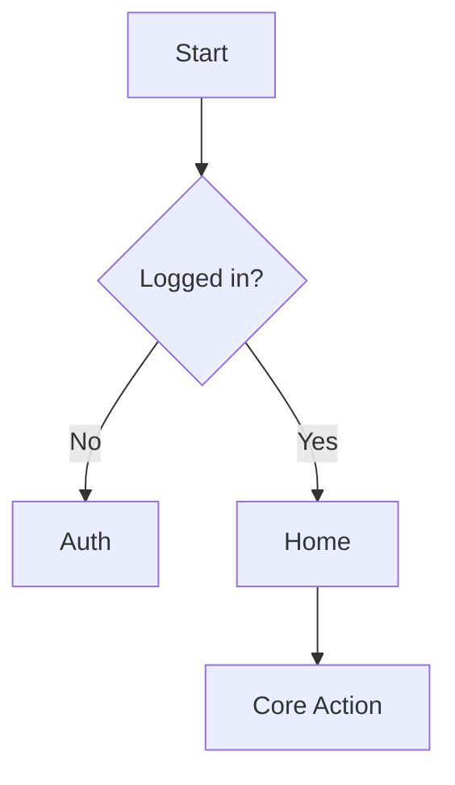
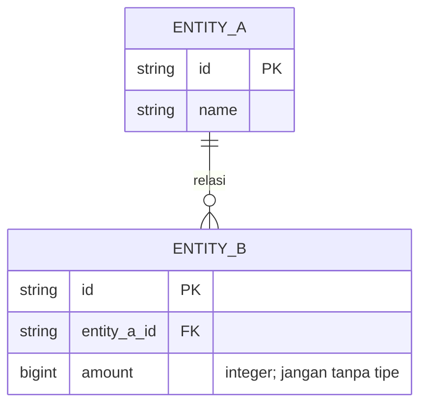
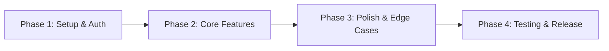

# PRD — {{PRODUCT_NAME}}

> **Doc Type:** Project Requirements Document
> {{Satu kalimat pitch produk.}}

| Field | Nilai |
|---|---|
| Produk | {{PRODUCT_NAME}} |
| Version | v1.0  <!-- naikkan tiap perubahan signifikan --> |
| Status | Draft \| In Review \| Approved \| Frozen |
| Platform | Web \| Mobile (iOS/Android) \| Both |
| Stack inti | {{RN CLI + TS · Clean Architecture · TanStack Query + Zustand · Supabase/Golang}} |
| Last Updated | {{YYYY-MM-DD}} |
| Pemilik dokumen | {{NAMA}} |

> Sumber kebenaran **apa** & **mengapa**. Aturan penulisan: [`docs/PRD-RULE.md`](PRD-RULE.md). Struktur ini (section 1–11) **wajib diikuti persis**.
>
> ⚖️ Keputusan yang mengikat ada di [§9 Decision Log](#9-decision-log).

---

## 1. Overview

{{Ringkasan produk 2–4 kalimat: untuk siapa, masalah apa, solusi inti.}}

### 1.1 Problem Statement
{{Masalah nyata yang dipecahkan. Fokus ke pain, bukan solusi. Sertakan "mengapa sekarang".}}

### 1.2 Goals & Objectives
| # | Tujuan | Deskripsi |
|---|---|---|
| G1 | {{...}} | {{terukur bila bisa}} |

### 1.3 Non-Goals (Out of Scope)
- {{Hal yang SENGAJA tidak dikerjakan di versi ini.}}

### 1.4 Target Users / Personas
| Persona | Deskripsi | Kebutuhan utama |
|---|---|---|
| {{Persona A}} | {{...}} | {{...}} |

### 1.5 Success Metrics
| Metric | Target | Cara ukur |
|---|---|---|
| {{Retention / DAU / dst}} | {{...}} | {{...}} |

---

## 2. Requirements

### 2.1 Functional Requirements (ringkasan & prioritas)
Detail tiap `FR-*` ada di [§3 Core Features](#3-core-features). Ringkasan prioritas (MoSCoW):

| Prioritas | Cakupan |
|---|---|
| **Must** | {{...}} |
| **Should** | {{...}} |
| **Could** | {{...}} |
| **Won't (rilis awal)** | Lihat §1.3 Non-Goals. |

### 2.2 Non-Functional Requirements
| ID | Kategori | Requirement |
|---|---|---|
| NFR-01 | Performance | {{mis. cold start < 2s}} |
| NFR-02 | Security | {{mis. RLS aktif di semua tabel; API key hanya di server}} |
| NFR-03 | Offline | {{mis. offline-first, sync saat online}} |
| NFR-04 | Scalability | {{...}} |

### 2.3 Assumptions & Constraints
- {{Asumsi (mis. koneksi sesekali) & batasan (budget, deadline, regulasi).}}

---

## 3. Core Features

> **Format tetap per fitur (wajib — PRD-RULE #2):** Description, User Story, Inputs, Outputs, Edge Cases, Dependencies — lalu tabel Functional Requirements dan blok **Acceptance Criteria** yang testable (PRD-RULE #6).

### 3.1 {{Feature Name}}
- **Description:** {{apa & untuk siapa}}
- **User Story:** Sebagai {{persona}}, saya ingin {{aksi}}, supaya {{benefit}}.
- **Inputs:** {{data/aksi masuk}}
- **Outputs:** {{hasil}}
- **Edge Cases:** {{kosong, gagal jaringan, input invalid, izin ditolak}}
- **Dependencies:** {{API / service / fitur lain}}

**Functional Requirements:**
| ID | Persyaratan |
|---|---|
| FR-{{FEAT}}-1 | {{...}} |

**Acceptance Criteria:**
- {{Kondisi "selesai" yang dapat diverifikasi.}}

### 3.2 {{Feature Name}}
<!-- ulangi pola yang sama -->

---

## 4. User Flow

### 4.1 Primary Flow


### 4.2 Alternative / Error Flows
- {{Jalur gagal, retry, empty state, offline, izin ditolak.}}

---

## 5. Architecture

### 5.1 High-Level Architecture
{{Client ↔ API ↔ DB ↔ third-party. Dependency rule bila Clean Architecture.}}

### 5.2 Layered Structure (Clean Architecture)
```
src/
  domain/        # entities, use cases, repository interfaces
  data/          # repository impl, datasources, mappers, DTO
  presentation/  # screens, components, hooks, state (Zustand)
```

### 5.3 State Management
- **Server state:** TanStack Query — {{caching, pagination, optimistic mutation}}
- **UI/client state:** Zustand — {{global UI state ringan}}

### 5.4 Tech Stack
| Layer | Teknologi | Alasan |
|---|---|---|
| Frontend | {{React Native CLI + TS}} | {{...}} |
| Backend | {{Golang / Supabase Edge}} | {{...}} |
| Database | {{Postgres/Supabase}} | {{...}} |
| Auth | {{...}} | {{...}} |

> ⚠️ Perubahan Tech Stack **wajib** dicatat di §9 Decision Log (PRD-RULE Larangan).

---

## 6. Design & Technical Constraints

### 6.1 Typography
- Font utama / sekunder + skala (size/line-height/weight). Ambil dari design token aktual, jangan karang.

### 6.2 Theme & Color Tokens
- Default theme: **{{Dark}}** (PRD-RULE default; override → catat di Decision Log).
- Color tokens: primary, secondary, danger, background/surface, border, text*.

### 6.3 Spacing & Design System
- Spacing scale + lokasi komponen/token bersama.

### 6.4 Technical Constraints
- {{Min OS, presisi uang (integer), path alias, package manager, dependency yang dilarang.}}

---

## 7. Entity Relationship Diagram (ERD)

### 7.1 Diagram


### 7.2 Entities
{{Ringkasan tiap entity + computed fields. Setiap field WAJIB punya tipe data (PRD-RULE Larangan).}}

### 7.3 Relationships
- {{1-N, N-N, FK rules.}}

### 7.4 Constraints / RLS
- {{Unique, not null, indeks, Row Level Security per tabel.}}

---

## 8. Development Phases



| Phase | Scope | Deliverable |
|---|---|---|
| 1 | {{Setup, arsitektur, auth}} | {{...}} |
| 2 | {{Core features}} | {{...}} |
| 3 | {{Edge cases, offline, polish}} | {{...}} |
| 4 | {{Testing, CI/CD, release}} | {{...}} |

---

## 9. Decision Log

Keputusan yang **mengikat seluruh dokumen**. Setiap keputusan/perubahan teknis-produk → 1 baris (PRD-RULE #4).

| # | Topik | **[KEPUTUSAN]** |
|---|---|---|
| D1 | {{...}} | {{...}} |

---

## 10. Open Questions

- [ ] {{Hal yang belum diputuskan.}}

---

## 11. Glossary

| Term | Definisi |
|---|---|
| **{{Term}}** | {{definisi}} |

---

<!-- Appendix opsional (un-numbered, tidak menggeser section 1–11): Risiko & Mitigasi, Lampiran/Referensi. -->
</content>
