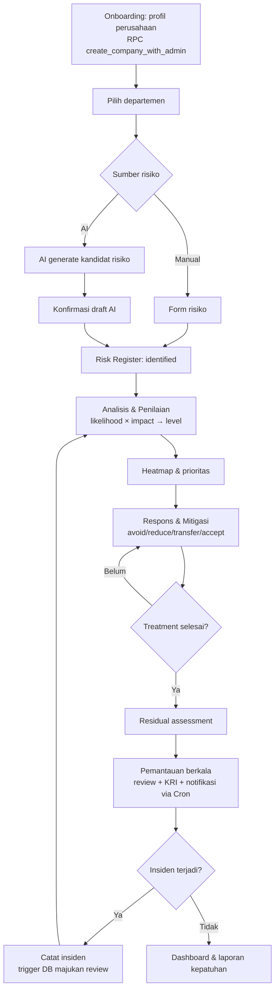
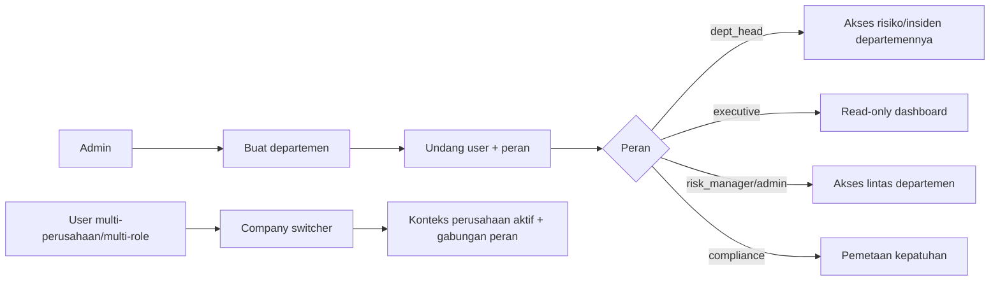
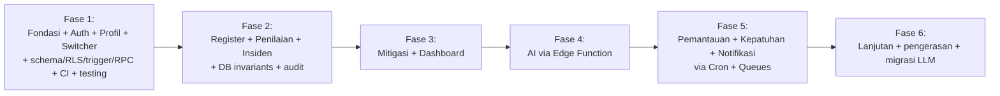

# PRD — RiskoFlow

> **Doc Type:** Project Requirements Document
> Aplikasi web pengelolaan manajemen risiko perusahaan berbasis **ISO 31000:2018**, dengan bantuan AI untuk identifikasi, analisis, mitigasi, dan pemantauan risiko per departemen.

| Field | Nilai |
|---|---|
| Produk | RiskoFlow |
| Version | **1.6** |
| Status | Approved (MVP) |
| Platform | Web (React 19, TypeScript strict, Vite) |
| Stack inti | React + TS · Clean Architecture (feature-sliced) · TanStack Router + TanStack Query + Zustand · Tailwind v4 + shadcn/ui · Supabase (Postgres + RLS + Auth + Edge Functions + Cron + Queues + Vault) |
| Last Updated | 2026-06-24 |
| Pemilik dokumen | Tim RiskoFlow |
| Authoring rule | Mengikuti [`docs/PRD-RULE.md`](PRD-RULE.md) + struktur [`docs/PRD-TEMPLATE.md`](PRD-TEMPLATE.md) |
| Standar acuan | **ISO 31000:2018** + pedoman tata kelola CRMS Indonesia & Mekari (D2, D11) |

> Dokumen ini adalah sumber kebenaran untuk **apa** yang dibangun dan **mengapa**.
> ⚖️ **Keputusan yang mengikat seluruh dokumen ada di [§9 Decision Log](#9-decision-log).** Bila ada detail ambigu, §9 yang berlaku.
> 🔄 **Riwayat:** v1.3 → v1.4 pengerasan stack (D16–D24). v1.4 → v1.5 materialisasi skema §7 jadi declarative SQL + RLS + trigger (D25–D26). v1.5 → v1.6 RPC provisioning atomik + **RBAC multi-role** (D27). Tidak ada perubahan scope fungsional.

---

## 1. Overview

RiskoFlow adalah aplikasi web yang membantu perusahaan menjalankan **siklus manajemen risiko sesuai ISO 31000:2018** secara terstruktur dan dapat diaudit. Alih-alih mengelola risiko di spreadsheet yang tercerai-berai, perusahaan memetakan risiko **per departemen** dalam satu *risk register* terpusat, lalu menjalankannya melalui tahap inti yang saling terhubung:

1. **Identifikasi Risiko** — mendata ancaman internal & eksternal (keuangan, operasional, hukum, reputasi, strategis).
2. **Analisis & Penilaian** — menilai *likelihood*, *impact*, dan *severity* lewat matriks risiko (heatmap 5×5).
3. **Respons & Mitigasi** — memilih strategi: hindari (*avoid*), kurangi (*reduce*), transfer (*transfer*, mis. asuransi), atau terima (*accept*).
4. **Pemantauan Berkelanjutan** — review berkala, *Key Risk Indicators* (KRI), kontrol eksekutif/manajemen.
5. **Incident / Loss-Event Log** — mencatat kejadian risiko nyata sebagai umpan balik ke penilaian & pemantauan.

**AI tertanam di seluruh siklus.** Berbekal **profil perusahaan** (bidang usaha, jumlah departemen, jumlah karyawan), AI menyarankan kandidat risiko per departemen, mengusulkan skor awal, merekomendasikan rencana mitigasi, dan menandai risiko yang perlu ditinjau. Semua saran AI **bersifat usulan** dan wajib dikonfirmasi manusia sebelum masuk register (D6).

Aplikasi bersifat **multi-tenant**: setiap perusahaan terisolasi via RLS, dan **satu user dapat tergabung di beberapa perusahaan** dengan peran berbeda, berpindah lewat *company switcher* (D9). User memilih tipe perusahaan — **jasa, dagang, atau manufaktur** — yang memengaruhi template risiko, library kepatuhan, dan contoh yang ditawarkan AI (D3).

### 1.1 Problem Statement

Banyak perusahaan menjalankan manajemen risiko secara reaktif dan tidak terstruktur: risiko dicatat terpisah per divisi, penilaian tidak konsisten, rencana mitigasi tidak ditindaklanjuti, dan pemantauan hanya terjadi saat audit. Akibatnya manajemen tidak punya gambaran utuh atas profil risiko perusahaan, dan kepatuhan terhadap standar (ISO 31000, GCG) sulit dibuktikan.

**Peluang & timing:** ISO 31000:2018 memberi kerangka proses yang jelas namun butuh tooling agar konsisten dijalankan lintas departemen. Sekaligus, **LLM** kini mampu menyusun draf risk register kontekstual berdasarkan profil industri & struktur organisasi — memangkas friksi terbesar (memulai dari halaman kosong) sambil tetap menempatkan keputusan akhir pada manusia.

### 1.2 Goals & Objectives

| # | Tujuan | Deskripsi |
|---|---|---|
| G1 | Siklus ISO 31000 utuh | Satu risiko dapat ditelusuri dari identifikasi → penilaian → mitigasi → pemantauan → insiden tanpa keluar aplikasi. |
| G2 | Akselerasi lewat AI | Draf risk register awal per departemen tersusun dalam hitungan menit. |
| G3 | Visibilitas eksekutif | Dashboard risiko per perusahaan/departemen/kategori yang dipahami manajemen < 1 menit. |
| G4 | Kepatuhan terbukti | Setiap mitigasi dapat dipetakan ke regulasi/standar terkait & diaudit. |
| G5 | Fondasi teknis sehat | Clean Architecture, multi-tenant aman (RLS), invariant ditegakkan di DB, teruji, observable, siap skala. |

### 1.3 Non-Goals (Out of Scope rilis awal)

- **Quantitative Risk Analysis lanjutan** (Monte Carlo, VaR, simulasi finansial) — MVP fokus matriks kualitatif 5×5.
- **Integrasi otomatis ke GRC/ERP pihak ketiga** via API (SAP, Oracle GRC, dll.).
- **Modul audit internal penuh** (kertas kerja audit, sampling) — disinggung, bukan dibangun.
- **Multi-bahasa penuh** selain ID/EN.
- **Pembelian/manajemen polis asuransi** end-to-end (transfer risiko dicatat sebagai strategi, bukan transaksi).
- **Real-time collaboration editing** (co-editing simultan).
- **SSR / full-stack framework mode** — RiskoFlow tetap SPA murni di belakang auth (D16).

### 1.4 Target Users / Personas

| Persona | Deskripsi | Kebutuhan utama |
|---|---|---|
| **Risk Manager / CRO** | Penanggung jawab manajemen risiko perusahaan. | Risk register terpusat, konsistensi penilaian, laporan ke direksi. |
| **Department Head / Risk Owner** | Kepala departemen pemilik risiko di unitnya. | Catat & kelola risiko + mitigasi + insiden departemen. |
| **Eksekutif / Direksi** | Pemantau lapis atas. | Dashboard ringkas, tren risiko, status mitigasi — read-mostly. |
| **Compliance Officer** | Penjaga kepatuhan & GCG. | Pemetaan risiko ↔ regulasi, bukti kepatuhan, jejak audit. |
| **Admin** | Pengelola tenant. | Setup perusahaan, departemen, user, peran (RBAC). |

> Satu user dapat memegang **beberapa peran sekaligus** dalam satu perusahaan (mis. pembuat tenant = admin + risk_manager) — D27.

### 1.5 Success Metrics

| Metrik | Target awal | Cara ukur |
|---|---|---|
| Waktu menyusun draf register awal 1 departemen | < 15 menit (dengan AI) | Onboarding → register pertama |
| Risiko dinilai lengkap (likelihood+impact+treatment) | ≥ 80% | % risiko *assessed + treated* |
| Saran AI diterima tanpa edit besar | ≥ 60% | % saran AI di-accept (instrumented via analytics) |
| Risiko jatuh tempo review ditinjau tepat waktu | ≥ 75% | Review selesai sebelum `next_review_date` |
| Insiden tercatat ter-link ke risiko | ≥ 70% | % insiden dengan `risk_id` |
| Retensi tim aktif 30 hari | ≥ 50% | Cohort retention |
| Error-free sessions | ≥ 99% | Sentry / error reporter |

---

## 2. Requirements

### 2.1 Functional Requirements (ringkasan & prioritas)

Detail tiap `FR-*` ada di [§3 Core Features](#3-core-features). Ringkasan MoSCoW:

| Prioritas | Cakupan |
|---|---|
| **Must** | Auth + multi-tenant (multi-membership + company switcher); profil perusahaan; departemen, user & RBAC (multi-role); risk register; analisis & penilaian (5×5 + heatmap); respons & mitigasi (4 strategi); incident/loss-event log; dashboard; soft delete + audit (DB-enforced). |
| **Should** | AI via Edge Function (saran 4 tahap); pemantauan berkelanjutan (review + status); kepatuhan + library regulasi 3 industri; **notifikasi in-app + email** (via Cron + Queues); ekspor laporan. |
| **Could** | KRI/indikator + threshold; komentar/diskusi per risiko; impor risiko via CSV; template risiko per industri; digest email harian; MFA/Passkeys auth hardening. |
| **Won't (rilis awal)** | Lihat [§1.3 Non-Goals](#13-non-goals-out-of-scope-rilis-awal). |

### 2.2 Non-Functional Requirements

| ID | Kategori | Requirement |
|---|---|---|
| NFR-01 | Multi-tenancy & Keamanan | **RLS wajib** semua tabel (scope `company_id` lewat `membership`); isolasi penuh antar perusahaan. **GRANT eksplisit** per tabel (default-deny Data API, D21). API key LLM/email **hanya** di **Supabase Vault**, diakses dari Edge Function (D6, D15, D20). |
| NFR-02 | RBAC | Peran: `admin`, `risk_manager`, `dept_head`, `executive`, `compliance` — **per perusahaan**, **multi-role per user** (D27). Ditegakkan di UI **dan** RLS. |
| NFR-03 | Cost control (AI) | Kuota harian/perusahaan, rate limit, timeout, retry terbatas, batas ukuran prompt (D10). |
| NFR-04 | Auditability | Setiap perubahan risiko/penilaian/mitigasi/insiden tercatat (who/when/what) lewat **generic audit trigger → `audit_log`** (D22, D26); soft delete (D8). |
| NFR-05 | Performa | Dashboard < 1.5 dtk; list risiko < 300 ms (optimistic); heatmap < 500 ms untuk ≤ 500 risiko. React Compiler aktif untuk mengurangi re-render (D16). |
| NFR-06 | Scalability | Keyset/cursor pagination; agregasi via RPC/view kanonik; indeks tepat; hindari `SELECT *`. |
| NFR-07 | Reliability | Operasi AI/email/jaringan punya error state jelas, tidak membuat app hang. Email lewat **Queues (pgmq)** dengan guaranteed delivery + retry (D19). Error-free ≥ 99%. |
| NFR-08 | Privasi & Kepatuhan data | Rilis awal memakai **free tier LLM** dengan **mitigasi wajib: konteks minimal non-sensitif + disclaimer + opt-out** (sanitasi field di Edge Function, bukan sekadar disclaimer). Free tier dapat dipakai melatih model pihak ketiga → **migrasi ke tier berbayar wajib sebelum menangani data tenant produksi sungguhan** (item tata kelola §10). Privacy policy menjelaskan data yang dikirim ke AI; hak hapus data tenant. |
| NFR-09 | Aksesibilitas & UX | Kontras WCAG AA; level risiko **tidak hanya warna** (label + skor); label ikon-only; design token. Komponen di atas **Radix primitives (shadcn/ui)** untuk a11y bawaan (focus ring, ARIA, keyboard nav) — D17. |
| NFR-10 | Lokalisasi | UI ID/EN (i18n); format angka/tanggal per locale; mata uang IDR. |
| NFR-11 | Kualitas kode | Lolos `bun run lint`, `bun run typecheck`, `bun run test`; patuhi dependency rule Clean Architecture. |
| NFR-12 | Testing & Observability | Unit/integration (**Vitest + RTL**), E2E flow kritis (**Playwright**), **RLS policy & RPC test (pgTAP / `supabase test db`)**; error monitoring (**Sentry**). CI menjalankan lint+typecheck+test+migration dry-run sebelum merge (D23, D24). |
| NFR-13 | Schema governance | Skema dikelola **declarative + versioned migrations** (Supabase CLI); tidak ada perubahan skema manual di produksi tanpa migration ter-commit (D21). Sumber skema: `supabase/schemas/*.sql` (D25). |

### 2.3 Assumptions & Constraints

- **Asumsi:** satu user **dapat tergabung di beberapa perusahaan** (multi-membership) **dan memegang beberapa peran per perusahaan** (multi-role, D27); konteks aktif via **company switcher**; semua query & RLS di-scope ke `active_company_id` (D9).
- **Constraint metodologi:** penilaian MVP **kualitatif 5×5** (`likelihood` × `impact`) → `risk_level` (D4).
- **Constraint mitigasi:** 4 strategi ISO 31000 — avoid/reduce/transfer/accept (D5).
- **Constraint keamanan:** semua call AI & email **wajib** lewat Edge Function (D6, D15); key di Vault (D20); akses data **hanya** lewat interface repository `domain`.
- **Constraint mata uang:** nilai finansial = **integer rupiah penuh**, tidak pernah float.
- **Constraint integritas:** invariant kritis (severity, approval gate, incident auto-advance, guard organisasi) ditegakkan **di DB**, bukan hanya client (D22).
- **Constraint provisioning:** perusahaan + admin pertama dibuat atomik via RPC `create_company_with_admin` (SECURITY DEFINER); pembuat memperoleh peran **admin + risk_manager** + library regulasi ter-seed dalam satu transaksi (D25, D27).

---

## 3. Core Features

> Konvensi: `FR-<fitur>-<n>`. Tiap fitur memakai **format tetap (PRD-RULE #2)**: Description, User Story, Inputs, Outputs, Edge Cases, Dependencies — lalu Functional Requirements + **Acceptance Criteria** testable (PRD-RULE #6).

### Peta fitur

| Fitur | Peran | Tahap ISO 31000 |
|---|---|---|
| Onboarding & Profil Perusahaan | Identifikasi perusahaan (industri, departemen, karyawan) | Scope, context & criteria |
| Departemen, User & RBAC + Company Switcher | Struktur organisasi, hak akses, multi-tenant per user | Framework / leadership |
| Risk Register (Identifikasi) | Mendata risiko internal/eksternal per departemen | Risk identification |
| Analisis & Penilaian | Likelihood × impact → severity & heatmap | Risk analysis & evaluation |
| Respons & Mitigasi | 4 strategi + rencana tindakan | Risk treatment |
| Pemantauan Berkelanjutan | Review berkala, status, KRI | Monitoring & review |
| Incident / Loss-Event Log | Kejadian risiko nyata → umpan balik | Monitoring & review |
| Kepatuhan + Library Regulasi | Pemetaan risiko ↔ regulasi/GCG (3 industri) | Recording & reporting |
| AI Assistant | Saran lintas tahap berbasis profil | (lintas proses) |
| Notifikasi (in-app + email) | Review jatuh tempo & approval tertunda | (lintas proses) |
| Dashboard & Reporting | Ringkasan & ekspor | Recording & reporting |

### 3.1 Onboarding & Profil Perusahaan

- **Description:** wizard awal yang mengidentifikasi perusahaan — **bidang usaha** (jasa/dagang/manufaktur), **jumlah departemen**, **jumlah karyawan** — sebagai konteks bagi AI & library kepatuhan.
- **User Story:** Sebagai *Admin*, saya ingin menyiapkan profil perusahaan sekali di awal, supaya saran risiko & regulasi relevan dengan bidang dan skala perusahaan.
- **Inputs:** nama perusahaan, tipe industri (enum D3), jumlah karyawan, daftar departemen awal.
- **Outputs:** entity `Company` + `Department[]` ter-seed; konteks tersimpan untuk AI; library regulasi industri ter-load (D14).
- **Edge Cases:** jumlah departemen 0; nama departemen duplikat (di-dedupe case-insensitive); user batal di tengah; ubah industri setelah ada data.
- **Dependencies:** Supabase Auth, **RPC `create_company_with_admin` (SECURITY DEFINER, atomik — D25/D27)**, repository `company`/`department`, wizard form (react-hook-form + zod).

| ID | Persyaratan |
|---|---|
| FR-ONB-1 | Wizard 3 langkah: (1) data perusahaan + tipe industri, (2) jumlah karyawan + departemen, (3) konfirmasi. |
| FR-ONB-2 | Tipe industri wajib salah satu: `JASA`, `DAGANG`, `MANUFACTURE` (D3). |
| FR-ONB-3 | User dapat menambah departemen manual atau memakai **preset departemen per industri**; nama duplikat per perusahaan ditolak/di-dedupe. |
| FR-ONB-4 | Selesai → **RPC atomik** membuat `Company` + `Department[]`; pembuat memperoleh **dua membership: `admin` + `risk_manager`** (D27); **library regulasi industri terkait di-seed** (D14, D25). |
| FR-ONB-5 | Profil dapat diedit di Setting; ubah industri tidak menghapus data, hanya memengaruhi saran AI & menawarkan library regulasi baru (catat di audit). |

**Acceptance Criteria:**
- Menyelesaikan wizard menghasilkan satu perusahaan dengan ≥ 1 departemen, profil industri tersimpan, pembuat ber-peran admin+risk_manager, dan library regulasi industri ter-seed — semua dalam satu transaksi (gagal sebagian → rollback penuh).
- Tipe industri di luar 3 enum atau `employee_count ≤ 0` ditolak; tidak menyisakan baris parsial.
- Ubah jumlah karyawan/industri tercatat di audit & langsung tercermin di konteks AI.

### 3.2 Departemen, User & RBAC + Company Switcher

- **Description:** kelola struktur organisasi & undang user dengan peran; satu user bisa lintas perusahaan via switcher, dan bisa memegang >1 peran per perusahaan.
- **User Story:** Sebagai *Admin*, saya ingin mengundang kolega dengan peran sesuai, supaya tiap orang hanya mengakses tanggung jawabnya; dan sebagai konsultan, saya ingin berpindah antar perusahaan klien tanpa login ulang.
- **Inputs:** data departemen; email undangan + peran; penugasan `dept_head`; pilihan perusahaan aktif.
- **Outputs:** `Department`, `Membership` (user↔company↔role), konteks `active_company_id`.
- **Edge Cases:** undang email terdaftar; departemen punya risiko aktif lalu dihapus; menurunkan satu-satunya admin; user tanpa membership.
- **Dependencies:** Supabase Auth (invite via custom SMTP, D19), repository `department`/`membership`, **RLS policy + guard trigger last-admin & dept-delete (D22)**, Zustand (active company).

| ID | Persyaratan |
|---|---|
| FR-ORG-1 | CRUD departemen (nama, deskripsi, `head_user_id`). |
| FR-ORG-2 | Undang user via email (template branded via custom SMTP) + tetapkan satu/lebih peran ∈ {`admin`,`risk_manager`,`dept_head`,`executive`,`compliance`}. |
| FR-ORG-3 | RBAC ditegakkan: `dept_head` hanya kelola risiko/insiden departemennya; `executive` read-only; `admin`/`risk_manager` lintas departemen. |
| FR-ORG-4 | Tidak boleh hapus departemen yang masih punya risiko/insiden aktif (pindah/arsipkan dulu) — **guard di DB**. |
| FR-ORG-5 | Selalu ada minimal satu `admin` aktif per perusahaan (cegah lockout) — **guard di DB**. |
| FR-ORG-6 | **Company switcher**: user dengan ≥ 2 membership berpindah perusahaan aktif; seluruh data mengikuti perusahaan aktif. Peran dievaluasi **per perusahaan** (gabungan semua role user di perusahaan itu). |

**Acceptance Criteria:**
- `executive` tidak dapat membuat/mengubah risiko (ditolak di UI & DB/policy).
- `dept_head` hanya melihat & mengubah risiko/insiden departemennya.
- User dengan membership di 2 perusahaan dapat berpindah; data perusahaan A tidak pernah bocor ke B (diverifikasi via **RLS test pgTAP**, NFR-12).
- Menghapus departemen berisiko aktif atau menurunkan admin terakhir ditolak dengan pesan jelas.

### 3.3 Risk Register — Identifikasi Risiko

- **Description:** pendataan terstruktur ancaman **internal & eksternal** per departemen — kategori **keuangan, operasional, hukum, reputasi, strategis**.
- **User Story:** Sebagai *Risk Owner*, saya ingin mendata risiko unit saya dengan kategori & sumber jelas, supaya risiko terkelola sejak awal.
- **Inputs:** judul, deskripsi, kategori, sumber (internal/eksternal), departemen, owner, penyebab & dampak potensial.
- **Outputs:** entry `Risk` berstatus `identified`.
- **Edge Cases:** risiko duplikat antar departemen; lintas departemen; deskripsi kosong; risiko AI belum dikonfirmasi.
- **Dependencies:** repository `risk`, `CategoryPicker`, AI suggestion (§3.8), zod. Filter state via **typed search params (TanStack Router)** — D16.

| ID | Persyaratan |
|---|---|
| FR-RISK-1 | Buat risiko: `title` (3–150 char), `description`, `category` ∈ {FINANCIAL, OPERATIONAL, LEGAL, REPUTATIONAL, STRATEGIC}, `source` ∈ {INTERNAL, EXTERNAL}, `department_id`, `owner_id`. |
| FR-RISK-2 | Daftar risiko + filter (departemen, kategori, sumber, level, status) sebagai **typed URL search params** + **keyset pagination** (20/halaman). |
| FR-RISK-3 | Risiko dapat lintas departemen (primary department + tag departemen lain). |
| FR-RISK-4 | Status siklus: `identified → assessed → treated → monitored → closed`. |
| FR-RISK-5 | Risiko dari AI masuk sebagai **draft** (`ai_suggested = true`), wajib dikonfirmasi sebelum aktif (D6). |
| FR-RISK-6 | Soft delete (`deleted_at`) + audit trail (D8, D22). |

**Acceptance Criteria:**
- Risiko baru tersimpan dengan kategori & sumber valid; tanpa departemen ditolak.
- Risiko draft AI tidak masuk agregat/heatmap sampai dikonfirmasi.
- Risiko terhapus hilang dari list/agregat tetapi tetap ada untuk audit.
- Filter tersimpan di URL (shareable/bookmarkable) & ter-validasi tipe.

### 3.4 Analisis & Penilaian Risiko

- **Description:** evaluasi keparahan tiap risiko melalui **matriks 5×5** (`likelihood` × `impact`) → `severity_score` & `risk_level`; divisualisasikan **heatmap**.
- **User Story:** Sebagai *Risk Manager*, saya ingin menilai risiko secara konsisten, supaya prioritas sebanding antar departemen.
- **Inputs:** `likelihood` (1–5), `impact` (1–5), catatan, opsional estimasi dampak finansial (IDR).
- **Outputs:** `RiskAssessment` + `risk_level` (LOW/MEDIUM/HIGH/EXTREME); heatmap & ranking ter-update.
- **Edge Cases:** belum dinilai; penilaian ulang (riwayat); banyak risiko di sel sama; `inherent` vs `residual`.
- **Dependencies:** repository `risk_assessment`, fungsi `computeRiskLevel` kanonik (domain **+ generated column/IMMUTABLE function di DB**, D22), design token warna level.

| ID | Persyaratan |
|---|---|
| FR-ASSESS-1 | Form penilaian: `likelihood` 1–5 & `impact` 1–5 (skala berlabel, mis. impact 5 = "Katastrofik"). |
| FR-ASSESS-2 | `severity_score = likelihood × impact` (1–25); pemetaan level via threshold kanonik (D4). **Dihitung & dikunci di DB sebagai generated column** (bukan hanya client). |
| FR-ASSESS-3 | Dukung **inherent** (sebelum kontrol) & **residual** (setelah mitigasi) sebagai dua penilaian terkait. |
| FR-ASSESS-4 | **Heatmap 5×5**: sebaran risiko; sel menampilkan jumlah; klik sel → daftar risiko di sel itu. |
| FR-ASSESS-5 | Riwayat penilaian tersimpan (audit); penilaian terbaru = nilai aktif. |
| FR-ASSESS-6 | Level disertai label & skor, tidak hanya warna (NFR-09). |

**Acceptance Criteria:**
- `severity_score` & `risk_level` dari satu sumber kanonik (DB-generated); konsisten di list, heatmap, dashboard.
- Heatmap menempatkan risiko pada sel `(likelihood, impact)` yang benar; klik sel menampilkan persis risiko di sel itu.
- Penilaian residual hanya tersedia setelah ada ≥ 1 rencana mitigasi.

### 3.5 Respons & Mitigasi Risiko

- **Description:** menyusun respons ISO 31000 — **avoid, reduce, transfer (mis. asuransi), accept** — beserta rencana tindakan, PIC, biaya, tenggat.
- **User Story:** Sebagai *Risk Owner*, saya ingin menetapkan strategi & rencana untuk tiap risiko, supaya mitigasi terlaksana & terlacak.
- **Inputs:** strategi (enum D5), deskripsi rencana, PIC (`owner_id`), estimasi biaya (IDR), tenggat, detail transfer.
- **Outputs:** `RiskTreatment` + progres; mendorong penilaian residual (§3.4).
- **Edge Cases:** `accept` (butuh justifikasi & approval); tenggat lewat; mitigasi multi-langkah; biaya nol.
- **Dependencies:** repository `risk_treatment`, **approval gate DB-enforced** (trigger + approver check, D22), notifikasi jatuh tempo (§3.10), AI suggestion (§3.8).

| ID | Persyaratan |
|---|---|
| FR-TREAT-1 | Pilih strategi ∈ {AVOID, REDUCE, TRANSFER, ACCEPT} + deskripsi rencana tindakan (D5). |
| FR-TREAT-2 | Strategi `TRANSFER` membuka field detail (jenis transfer, penyedia/asuransi, premi opsional). |
| FR-TREAT-3 | Strategi `ACCEPT` **wajib** justifikasi + **approval `risk_manager`** sebelum aktif (cukup risk_manager — D5); gerbang ditegakkan di UI **dan** DB (hanya admin/risk_manager boleh set `approved`). |
| FR-TREAT-4 | Tiap treatment: `owner_id` (PIC), `due_date`, `status` (planned/in_progress/done), `cost` (IDR integer). |
| FR-TREAT-5 | Satu risiko boleh punya beberapa treatment; progres agregat tercermin di status risiko. |
| FR-TREAT-6 | Setelah treatment `done`, sistem mendorong input **residual assessment** (§3.4). |

**Acceptance Criteria:**
- `ACCEPT` tidak aktif tanpa justifikasi + approval risk_manager; upaya bypass ditolak di DB; tercatat di audit & memicu notifikasi (§3.10).
- `TRANSFER` menyimpan detail transfer; biaya tersimpan sebagai integer rupiah.
- Menyelesaikan semua treatment memunculkan prompt penilaian residual.

### 3.6 Pemantauan Berkelanjutan

- **Description:** evaluasi berkala & kontrol — jadwal review, status risiko, opsional **KRI** dengan threshold.
- **User Story:** Sebagai *Eksekutif*, saya ingin memantau risiko yang perlu ditinjau & yang melewati ambang, supaya pengendalian tetap relevan.
- **Inputs:** frekuensi review per risiko, catatan review, nilai KRI terkini.
- **Outputs:** `RiskReview` log; status jatuh tempo; alert KRI melewati threshold.
- **Edge Cases:** review terlambat; risiko closed dibuka kembali; KRI tanpa data; perubahan besar memicu re-assessment.
- **Dependencies:** repository `risk_review`/`indicator`, **Supabase Cron (pg_cron) → Edge Function** untuk deteksi jatuh tempo (D18), trigger bump `next_review_date` (D22), notifikasi (§3.10), dashboard.

| ID | Persyaratan |
|---|---|
| FR-MON-1 | Tetapkan `review_frequency` per risiko (mingguan/bulanan/kuartalan) → hitung `next_review_date`. |
| FR-MON-2 | Catat review: status terkini, perubahan likelihood/impact, catatan, reviewer; update `next_review_date` (via trigger). |
| FR-MON-3 | **Cron harian** memindai risiko melewati `next_review_date` → daftar "perlu ditinjau" + enqueue notifikasi ke owner/risk_manager (§3.10). |
| FR-MON-4 | (Could) KRI per risiko/departemen: `name`, `threshold`, `current_value`, arah → alert saat terlampaui. |
| FR-MON-5 | Risiko `closed` dapat dibuka kembali dengan alasan; tercatat di audit. |

**Acceptance Criteria:**
- Risiko melewati `next_review_date` muncul di daftar "perlu ditinjau" + notifikasi (dipicu oleh Cron job, bukan hanya saat user membuka app).
- Menyimpan review memperbarui `next_review_date` sesuai frekuensi.
- KRI melampaui threshold memunculkan alert di dashboard.

### 3.7 Incident / Loss-Event Log

- **Description:** mencatat **kejadian risiko yang benar-benar terjadi** (loss event/near-miss) dan menautkannya ke risiko untuk umpan balik ke penilaian & pemantauan. **Insiden ter-link otomatis memajukan jadwal review risiko terkait** (D13).
- **User Story:** Sebagai *Risk Owner*, saya ingin mencatat insiden nyata beserta dampak & akar masalahnya, supaya penilaian risiko diperbarui berdasar data aktual.
- **Inputs:** judul, deskripsi, tanggal kejadian, departemen, risiko terkait (opsional), nilai kerugian (IDR), tipe, akar masalah, tindakan korektif.
- **Outputs:** entry `Incident`; **otomatis** memicu re-assessment & memajukan `next_review_date` risiko terkait.
- **Edge Cases:** insiden tanpa risiko terdaftar (→ usul buat risiko); near-miss tanpa kerugian; lintas departemen; menutup insiden kerugian besar.
- **Dependencies:** repository `incident`, repository `risk` (re-assessment), **trigger DB auto-advance + close gate** (D22), notifikasi (§3.10), dashboard.

| ID | Persyaratan |
|---|---|
| FR-INC-1 | Catat insiden: `title`, `description`, `occurred_at`, `department_id`, `type` ∈ {LOSS, NEAR_MISS}, `loss_amount` (IDR integer, ≥ 0). |
| FR-INC-2 | Tautkan insiden ke ≥ 0 `Risk`; insiden tanpa risiko → CTA "buat risiko dari insiden ini". |
| FR-INC-3 | Field `root_cause` + `corrective_action` + `status` (open/investigating/closed). |
| FR-INC-4 | Insiden ter-link **otomatis** memicu re-assessment risiko terkait **dan memajukan `next_review_date` menjadi sekarang** (review dipercepat — D13), via **trigger DB**, tercatat di audit. |
| FR-INC-5 | Soft delete + audit trail; tampil di dashboard sebagai metrik "insiden periode ini" & total kerugian. |
| FR-INC-6 | **Approval menutup insiden kerugian besar:** insiden `type = LOSS` dengan `loss_amount ≥ close_approval_threshold` (satu angka per perusahaan, default Rp 50.000.000) **wajib approval `risk_manager`** sebelum `status = closed` (D13); ditegakkan di DB. |

**Acceptance Criteria:**
- Insiden tersimpan dengan dampak & tanggal valid; near-miss boleh `loss_amount = 0`.
- Menautkan insiden ke risiko **otomatis** memajukan `next_review_date` risiko itu ke hari ini & memunculkannya di daftar "perlu ditinjau".
- Insiden `LOSS` ≥ threshold tidak bisa di-`closed` tanpa approval risk_manager; upaya tanpa approval ditolak di UI & DB serta memicu notifikasi approval.
- Total kerugian di dashboard = penjumlahan insiden `LOSS` periode aktif (abaikan `deleted_at`).

### 3.8 AI Assistant (Should)

- **Description:** asisten AI yang—berbekal **profil perusahaan**—menyarankan keluaran di **empat tahap**: identifikasi, penilaian, mitigasi, pemantauan. Via **Edge Function proxy (Hono)** (D6).
- **User Story:** Sebagai *Risk Manager*, saya ingin AI menyusun draf risiko per departemen sesuai bidang perusahaan, supaya mulai dari draf relevan.
- **Inputs:** konteks perusahaan **minimal & non-sensitif** (tipe industri, nama departemen, jumlah karyawan) + (opsional) risiko yang ada.
- **Outputs:** `AiSuggestion[]` (draft) + `confidence`, untuk dikonfirmasi.
- **Edge Cases:** kuota habis; saran tak relevan; duplikat; output tak sesuai schema; opt-out aktif.
- **Dependencies:** Edge Function `ai-risk-assistant` (Hono, Deno), key di **Vault** (D20), `responseSchema`/zod, repository terkait, guard biaya (D10), sanitasi payload (NFR-08).

| ID | Persyaratan |
|---|---|
| FR-AI-1 | "Generate risiko untuk departemen X" → kandidat risiko (judul, kategori, sumber, alasan) sesuai industri. |
| FR-AI-2 | "Sarankan penilaian" → usulan `likelihood`/`impact` + rasional singkat (tetap dikonfirmasi). |
| FR-AI-3 | "Sarankan mitigasi" → strategi (4 opsi) + langkah tindakan. |
| FR-AI-4 | "Tinjau pemantauan" → tandai risiko yang sebaiknya di-review lebih sering / berubah level. |
| FR-AI-5 | Output **selalu** lewat schema tervalidasi (`responseSchema` + zod), masuk sebagai **draft** untuk dikonfirmasi (D6). |
| FR-AI-6 | Semua call lewat Edge Function (key di Vault, server-side); **guard (D10):** kuota harian/perusahaan, rate limit, timeout. |
| FR-AI-7 | Opt-out AI per perusahaan (Setting) menonaktifkan seluruh fitur AI. |
| FR-AI-8 | **Sanitasi payload:** Edge Function hanya meneruskan field konteks yang di-whitelist (non-sensitif); menolak mengirim detail finansial/nama pihak (NFR-08). Disclaimer ditampilkan di UI fitur AI. |

**Acceptance Criteria:**
- Setiap saran tervalidasi schema sebelum tampil; output invalid → error state, bukan crash.
- Tidak ada saran AI masuk register/agregat tanpa konfirmasi manusia.
- Saran mencerminkan tipe industri perusahaan.
- Payload yang dikirim ke provider hanya berisi field whitelist; field sensitif tidak pernah dikirim.
- Saat kuota habis/opt-out → tombol AI nonaktif + pesan jelas; alur manual tetap jalan.

### 3.9 Kepatuhan + Library Regulasi (Should)

- **Description:** memastikan mitigasi sejalan dengan regulasi industri & GCG; **membawa library regulasi siap pakai untuk ketiga industri** (D14), dapat dipetakan ke risiko/treatment.
- **User Story:** Sebagai *Compliance Officer*, saya ingin menautkan risiko ke regulasi terkait dari library bawaan, supaya kepatuhan dapat dibuktikan saat audit tanpa input manual dari nol.
- **Inputs:** pilihan library industri; pemetaan risiko↔regulasi; status kepatuhan.
- **Outputs:** `ComplianceRequirement` (seed + custom) + relasi ke risiko; laporan kepatuhan.
- **Edge Cases:** regulasi lintas departemen; risiko tanpa regulasi; status partial; regulasi sistem diedit.
- **Dependencies:** repository `compliance`, relasi m:n risk↔compliance, reporting, **seed via `seed_compliance_for_company()` di RPC onboarding** (D25).

| ID | Persyaratan |
|---|---|
| FR-COMP-1 | CRUD `ComplianceRequirement` (nama regulasi/standar, deskripsi, otoritas, industri). |
| FR-COMP-2 | Petakan risiko/treatment ↔ requirement (m:n) + status (`compliant`/`partial`/`non_compliant`). |
| FR-COMP-3 | Template standar umum (ISO 31000:2018, prinsip GCG) yang bisa disesuaikan. |
| FR-COMP-4 | Laporan kepatuhan: daftar requirement + risiko terkait + status; tandai requirement tanpa risiko sebagai **gap**. |
| FR-COMP-5 | **Seed library regulasi per industri** (JASA/DAGANG/MANUFACTURE) di-load saat onboarding sebagai baris `is_system = true` milik perusahaan (D14). |
| FR-COMP-6 | Library dapat di-disable/duplikat/diedit per perusahaan; regulasi sistem read-only sampai diduplikasi. |

**Seed library regulasi (Indonesia) — referensi awal, bukan nasihat hukum:**

*MANUFACTURE:* UU No. 1/1970 (Keselamatan Kerja), PP No. 50/2012 (SMK3), UU Ketenagakerjaan jo. UU Cipta Kerja, PP No. 22/2021 (PPLH + limbah B3), AMDAL/UKL-UPL, SNI wajib produk tertentu, UU No. 33/2014 (Jaminan Produk Halal), izin edar BPOM, ISO 9001/14001/45001 (sukarela).

*DAGANG:* UU No. 7/2014 (Perdagangan), UU No. 8/1999 (Perlindungan Konsumen), perizinan berusaha via OSS/NIB, regulasi PMSE/perdagangan elektronik (niaga online), UU No. 33/2014 (Halal — produk konsumsi), izin edar BPOM (pangan/kosmetik), SNI wajib, ketentuan perpajakan (PPN/PPh), UU No. 27/2022 (Pelindungan Data Pribadi — jika menyimpan data pelanggan).

*JASA:* UU Ketenagakerjaan jo. UU Cipta Kerja, UU No. 8/1999 (Perlindungan Konsumen), UU No. 27/2022 (Pelindungan Data Pribadi), perizinan berusaha via OSS/NIB, regulasi sektoral (mis. OJK untuk jasa keuangan), ISO 9001 (mutu layanan) & ISO/IEC 27001 (keamanan informasi — sukarela), ketentuan perpajakan.

> ⚠️ Library ini **titik awal**, bukan nasihat hukum — regulasi berubah & penerapannya bergantung sektor/produk/skala. Verifikasi dengan konsultan hukum/kepatuhan sebelum dijadikan acuan resmi. Subset yang di-seed via `seed_compliance_for_company()` adalah representatif; mekanisme pembaruan library ditunda (D14).

**Acceptance Criteria:**
- Saat onboarding `MANUFACTURE`, library regulasi manufaktur ter-seed otomatis (begitu pula JASA & DAGANG), plus baris GENERAL (ISO 31000, GCG).
- Risiko dapat ditautkan ke ≥ 1 requirement; status kepatuhan tampil di laporan.
- Laporan menampilkan requirement tanpa risiko/treatment terkait sebagai gap.

### 3.10 Notifikasi (In-app + Email) (Should)

- **Description:** notifikasi in-app **dan email** untuk dua pemicu utama: **review jatuh tempo** dan **approval tertunda** (ACCEPT mitigasi & penutupan insiden besar). Pengiriman email durable lewat **Queues (pgmq)** + Edge Function worker.
- **User Story:** Sebagai *Risk Manager*, saya ingin diberi tahu lewat email saat ada review jatuh tempo atau approval menunggu saya, supaya tidak ada yang terlewat meski tidak sedang membuka aplikasi.
- **Inputs:** event sistem (review due dari Cron, approval requested dari trigger); preferensi notifikasi user.
- **Outputs:** notifikasi in-app + email terkirim ke penerima relevan.
- **Edge Cases:** email gagal kirim (retry via Queues); user opt-out email; banyak event sekaligus (digest); email belum terverifikasi.
- **Dependencies:** **Supabase Cron** (deteksi review due), **Queues/pgmq** (durable delivery), **Edge Function worker** + provider email (Resend/Postmark) dengan key di **Vault**, repository `notification`.

| ID | Persyaratan |
|---|---|
| FR-NOTIF-1 | Notifikasi in-app + **email** saat risiko melewati `next_review_date` (dipicu Cron) → ke owner & risk_manager. |
| FR-NOTIF-2 | Notifikasi in-app + **email** saat **approval tertunda**: mitigasi `ACCEPT` (FR-TREAT-3) & penutupan insiden besar (FR-INC-6) → ke `risk_manager`. |
| FR-NOTIF-3 | Pengiriman email lewat **Queue → Edge Function worker → provider email** (key di Vault, D15/D20); **guaranteed delivery + retry via pgmq**; kegagalan tidak membuat app hang. |
| FR-NOTIF-4 | User dapat **opt-out email** per kategori notifikasi di Setting (in-app tetap jalan). |
| FR-NOTIF-5 | (Could) Mode **digest harian** (satu Cron job agregasi) untuk menghindari banjir email saat banyak event. |

**Acceptance Criteria:**
- Review yang lewat jatuh tempo mengirim email ke owner & risk_manager (kecuali opt-out) **dan** muncul in-app.
- Permintaan approval (ACCEPT / tutup insiden besar) mengirim email ke risk_manager.
- Kegagalan kirim email di-retry oleh Queue & dicatat; tidak memblokir aksi user.

### 3.11 Dashboard & Reporting

- **Description:** ringkasan eksekutif profil risiko per perusahaan/departemen/kategori + insiden + ekspor.
- **User Story:** Sebagai *Eksekutif*, saya ingin gambaran risiko menyeluruh dalam satu layar, supaya mengambil keputusan cepat.
- **Inputs:** filter periode/departemen; data risiko, penilaian, treatment, insiden.
- **Outputs:** kartu ringkasan, heatmap, distribusi kategori, status mitigasi, insiden & kerugian, daftar "perlu ditinjau"; ekspor `.xlsx`/`.pdf`.
- **Edge Cases:** belum ada data (empty state); satu departemen mendominasi; ekspor data besar.
- **Dependencies:** fungsi agregasi kanonik (RPC/view), `recharts`, ekspor (`xlsx`/`jspdf`).

| ID | Persyaratan |
|---|---|
| FR-DASH-1 | Kartu ringkas: total risiko, distribusi per level, % risiko ter-treat, jumlah jatuh tempo review, **insiden & total kerugian periode**. |
| FR-DASH-2 | Heatmap 5×5 tingkat perusahaan + filter per departemen/kategori. |
| FR-DASH-3 | Distribusi risiko per kategori & per departemen (bar/donut). |
| FR-DASH-4 | Daftar "Top risks" (severity tertinggi) & "Perlu ditinjau". |
| FR-DASH-5 | Ekspor laporan `.xlsx`/`.pdf` menghormati filter aktif. |
| FR-DASH-6 | Loading skeleton + empty state + error state. |

**Acceptance Criteria:**
- Semua angka konsisten dengan register (abaikan risiko `deleted_at` & draft AI).
- Ekspor menghasilkan file sesuai filter; data kosong → laporan dengan pesan, bukan file korup.

---

## 4. User Flow

### 4.1 Primary Flow — siklus manajemen risiko



### 4.2 Alternative / Error Flows

- **Onboarding gagal sebagian** → RPC rollback penuh; tidak ada tenant setengah jadi.
- **AI gagal / kuota habis / opt-out** → fitur AI nonaktif + pesan; alur manual tetap jalan.
- **Saran AI tak relevan/duplikat** → user reject/edit sebelum konfirmasi; tidak masuk register.
- **`ACCEPT` tanpa approval** → status pending sampai disetujui risk_manager (DB tolak aktivasi); notifikasi terkirim.
- **Insiden `LOSS` besar ditutup tanpa approval** → ditolak DB; tetap investigating sampai disetujui; notifikasi terkirim.
- **Review terlambat** → Cron memasukkannya ke daftar "perlu ditinjau" + enqueue notifikasi in-app & email.
- **Email gagal kirim** → retry via Queue; aksi user tidak diblokir.
- **Akses tidak berwenang** → ditolak di UI & RLS.

### 4.3 Flow setup organisasi & peran



---

## 5. Architecture

### 5.1 High-Level Architecture

**Feature-Sliced Clean Architecture** dengan dependency rule:

```
presentation → domain ← data
```

- `presentation` — UI React, state lokal, routing (boleh import `domain`, design-system; **tidak** boleh import `data`).
- `domain` — entity, business rules (`computeRiskLevel`, aturan re-assessment insiden, aturan approval threshold), interface repository (tanpa dependency layer lain).
- `data` — implementasi repository, datasource Supabase, mapper DTO ↔ entity.

> **Catatan integritas (D22):** business rules kritis hidup di `domain` untuk UX **dan** di Postgres (trigger/generated column/CHECK/RPC) untuk integritas. Client tidak pernah jadi satu-satunya penjaga invariant pada sistem multi-tenant yang diaudit.

### 5.2 Layered Structure (per fitur) + struktur Supabase

```
src/features/<feature>/
  domain/        # entities, repository interfaces, use cases
  data/          # repository impl, supabase datasource, mappers, DTO
  presentation/  # pages, components, hooks, state (Zustand)
  __tests__/     # vitest + RTL
src/infrastructure/supabase/
  database.types.ts   # supabase gen types (NFR-13)
supabase/
  schemas/       # SUMBER skema declarative:
                 #   00_extensions_enums · 10_core_tenant · 15_rls_helpers
                 #   20_risk_domain · 30_incidents · 40_compliance
                 #   50_ai_notifications · 60_audit · 70_business_rules
                 #   72_rpc_provisioning · 80_rls_policies · 90_grants  (D25, D27)
  migrations/    # versioned migrations hasil `supabase db diff`
  functions/     # edge functions (Hono): ai-risk-assistant, email-worker, cron-targets
  tests/         # pgTAP: RLS policy + RPC atomicity (D23)
e2e/             # playwright (flow RBAC + multi-tenant isolation)
```

### 5.3 State Management

- **Server/persisted state** → TanStack Query (cache, invalidate, optimistic update).
- **Routing & URL state** → TanStack Router (typed routes + typed search params untuk filter register) — D16.
- **UI state global** → Zustand (+persist untuk tema/bahasa & **perusahaan aktif**); peran aktif = **gabungan role** user di perusahaan aktif (D27).
- **State lokal** → `useState`/`useReducer`.

### 5.4 Backend (Supabase)

| Aspek | Implementasi |
|---|---|
| Database | Postgres + **RLS wajib** (scope `company_id` lewat `membership`, dievaluasi per perusahaan aktif) + **GRANT eksplisit** per tabel (D21). |
| Skema & migrasi | **Declarative schema files (`supabase/schemas/`) → versioned migrations** via Supabase CLI (D21, D25). |
| Provisioning tenant | **RPC `create_company_with_admin` (SECURITY DEFINER)** — company + dept (dedupe) + membership **admin + risk_manager** + `seed_compliance_for_company()`, atomik (D25, D27). |
| Auth | Supabase Auth (email/password + invite). **Custom SMTP (provider email)** untuk email auth ber-branding (D19). (Could) MFA/Passkeys. |
| Invariant & audit | **Trigger/generated column DB** untuk severity, approval gate, incident auto-advance, guard last-admin & dept-delete; **generic audit trigger → `audit_log`** (D22, D26). |
| AI gateway | **Edge Function (Hono)** `ai-risk-assistant` — key LLM di **Vault** + sanitasi payload (NFR-08); client tak pernah memegang key (D6, D20). |
| Scheduler | **Supabase Cron (pg_cron)** → panggil Edge Function untuk deteksi review due & digest (D18). |
| Email | **Queues (pgmq)** durable → **Edge Function worker** → provider email (Resend/Postmark); key di Vault (D15, D19, D20). |
| Secrets | **Supabase Vault** untuk semua API key & token (D20). |
| Storage | Bucket privat untuk lampiran/ekspor (opsional). |
| Agregasi | Fungsi ringkasan kanonik via **RPC/view** (heatmap, distribusi, kerugian) — bukan offset (NFR-06). |

> **Kunci arsitektur:** semua akses data lewat interface repository `domain`; presentation tidak memanggil Supabase langsung.

### 5.5 Tech Stack

| Kebutuhan | Library | Catatan |
|---|---|---|
| Framework web | `react` 19 + `vite` + TypeScript (strict) | React Compiler aktif (D16) |
| Routing | **`@tanstack/react-router`** | typed routes + typed search params (D16) |
| Server state / cache | `@tanstack/react-query` | |
| UI state global | `zustand` (+persist) | |
| Styling & komponen | **`tailwindcss` v4 + `shadcn/ui` (Radix)** + `clsx` + `tailwind-merge` | a11y bawaan WCAG AA (D17) |
| Ikon | `lucide-react` | sesuai design dictionary |
| Validasi skema | `zod` (v4) | |
| Form | `react-hook-form` + `@hookform/resolvers` | |
| Backend & DB | **Supabase** (Postgres+RLS, Auth, Storage, Edge Functions, **Cron, Queues, Vault**) | |
| Edge runtime | **Deno + `hono`** | routing/middleware Edge Function (D6) |
| AI (parsing/saran) | **Gemini Flash** (dev & produksi awal: free tier) via Edge Function + `responseSchema` (D6) | `@google/genai` |
| Email transaksional | Provider email (Resend/Postmark) + **SMTP Auth + Queue worker** (D15, D19) | |
| Charting | `recharts` (heatmap kustom + bar/donut) | |
| Tabel data | `@tanstack/react-table` (headless) | DataTable risk register: sort/filter/keyset pagination |
| Ekspor | `xlsx`, `jspdf` (atau setara) | menghormati filter aktif (FR-DASH-5) |
| Tanggal & format | `date-fns` (locale `id`) + helper `@/lib/format` | uang = **integer IDR**, locale `id-ID` |
| Lokalisasi | `react-i18next` | |
| Testing | **`vitest` + `@testing-library/react` + `playwright` + pgTAP** | unit/integration/E2E/RLS+RPC (D23) |
| Observability | **`@sentry/react`** + (opsional) PostHog | error monitoring + metrics (D24) |
| Type-gen | `supabase gen types typescript` | tipe DB → TS |
| CI/CD | GitHub Actions | lint+typecheck+test+migration dry-run |
| Package manager | **bun** | |

> ⚠️ **Perlu konfirmasi/instalasi:** library di atas **belum tentu ada di `package.json`** — cek dulu & minta persetujuan instalasi sebelum import.

---

## 6. Design & Technical Constraints

### 6.1 Theme & Color Tokens

- **Tema default: Light (D12)** — override default Dark di PRD-RULE; umum untuk dashboard enterprise. Dark mode tersedia via Setting. Token via **Tailwind v4 `@theme` directive** + design token di `DESIGN.md` (D17).

| Token | Level | Pemakaian |
|---|---|---|
| `riskLow` | LOW (skor 1–4) | Hijau — risiko rendah |
| `riskMedium` | MEDIUM (5–9) | Kuning — perlu perhatian |
| `riskHigh` | HIGH (10–15) | Oranye — prioritas |
| `riskExtreme` | EXTREME (16–25) | Merah — kritis |
| `primary` | — | Aksi utama, navigasi aktif |
| `danger` | — | Hapus/error |

> Level **tidak hanya** dibedakan warna — selalu sertakan label + skor (NFR-09).

### 6.2 Spacing & Design System

- Spacing scale: `xs 4 · sm 8 · md 16 · lg 24 · xl 32 · xxl 48`.
- Komponen di atas **shadcn/ui (Radix)**; token di `src/design-system/` & `DESIGN.md`. **Jangan hardcode** warna/spacing/font.

### 6.3 Technical Constraints

- React 19 (**React Compiler aktif**), **TypeScript strict**.
- **Path alias wajib** (`@core`, `@features`, `@design-system`, `@infrastructure`).
- **Nilai uang = integer rupiah penuh**, tidak pernah float.
- **AI & email hanya lewat Edge Function** (D6, D15); **API key di Vault**, tidak pernah di client; **payload AI disanitasi** (NFR-08).
- **RLS wajib** semua tabel + **GRANT eksplisit**; tidak ada query tanpa scope `company_id`.
- **Skema declarative + versioned migrations** (`supabase/schemas/`, D21/D25); tidak ada perubahan skema manual di produksi.
- **Invariant kritis DB-enforced** (D22); helper RLS & RPC memakai `SECURITY DEFINER` + `search_path` terkunci.
- **Provisioning tenant via RPC** (bukan insert client langsung) — D25/D27.
- **DELETE fisik dilarang** pada tabel ber-soft-delete; pakai `deleted_at` via UPDATE.
- Package manager & task runner: **bun**.

---

## 7. Entity Relationship Diagram (ERD)

> Definisi kanonik di layer `domain`; dimaterialisasi sebagai declarative SQL di `supabase/schemas/` (D25). Nama kolom Postgres (snake_case). ERD `USER` = tabel `profiles` (memetakan `auth.users`).

### 7.1 Diagram

```mermaid
erDiagram
    COMPANY ||--o{ DEPARTMENT : "memiliki"
    COMPANY ||--o{ MEMBERSHIP : "punya anggota"
    USER ||--o{ MEMBERSHIP : "tergabung (multi, multi-role)"
    DEPARTMENT ||--o{ RISK : "memiliki"
    USER ||--o{ RISK : "owner"
    RISK ||--o{ RISK_ASSESSMENT : "dinilai"
    RISK ||--o{ RISK_TREATMENT : "ditangani"
    RISK ||--o{ RISK_REVIEW : "ditinjau"
    RISK ||--o{ INDICATOR : "punya KRI"
    RISK ||--o{ INCIDENT : "terwujud sebagai"
    DEPARTMENT ||--o{ INCIDENT : "terjadi di"
    RISK }o--o{ COMPLIANCE_REQUIREMENT : "dipetakan"
    RISK ||--o{ AI_SUGGESTION : "menghasilkan"
    USER ||--o{ NOTIFICATION : "menerima"
    COMPANY ||--o{ AUDIT_LOG : "mencatat"

    COMPANY {
        uuid id PK
        string name
        string industry_type "JASA|DAGANG|MANUFACTURE"
        int employee_count "> 0"
        bigint close_approval_threshold "default 50000000; integer rupiah; satu angka per perusahaan"
        boolean ai_enabled "default true"
        string theme "default light"
        timestamptz created_at
        timestamptz updated_at
    }
    DEPARTMENT {
        uuid id PK
        uuid company_id FK
        string name "unique(company_id, lower(name)) where deleted_at null"
        string description
        uuid head_user_id FK "null"
        timestamptz deleted_at "null; soft delete"
        timestamptz created_at
    }
    USER {
        uuid id PK "= auth.users.id"
        string full_name
        string email
        timestamptz created_at
    }
    MEMBERSHIP {
        uuid id PK
        uuid company_id FK
        uuid user_id FK
        string role "admin|risk_manager|dept_head|executive|compliance"
        timestamptz created_at
    }
    RISK {
        uuid id PK
        uuid company_id FK
        uuid department_id FK
        string title "3-150 char"
        string description
        string category "FINANCIAL|OPERATIONAL|LEGAL|REPUTATIONAL|STRATEGIC"
        string source "INTERNAL|EXTERNAL"
        uuid owner_id FK
        string status "identified|assessed|treated|monitored|closed"
        boolean ai_suggested "default false"
        string review_frequency "weekly|monthly|quarterly"
        date next_review_date "null"
        timestamptz created_at
        timestamptz updated_at
        timestamptz deleted_at "null; soft delete"
    }
    RISK_ASSESSMENT {
        uuid id PK
        uuid risk_id FK
        int likelihood "1-5"
        int impact "1-5"
        int severity_score "1-25; GENERATED = likelihood*impact (D22)"
        string risk_level "LOW|MEDIUM|HIGH|EXTREME; GENERATED via fungsi IMMUTABLE"
        string assessment_type "INHERENT|RESIDUAL"
        bigint financial_impact "integer rupiah; null"
        uuid assessor_id FK
        timestamptz assessed_at
    }
    RISK_TREATMENT {
        uuid id PK
        uuid risk_id FK
        string strategy "AVOID|REDUCE|TRANSFER|ACCEPT"
        string action_plan
        string transfer_details "null; utk TRANSFER"
        string justification "null; wajib utk ACCEPT (CHECK)"
        boolean approved "default false; gate DB utk ACCEPT"
        uuid owner_id FK
        bigint cost "integer rupiah; >= 0"
        date due_date "null"
        string status "planned|in_progress|done"
        timestamptz created_at
        timestamptz updated_at
    }
    RISK_REVIEW {
        uuid id PK
        uuid risk_id FK
        uuid reviewer_id FK
        string notes
        string outcome "unchanged|escalated|deescalated|reopened"
        timestamptz reviewed_at
    }
    INDICATOR {
        uuid id PK
        uuid risk_id FK
        string name
        decimal threshold
        decimal current_value
        string direction "above|below"
    }
    INCIDENT {
        uuid id PK
        uuid company_id FK
        uuid department_id FK
        uuid risk_id FK "null; risiko terkait"
        string title
        string type "LOSS|NEAR_MISS"
        bigint loss_amount "integer rupiah; >= 0"
        string root_cause
        string corrective_action
        boolean close_approved "default false; gate DB"
        string status "open|investigating|closed"
        timestamptz occurred_at
        timestamptz created_at
        timestamptz updated_at
        timestamptz deleted_at "null; soft delete"
    }
    COMPLIANCE_REQUIREMENT {
        uuid id PK
        uuid company_id FK "null = sistem/seed global"
        string industry_type "JASA|DAGANG|MANUFACTURE|GENERAL"
        string regulation_name
        string description
        string authority "null"
        boolean is_system "read-only sampai diduplikasi"
        timestamptz created_at
    }
    AI_SUGGESTION {
        uuid id PK
        uuid company_id FK
        uuid risk_id FK "null"
        string suggestion_type "RISK|ASSESSMENT|TREATMENT|MONITORING"
        jsonb content
        decimal confidence "0-1"
        string status "pending|accepted|rejected"
        timestamptz created_at
    }
    NOTIFICATION {
        uuid id PK
        uuid company_id FK
        uuid recipient_id FK
        string type "REVIEW_DUE|APPROVAL_PENDING"
        string channel "in_app|email"
        uuid ref_id "risk_id|treatment_id|incident_id"
        boolean read "default false"
        boolean email_sent "default false"
        timestamptz created_at
    }
    AUDIT_LOG {
        uuid id PK
        uuid company_id FK
        string table_name
        uuid record_id
        string action "INSERT|UPDATE|DELETE"
        uuid actor_id FK "auth.uid(); null = aksi sistem"
        jsonb diff "old/new"
        timestamptz created_at
    }
```



### 7.2 Constraints / RLS

- **Multi-tenant:** semua tabel ber-`company_id` difilter lewat `MEMBERSHIP` (`auth.uid()`); user multi-membership hanya akses perusahaan tempat ia anggota; tidak ada akses lintas perusahaan (NFR-01). **GRANT eksplisit** per tabel; `anon` tanpa akses (D21).
- **RBAC multi-role (D27):** `MEMBERSHIP` unik pada `(company_id, user_id, role)` — satu user boleh memegang beberapa peran per perusahaan. Helper `has_company_role` mengevaluasi gabungan peran.
- **Helper RLS:** `is_company_member`, `has_company_role`, `heads_department`, `shares_company_with`, `company_of_risk`, `department_of_risk` — semua `SECURITY DEFINER` + `search_path = public` untuk hindari rekursi RLS pada `memberships`.
- **Provisioning (D25):** `create_company_with_admin` & `seed_compliance_for_company` `SECURITY DEFINER` (bypass RLS) karena saat insert `companies` belum ada membership untuk lolos RLS tabel anak. Execute hanya di-grant ke `authenticated` untuk RPC utama; seed function internal.
- **Departemen unik:** partial unique index `(company_id, lower(name)) where deleted_at is null` (FR-ONB-3).
- **Soft delete:** query list/agregat selalu `deleted_at IS NULL` (D8); DELETE fisik di-policy `false`.
- **Presisi uang:** `financial_impact`, `cost`, `loss_amount`, `close_approval_threshold` = `bigint` integer rupiah (D5).
- **Severity kanonik (DB-enforced):** `severity_score` = GENERATED `likelihood × impact`; `risk_level` = GENERATED via `risk_level_from_score()` IMMUTABLE (D4, D22).
- **Approval gate (DB-enforced):** `RISK_TREATMENT.strategy = ACCEPT` tidak boleh aktif (`status <> planned`) tanpa `approved = true`; hanya admin/risk_manager boleh set `approved`. `INCIDENT.type = LOSS` & `loss_amount ≥ close_approval_threshold` → `closed` hanya bila `close_approved = true` (D13, D22).
- **Auto-advance (trigger):** insert/link `INCIDENT.risk_id` → set `RISK.next_review_date = current_date` (D13, D22).
- **Guard organisasi (trigger):** cegah turunkan admin terakhir (FR-ORG-5); cegah soft-delete departemen yang masih punya risk/incident aktif (FR-ORG-4).
- **Audit:** generic trigger `fn_audit` untuk `risks` & `incidents`; varian me-resolve `company_id` dari risk induk untuk `risk_assessments`/`risk_treatments` (D26).
- **Indeks:** `(company_id, department_id)`, `(company_id, status)`, `(risk_id, assessed_at DESC)`, `(company_id, next_review_date)`, `(company_id, occurred_at DESC)`, `(recipient_id, read)`, `(user_id)` & `(company_id, role)` membership, `(company_id, table_name, record_id)` audit.

---

## 8. Development Phases



| Phase | Scope | Deliverable utama |
|---|---|---|
| **1 — Fondasi** | Setup React+TS+Vite+TanStack Router, Clean Architecture, Tailwind v4 + shadcn/ui; **apply declarative schema (`supabase/schemas/`) + RLS + GRANT + helper + guard trigger + RPC `create_company_with_admin` (multi-role + seed regulasi)**; Supabase Auth (custom SMTP); onboarding profil; departemen, user & RBAC (multi-role); **multi-membership + company switcher**. **Harness: Vitest+RTL, Playwright, pgTAP (RLS + RPC atomicity), Sentry, GitHub Actions CI, type-gen.** | Tenant siap (provisioning atomik teruji) + organisasi multi-perusahaan + pipeline kualitas. |
| **2 — Identifikasi, Penilaian & Insiden** | Risk register (CRUD + filter typed search params + keyset pagination); penilaian 5×5 + heatmap (severity GENERATED); **incident/loss-event log**; **DB invariants** (auto-advance trigger, approval gate); **generic audit trigger** + varian child-table; soft delete. | Risiko & insiden terdata, dinilai konsisten, integritas dijaga DB. |
| **3 — Mitigasi & Dashboard** | Respons & mitigasi (4 strategi, approval ACCEPT risk_manager DB-enforced, residual); dashboard ringkas + ekspor. | Siklus inti tanpa AI lengkap. |
| **4 — AI (via Edge Function)** | Edge Function `ai-risk-assistant` (Hono), key di Vault; saran 4 tahap + `responseSchema` + zod; guard biaya (D10); sanitasi payload + disclaimer; opt-out. **Gemini Flash free tier.** | Akselerasi bertenaga AI. |
| **5 — Pemantauan, Kepatuhan & Notifikasi** | Jadwal review + KRI; kepatuhan + **library regulasi 3 industri** (seed via RPC onboarding) + laporan gap; **notifikasi in-app + email** via **Cron + Queues**. | Kontrol berkelanjutan + bukti kepatuhan + alerting tahan banting. |
| **6 — Lanjutan & pengerasan** | Impor CSV, komentar/diskusi, digest email, MFA/Passkeys, perluasan test & analitik; **migrasi LLM ke tier berbayar/multi-provider** (NFR-08, §10). | Kualitas & kesiapan produksi. |

---

## 9. Decision Log

Keputusan yang **mengikat seluruh dokumen**. **[KEPUTUSAN]** = bisa di-override pemilik produk.

| # | Topik | **[KEPUTUSAN]** |
|---|---|---|
| D1 | Stack (override PRD-RULE) | **Frontend = React + TypeScript (web, Vite)**, bukan React Native. Backend = **Supabase**. PRD-RULE mengizinkan override stack asal dicatat. |
| D2 | Metodologi | Mengikuti **ISO 31000:2018**: identifikasi → analisis & evaluasi → treatment → monitoring & review → recording & reporting. |
| D3 | Tipe industri | Enum tetap **JASA / DAGANG / MANUFACTURE**. |
| D4 | Skoring risiko | **Matriks kualitatif 5×5**, `severity = likelihood × impact` (1–25). Level: LOW 1–4, MEDIUM 5–9, HIGH 10–15, EXTREME 16–25. (Final.) |
| D5 | Strategi mitigasi | Empat strategi ISO 31000: **AVOID/REDUCE/TRANSFER/ACCEPT**. `ACCEPT` butuh justifikasi + **approval `risk_manager`**. |
| D6 | AI gateway & provider | Semua call LLM lewat **Edge Function (Hono)**, key di **Vault**, output via `responseSchema` + zod, masuk sebagai **draft**. **Provider = Gemini Flash free tier** (dev & produksi awal). Multi-provider & tier berbayar **ditunda** (§10). Wajib mitigasi NFR-08. |
| D7 | RBAC | Peran: admin, risk_manager, dept_head, executive, compliance — **per perusahaan**. Ditegakkan di UI **dan** RLS. |
| D8 | Audit & delete | **Soft delete** (`deleted_at`) + audit trail untuk risiko/penilaian/mitigasi/insiden. |
| D9 | Multi-tenant per user | Isolasi per perusahaan via **RLS**. **Satu user boleh banyak membership lintas perusahaan**; konteks via **company switcher**; peran per perusahaan. |
| D10 | Guard biaya AI | Default **50 generasi/perusahaan/hari**, 10 req/menit, timeout 30 dtk, retry ≤ 2×, context caching. Konfigurabel. |
| D11 | Acuan kepatuhan | Pedoman **CRMS Indonesia & Mekari** sebagai referensi (pelengkap ISO 31000). |
| D12 | Tema default | **Default = Light**. Dark tetap tersedia via Setting. |
| D13 | Incident / loss-event | **Masuk MVP.** Insiden ter-link **otomatis** memicu re-assessment & **memajukan `next_review_date` ke hari ini** (trigger). Tutup insiden `LOSS` ≥ `close_approval_threshold` (default Rp 50 jt) **wajib approval `risk_manager`**. |
| D14 | Library regulasi | **Seed library regulasi 3 industri** saat onboarding; sistem read-only sampai diduplikasi. **Pembaruan ditunda** (§10). Referensi, bukan nasihat hukum. |
| D15 | Notifikasi email | **In-app + email masuk MVP** (review due & approval). Email lewat Edge Function + provider (key di Vault); opt-out per kategori. |
| D16 | Routing & React Compiler | **Routing = TanStack Router** (typed routes + search params), override `react-router` v1.3. **React Compiler aktif**. React Router v7 = fallback. |
| D17 | UI layer | **Tailwind v4 + shadcn/ui (Radix)** + `clsx`/`tailwind-merge` + `lucide-react`. Alasan: WCAG AA → a11y bawaan; token nyambung ke `DESIGN.md`. |
| D18 | Scheduler | **Supabase Cron (pg_cron)** memanggil Edge Function untuk review due & digest. |
| D19 | Email reliability & SMTP | **Queues (pgmq) durable + Edge worker → provider**; guaranteed delivery + retry. Provider sama = **SMTP Auth** untuk email invite/reset branded (pembatasan template email free-tier Supabase sejak 3 Jun 2026). |
| D20 | Secrets | Semua API key & token di **Supabase Vault**. |
| D21 | Schema governance | **Declarative schema → versioned migrations** + **GRANT eksplisit** (default-deny Data API). Tidak ada perubahan skema manual di produksi. |
| D22 | Invariant DB-enforced | Severity (generated), approval gate, incident auto-advance, guard last-admin & dept-delete, audit trail ditegakkan **di Postgres**. |
| D23 | Testing stack | **Vitest + RTL**, **Playwright** (RBAC + isolasi tenant), **pgTAP** (RLS policy + **RPC atomicity**). RLS wajib punya test. |
| D24 | Observability | **Sentry** error monitoring; opsional **PostHog**. CI GitHub Actions (lint+typecheck+test+migration dry-run). |
| D25 | Materialisasi skema & provisioning | Skema §7 dimaterialisasi sebagai declarative SQL di `supabase/schemas/`. Pembuatan perusahaan + admin pertama via **RPC `create_company_with_admin` (SECURITY DEFINER)** yang membuat company + departemen + membership + seed regulasi **atomik** (FR-ONB-4) — bukan insert client, karena saat insert `companies` belum ada membership untuk lolos RLS tabel anak. |
| D26 | Audit tabel anak risk | `risk_assessments`/`risk_treatments` tanpa `company_id` langsung → varian `fn_audit` me-resolve `company_id` dari `risk_id` induk agar `audit_log.company_id` konsisten. |
| **D27** | **RBAC multi-role** | `MEMBERSHIP` unik pada **`(company_id, user_id, role)`** (sebelumnya `(company_id, user_id)`) → satu user boleh memegang beberapa peran per perusahaan. **Alasan:** FR-ONB-4 mengharuskan pembuat = **admin + risk_manager**; helper RLS sudah mendukung (semua `EXISTS … role = any(...)`). Alternatif (single-role dengan hierarki admin⊇risk_manager) ditolak demi eksplisit & faithful ke PRD. |

---

## 10. Open Questions

Seluruh pertanyaan rilis awal telah terjawab. Tersisa **item tata kelola pra-produksi** (bukan blocker MVP):

- [ ] **Migrasi LLM ke tier berbayar + multi-provider** — kapan & bagaimana; prasyarat sebelum data tenant produksi nyata (NFR-08, D6).
- [ ] **Pembaruan library regulasi** — frekuensi & siapa validator keakuratannya (D14).
- [ ] (Could) Mode digest email vs per-event — perlu di MVP atau fase lanjut?
- [ ] **Auth hardening** — apakah MFA/Passkeys masuk sebelum produksi nyata (D19, Could).

> ℹ️ Catatan platform: pembatasan template email auth free-tier Supabase (sejak 3 Jun 2026) **sudah ditangani** lewat keputusan custom SMTP di D19.

---

## 11. Glossary

| Term | Definisi |
|---|---|
| **ISO 31000:2018** | Standar internasional manajemen risiko: prinsip, kerangka, proses (D2). |
| **Risk register** | Daftar terpusat semua risiko beserta penilaian, mitigasi, status. |
| **Likelihood / Impact** | Probabilitas & besarnya dampak risiko; skala 1–5 (D4). |
| **Severity score** | `likelihood × impact` (1–25), dipetakan ke risk level (DB-generated, D22). |
| **Inherent vs Residual risk** | Risiko sebelum vs setelah penerapan kontrol/mitigasi. |
| **Risk treatment** | Strategi penanganan: avoid/reduce/transfer/accept (D5). |
| **Loss event / Near-miss** | Kejadian risiko nyata (dengan/tanpa kerugian) di incident log (D13). |
| **KRI** | Key Risk Indicator — indikator terukur dengan threshold (FR-MON-4). |
| **RLS** | Row Level Security — isolasi data antar tenant (D9). |
| **SECURITY DEFINER** | Fungsi berjalan dengan privilege pembuatnya; dipakai untuk helper RLS & RPC provisioning (D25). |
| **RPC provisioning** | `create_company_with_admin` — onboarding atomik (D25, D27). |
| **Multi-role** | Satu user memegang >1 peran dalam satu perusahaan (D27). |
| **Generated column** | Kolom dihitung otomatis DB (severity_score, risk_level) — mustahil di-bypass client (D22). |
| **Edge Function** | Fungsi server Supabase (Deno+Hono) proxy AI & email (D6, D15). |
| **Supabase Cron** | Scheduler pg_cron untuk job berulang (D18). |
| **Supabase Queues** | Message queue durable (pgmq) untuk email tahan banting (D19). |
| **Vault** | Penyimpanan secret terenkripsi Supabase (D20). |
| **Multi-membership** | Satu user di beberapa perusahaan via company switcher (D9). |
| **RBAC** | Role-Based Access Control — per peran, per perusahaan, multi-role (D7, D27). |
| **GCG** | Good Corporate Governance. |
| **Soft delete** | Penghapusan dengan menandai `deleted_at` (D8). |

---

## Appendix A — Risiko Produk & Mitigasi

| Risiko | Dampak | Mitigasi |
|---|---|---|
| Saran AI tidak relevan/halusinasi | Register tercemar | Konfirmasi manusia + schema tervalidasi + confidence (D6). |
| Data tenant bocor ke training LLM (free tier) | Pelanggaran privasi | Sanitasi payload (whitelist) + disclaimer + opt-out; migrasi tier berbayar (NFR-08, D6). |
| Kebocoran data antar perusahaan | Pelanggaran kerahasiaan | RLS ketat + helper SECURITY DEFINER + GRANT eksplisit + **test pgTAP** (D9, D21, D23). |
| Invariant bypass via client | Integritas data rusak | **Invariant DB-enforced** (generated + trigger) — D22. |
| Provisioning tenant tidak atomik | Tenant setengah jadi / RLS deadlock | **RPC `create_company_with_admin` atomik** + test rollback (D25, D27). |
| Biaya AI membengkak | Operasional mahal | Kuota + rate limit + timeout + caching (D10). |
| Penilaian tidak konsisten | Prioritas salah | Skala berlabel + severity DB-generated (D4, D22). |
| Mitigasi `ACCEPT` disalahgunakan | Risiko kritis dibiarkan | Justifikasi + approval risk_manager, gate di DB (FR-TREAT-3, D22). |
| Insiden besar ditutup prematur | Investigasi tidak tuntas | Approval risk_manager di DB (FR-INC-6, D22). |
| Library regulasi usang | Kepatuhan keliru | Tandai referensi; verifikasi konsultan; sistem read-only; pembaruan ditunda (D14). |
| Email gagal/banjir | Notifikasi terlewat/mengganggu | **Queues durable + retry** + opt-out + opsi digest (FR-NOTIF-3/4/5, D19). |
| Review terlewat saat user tak buka app | Kontrol lemah | **Cron job** server-side mendeteksi & enqueue notifikasi (D18). |
| Kepatuhan tak terbukti saat audit | Sanksi regulasi | Audit trail (`audit_log`) + pemetaan kepatuhan (§3.9, D8, D22, D26). |
| Error produksi tak terdeteksi | NFR ≥99% gagal | **Sentry** + CI gate (D24). |

## Appendix B — Referensi

- Standar: ISO 31000:2018 (prinsip, kerangka, proses).
- Pedoman tata kelola: CRMS Indonesia, Mekari (D11).
- Aturan & template PRD: [`docs/PRD-RULE.md`](PRD-RULE.md), [`docs/PRD-TEMPLATE.md`](PRD-TEMPLATE.md).
- Platform: Supabase Cron, Queues, Vault, Declarative Schemas, Custom SMTP (docs.supabase.com).
- Implementasi skema: `supabase/schemas/00_extensions_enums.sql` … `90_grants.sql`; RPC: `72_rpc_provisioning.sql` (D25, D27).

---

---

## Appendix C — Catatan Implementasi: RPC Provisioning & RBAC Multi-Role (D27)

> **Lingkup:** Hard dependency Fase 1. Tanpa RPC `create_company_with_admin`, onboarding tidak dapat berjalan: tabel anak tidak bisa di-insert karena RLS-nya membutuhkan membership yang belum ada saat baris `companies` pertama dibuat. Test pgTAP (D23) juga bergantung pada RPC ini untuk menyiapkan fixture.

### Keputusan terkait: RBAC multi-role (D27)

Terdapat satu inkonsistensi skema yang diputuskan di sini: FR-ONB-4 menetapkan pembuat tenant memperoleh peran **admin + risk_manager**, sementara tabel `memberships` semula memakai `unique (company_id, user_id)` — yang hanya mengizinkan **satu** peran per user per perusahaan. Resolusi: RBAC dijadikan **multi-role** via `unique (company_id, user_id, role)`. Desain ini lebih tepat dan sudah didukung penuh oleh helper RLS (semuanya memakai pola `EXISTS ... role = any(...)`). Dicatat sebagai **D27**.

#### Patch `supabase/schemas/10_core_tenant.sql` (D27)

```sql
-- GANTI definisi tabel memberships: izinkan multi-role per user per company
create table public.memberships (
  id         uuid primary key default gen_random_uuid(),
  company_id uuid not null references public.companies(id) on delete cascade,
  user_id    uuid not null references public.profiles(id) on delete cascade,
  role       membership_role not null,
  created_at timestamptz not null default now(),
  unique (company_id, user_id, role)   -- D27: user boleh punya >1 peran (mis. admin + risk_manager)
);

create index idx_memberships_user    on public.memberships(user_id);
create index idx_memberships_company on public.memberships(company_id, role);

-- TAMBAH: cegah nama departemen duplikat per perusahaan (edge case FR-ONB-3),
-- sekaligus jadi conflict target untuk seed onboarding
create unique index idx_departments_unique_name
  on public.departments (company_id, lower(name))
  where deleted_at is null;
```

#### File baru `supabase/schemas/72_rpc_provisioning.sql`

```sql
-- ============================================================
-- RPC Provisioning — onboarding atomik (D25, FR-ONB-4)
-- SECURITY DEFINER: berjalan sebagai owner (bypass RLS) karena saat
-- insert companies belum ada membership untuk lolos RLS tabel anak.
-- ============================================================

-- Seed library regulasi per industri (FR-COMP-5, D14). Internal — dipanggil RPC.
create or replace function public.seed_compliance_for_company(
  p_company  uuid,
  p_industry industry_type
)
returns void
language plpgsql
security definer set search_path = public
as $$
begin
  -- GENERAL (berlaku semua industri)
  insert into public.compliance_requirements
    (company_id, industry_type, regulation_name, description, authority, is_system)
  values
    (p_company,'GENERAL','ISO 31000:2018','Kerangka & proses manajemen risiko','ISO',true),
    (p_company,'GENERAL','Prinsip GCG','Tata kelola perusahaan yang baik (transparansi, akuntabilitas, responsibilitas)','KNKG',true);

  if p_industry = 'MANUFACTURE' then
    insert into public.compliance_requirements
      (company_id, industry_type, regulation_name, description, authority, is_system)
    values
      (p_company,'MANUFACTURE','UU No. 1/1970','Keselamatan Kerja','Pemerintah RI',true),
      (p_company,'MANUFACTURE','PP No. 50/2012','Sistem Manajemen K3 (SMK3)','Kemnaker',true),
      (p_company,'MANUFACTURE','PP No. 22/2021','Perlindungan & pengelolaan lingkungan hidup + limbah B3','KLHK',true),
      (p_company,'MANUFACTURE','AMDAL/UKL-UPL','Dokumen lingkungan wajib','KLHK',true),
      (p_company,'MANUFACTURE','UU No. 33/2014','Jaminan Produk Halal','BPJPH',true),
      (p_company,'MANUFACTURE','Izin Edar BPOM','Untuk produk tertentu','BPOM',true);
  elsif p_industry = 'DAGANG' then
    insert into public.compliance_requirements
      (company_id, industry_type, regulation_name, description, authority, is_system)
    values
      (p_company,'DAGANG','UU No. 7/2014','Perdagangan','Kemendag',true),
      (p_company,'DAGANG','UU No. 8/1999','Perlindungan Konsumen','Pemerintah RI',true),
      (p_company,'DAGANG','Perizinan OSS/NIB','Perizinan berusaha','BKPM/OSS',true),
      (p_company,'DAGANG','Regulasi PMSE','Perdagangan melalui sistem elektronik','Kemendag',true),
      (p_company,'DAGANG','UU No. 27/2022','Pelindungan Data Pribadi (jika simpan data pelanggan)','Kominfo',true),
      (p_company,'DAGANG','Ketentuan Perpajakan','PPN/PPh','DJP',true);
  elsif p_industry = 'JASA' then
    insert into public.compliance_requirements
      (company_id, industry_type, regulation_name, description, authority, is_system)
    values
      (p_company,'JASA','UU Ketenagakerjaan jo. UU Cipta Kerja','Hubungan kerja','Kemnaker',true),
      (p_company,'JASA','UU No. 8/1999','Perlindungan Konsumen','Pemerintah RI',true),
      (p_company,'JASA','UU No. 27/2022','Pelindungan Data Pribadi','Kominfo',true),
      (p_company,'JASA','Perizinan OSS/NIB','Perizinan berusaha','BKPM/OSS',true),
      (p_company,'JASA','Regulasi Sektoral (mis. OJK)','Untuk jasa keuangan','OJK/sektoral',true),
      (p_company,'JASA','ISO/IEC 27001','Keamanan informasi (sukarela)','ISO',true);
  end if;
end;
$$;

-- RPC utama: buat company + departemen + membership pembuat + seed regulasi (atomik)
create or replace function public.create_company_with_admin(
  p_name           text,
  p_industry_type  industry_type,
  p_employee_count int,
  p_departments    text[] default '{}'
)
returns uuid                         -- company_id baru (untuk set active company di client)
language plpgsql
security definer set search_path = public
as $$
declare
  v_uid        uuid := auth.uid();
  v_company_id uuid;
begin
  -- 0) Auth guard
  if v_uid is null then
    raise exception 'Tidak terautentikasi' using errcode = '28000';
  end if;

  -- 1) Validasi input (mirror constraint DB → pesan jelas, fail fast)
  if p_name is null or btrim(p_name) = '' then
    raise exception 'Nama perusahaan wajib diisi';
  end if;
  if p_industry_type is null then
    raise exception 'Tipe industri wajib salah satu: JASA, DAGANG, MANUFACTURE';
  end if;
  if p_employee_count is null or p_employee_count <= 0 then
    raise exception 'Jumlah karyawan harus > 0';
  end if;

  -- 2) Company
  insert into public.companies (name, industry_type, employee_count)
  values (btrim(p_name), p_industry_type, p_employee_count)
  returning id into v_company_id;

  -- 3) Departemen (dedupe case-insensitive, skip kosong)
  insert into public.departments (company_id, name)
  select v_company_id, x.name
  from (
    select distinct on (lower(btrim(d))) btrim(d) as name
    from unnest(coalesce(p_departments, '{}'::text[])) as d
    where btrim(d) <> ''
    order by lower(btrim(d))
  ) x;

  -- 4) Membership pembuat: admin + risk_manager (D27 multi-role, FR-ONB-4)
  insert into public.memberships (company_id, user_id, role)
  values (v_company_id, v_uid, 'admin'),
         (v_company_id, v_uid, 'risk_manager');

  -- 5) Seed library regulasi sesuai industri (FR-COMP-5)
  perform public.seed_compliance_for_company(v_company_id, p_industry_type);

  return v_company_id;
end;
$$;
```

#### Patch `supabase/schemas/90_grants.sql` (tambah di akhir)

```sql
-- RPC onboarding boleh dipanggil client; seed function internal (least privilege)
grant execute on function public.create_company_with_admin(text, industry_type, int, text[]) to authenticated;
revoke all on function public.seed_compliance_for_company(uuid, industry_type) from public, authenticated;
```

#### Cara panggil dari client (repository `data` layer)

```ts
// src/features/onboarding/data/onboarding.repository.ts
const { data: companyId, error } = await supabase.rpc('create_company_with_admin', {
  p_name: 'PT Maju Jaya',
  p_industry_type: 'MANUFACTURE',
  p_employee_count: 120,
  p_departments: ['Produksi', 'Keuangan', 'HSE', 'Logistik'],
});
if (error) throw mapSupabaseError(error); // pesan exception jadi user-facing message
// → set active company di Zustand = companyId
```

#### Verifikasi atomik (psql cepat — bukti rollback bekerja)

```sql
-- Simulasikan user terautentikasi (lokal)
select set_config(
  'request.jwt.claims',
  json_build_object('sub','11111111-1111-1111-1111-111111111111','role','authenticated')::text,
  true
);
-- pastikan profile-nya ada dulu (di prod dibuat trigger handle_new_user)
insert into public.profiles (id, email) values ('11111111-1111-1111-1111-111111111111','demo@test.id')
  on conflict do nothing;

select public.create_company_with_admin('PT Uji', 'JASA', 10, array['Ops','Finance']);
-- Harus: 1 company, 2 departemen, 2 membership (admin+risk_manager), ~8 compliance rows.
-- Coba employee_count = 0 → exception, dan TIDAK ada baris company tersisa (rollback penuh).
```

#### Catatan penting

1. **Profil otomatis.** Trigger `handle_new_user` sudah menangani pembuatan baris `profiles` saat signup, sehingga di produksi `auth.uid()` selalu memiliki profil sebelum RPC dipanggil. Snippet `insert profiles` di atas hanya untuk uji manual.
2. **Isolasi library regulasi.** Regulasi di-seed sebagai baris **`is_system = true` milik perusahaan** (bukan global `company_id NULL`), sehingga read-only sampai diduplikasi (FR-COMP-6) namun tetap terisolasi per tenant. Daftar regulasi adalah subset representatif dari §3.9 — **referensi, bukan nasihat hukum**.
3. **Wajib ditutup pgTAP (D23).** Uji bahwa `employee_count = 0` memicu rollback penuh, dan bahwa pembuat benar-benar memperoleh dua membership.
