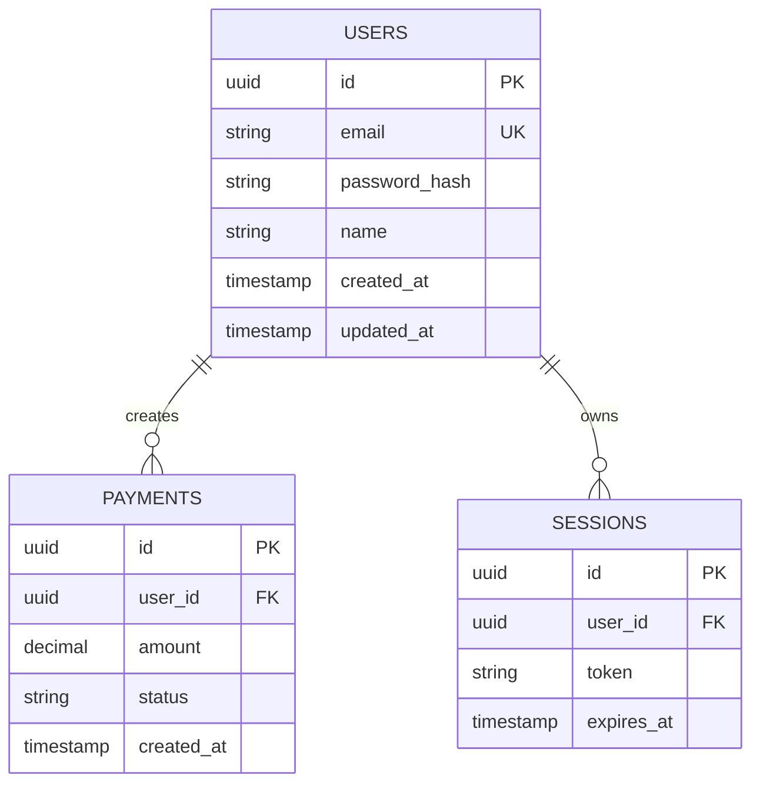
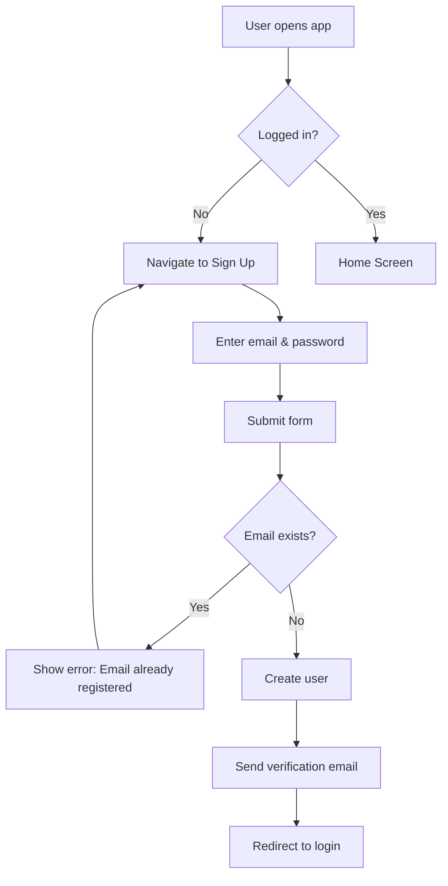
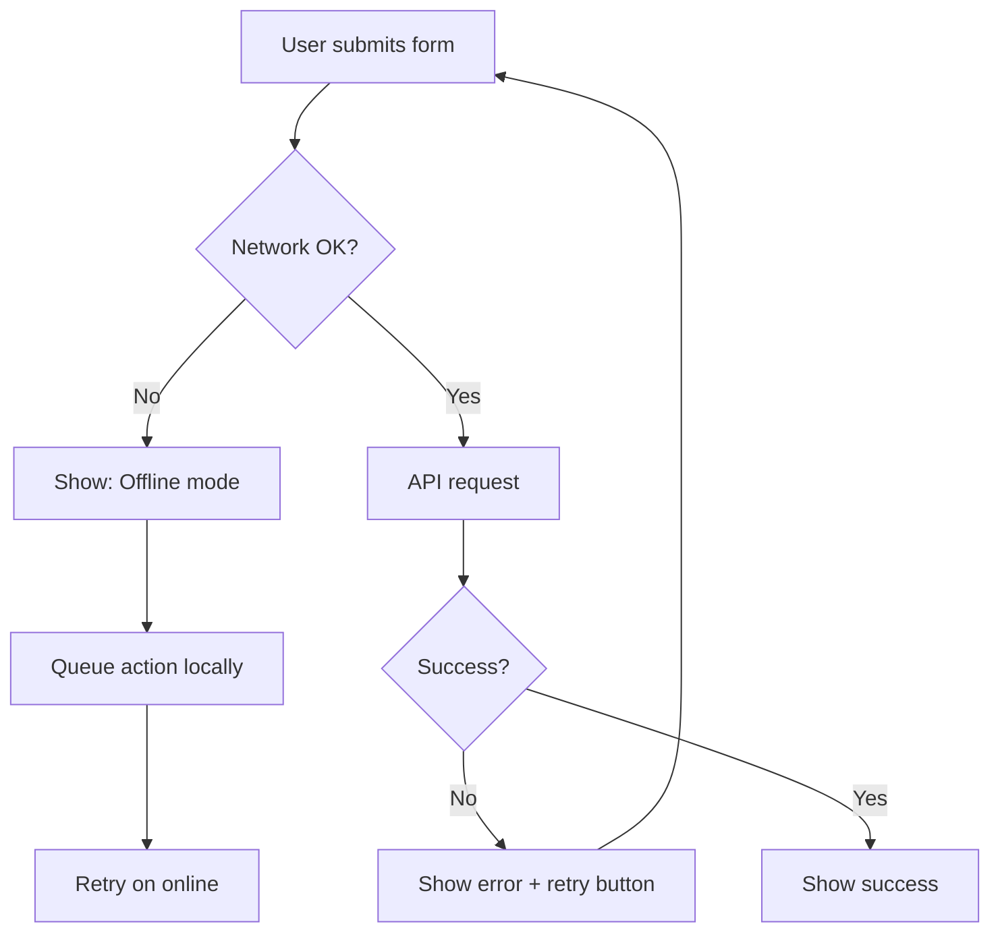
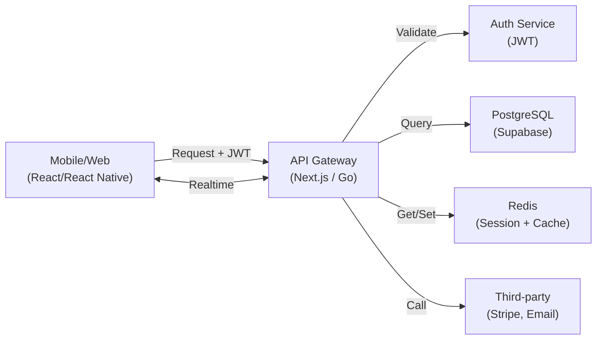
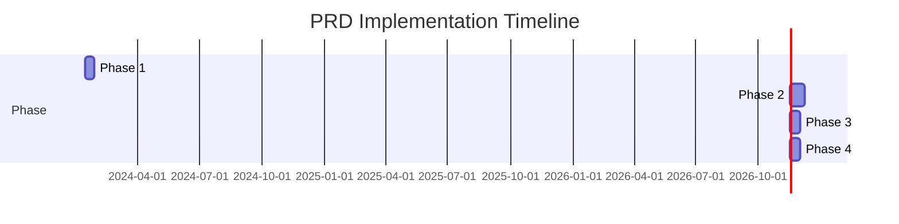

# PRD — {{PRODUCT_NAME}}

> **Doc Type:** Product Requirement Document  
> **Pitch:** {{One-liner describing what product does, for whom, why.}}

| Field | Value |
|---|---|
| **Product** | {{PRODUCT_NAME}} |
| **Version** | v1.0.0 |
| **Last Updated** | {{YYYY-MM-DD}} |
| **Status** | Draft \| In Review \| Approved \| Frozen |
| **Platform** | Web \| Mobile (RN) \| Both |
| **Primary Stack** | {{Next.js 14 + TS}} \| {{React Native 0.74 + TS}} \| {{Go 1.21 + Postgres}} |
| **Owner** | {{NAME}} (Product Lead) |
| **Tech Lead** | {{NAME}} |

---

## 1. Overview

### 1.1 Problem Statement
{{Real problem user faces. Focus pain, not solution. Why now?}}

### 1.2 Goals & Objectives
| # | Goal | Measurable |
|---|---|---|
| G1 | {{...}} | {{...}} |
| G2 | {{...}} | {{...}} |

### 1.3 Non-Goals (Out of Scope)
- {{Feature intentionally excluded from v1.0}}
- {{Deferred to v2.0, reason: {{...}}}}

### 1.4 Target Users / Personas
| Persona | Description | Core Need |
|---|---|---|
| {{Persona A}} | {{demographics}} | {{problem solved}} |

### 1.5 Success Metrics
| Metric | Target | Measurement |
|---|---|---|
| {{DAU / Retention / Conversion}} | {{300 users}} | {{Analytics event: `user_signup`}} |

---

## 2. Functional Requirements (Overview)

### 2.1 Feature List (MoSCoW Prioritization)

| Priority | Features | Notes |
|---|---|---|
| **Must** | {{Feature A, Feature B}} | Core to MVP |
| **Should** | {{Feature C}} | Nice-to-have, post-MVP |
| **Could** | {{Feature D}} | Future iteration |
| **Won't (v1)** | {{Feature X}} | See §1.3 Non-Goals |

### 2.2 Functional Requirements Matrix
Detail per `FR-*` below (§3 Core Features). Summary:

| ID | Feature | AC Count | Priority | Dependencies |
|---|---|---|---|---|
| FR-AUTH-001 | User Registration | 3 | Must | Email service |
| FR-AUTH-002 | User Login | 3 | Must | Session/JWT |
| FR-{{...}}-001 | {{...}} | 3+ | {{...}} | {{...}} |

---

## 3. Core Features

> **Format per feature (§PRD-RULE #2):** Description, User Story, Business Rules, Validation Rules, Inputs, Outputs, Permissions, Failure Scenarios, Edge Cases, Dependencies, Analytics Events.

### 3.1 {{Feature Name}}

**Description:**  
{{What is this feature? For whom? Why does it matter?}}

**Business Value:**  
{{Impact on business metrics (revenue, retention, engagement).}}

**User Story:**  
As a {{persona}}, I want {{action}}, so that {{benefit}}.

**Business Rules:**
- {{Constraint/logic rule 1}}
- {{Constraint/logic rule 2}}

**Validation Rules:**
- {{Input constraint 1 (e.g., email format)}}
- {{Input constraint 2 (e.g., age >= 18)}}

**Inputs:**
| Field | Type | Required | Format | Example |
|---|---|---|---|---|
| {{field1}} | string | Yes | {{format}} | `user@example.com` |
| {{field2}} | integer | No | {{range}} | `25` |

**Outputs:**
| Field | Type | Condition | Example |
|---|---|---|---|
| {{result1}} | string | Always | `success_id_123` |
| {{result2}} | boolean | On success | `true` |

**Permissions:**
- {{Auth requirement (JWT, session, anonymous)}}
- {{Authorization rule (user owns resource, admin-only, etc.)}}

**Failure Scenarios:**
| Scenario | Behavior | Retry? |
|---|---|---|
| Invalid input | Return 400 + error msg | No |
| Auth failed | Return 401 | Yes (max 3) |
| Timeout (>5s) | Queue + retry async | Yes (exponential backoff) |

**Edge Cases:**
- Empty/null input → {{behavior}}
- Concurrent requests → {{behavior (last-write-wins? lock?)}}
- Offline → {{behavior (queue? error?)}}
- Over-quota → {{behavior (403? queue?)}}

**Dependencies:**
- {{API: Stripe Payment API (SLA: 99.9%)}}
- {{Service: Email provider}}
- {{Feature: Feature X (must complete first)}}

**Analytics Events:**
| Event | Trigger | Properties | Goal |
|---|---|---|---|
| `{{event_name}}` | User {{action}} | `user_id, timestamp` | {{Track adoption}} |
| `{{event_fail}}` | {{failure}} | `error_code, user_id` | {{Debug issues}} |

---

### 3.2 {{Another Feature}}
{{Repeat 3.1 structure exactly.}}

---

## 4. Functional Requirements (Detailed)

### 4.1 FR-{{MODULE}}-001: {{Requirement Title}}

**Requirement ID:** FR-{{MODULE}}-001  
**Description:** {{What the system must do.}}  
**Priority:** Must | Should | Could | Won't  
**Dependencies:** {{Other FR/service.}}  
**Risk:** {{Technical/business risk.}}

**Acceptance Criteria:**

```
AC-001: {{Name}}
Given {{precondition}}
When {{action}}
Then {{observable result}} within {{timeout}}

AC-002: {{Name}}
Given {{precondition}}
When {{action}}
Then {{observable result}}

AC-003: {{Name — edge case}}
Given {{edge condition}}
When {{action}}
Then {{behavior}}
```

**Minimum 3 AC per FR. Format strictly: Given-When-Then, testable & measurable.**

### 4.2 FR-{{MODULE}}-002: {{Another Requirement}}
{{Repeat 4.1 exactly.}}

---

## 5. Non-Functional Requirements

> Mandatory per product type (§PRD-RULE §5). Pick template matching your platform.

### 5.1 Performance
| Requirement | Target | Measurement |
|---|---|---|
| {{Page Load / Cold Start}} | < {{3s}} | First Contentful Paint / App start |
| {{API Latency}} | < {{500ms}} (p95) | Server response time |
| {{Bundle/App Size}} | < {{300kb}} gzipped / {{100MB}} | Delivery size |

### 5.2 Security
| Requirement | Target | Implementation |
|---|---|---|
| {{HTTPS}} | Mandatory | All traffic encrypted |
| {{Auth}} | JWT + expiry 24h | Bearer token, refresh mechanism |
| {{Rate Limit}} | 100 req/min per IP | Redis counter, 429 response |
| {{Input Validation}} | Zod schema | All inputs validated server-side |
| {{PII Protection}} | Masked in logs | Card # → last 4 digits only |

### 5.3 Accessibility
- WCAG 2.1 Level AA
- Keyboard navigation
- Screen reader compatible

### 5.4 Availability
- Uptime: 99.5%
- Offline mode: {{Local cache + sync on online}}
- Graceful degradation: {{Show cached data if API fails}}

### 5.5 Scalability
- Concurrent users: {{10k}}
- Throughput: {{1000 req/s}}
- Cache strategy: {{Redis TTL 24h}}
- DB connection pooling: {{20 connections}}

### 5.6 Localization
- Languages: English, Bahasa Indonesia
- Date/time/currency formatting per locale
- RTL support: {{Yes/No}}

### 5.7 Monitoring & Logging
| Category | Target |
|---|---|
| Error rate | < 0.1% |
| Response time (p95) | {{target}} |
| Custom analytics | {{Events tracked}} |
| Log retention | 30 days (error), 7 days (debug) |
| Structured logging | JSON with request_id |

---

## 6. API Contract (if applicable)

### 6.1 Authentication
- **Type:** JWT Bearer
- **Expiry:** 24 hours
- **Refresh:** POST `/api/v1/auth/refresh`
- **Headers Required:** 
  - `Authorization: Bearer <token>`
  - `Content-Type: application/json`
  - `X-Request-ID: <uuid>`

### 6.2 Endpoint: {{POST /api/v1/users/register}}

**Request:**
```json
{
  "email": "user@example.com",
  "password": "secure_password_min_8_chars",
  "name": "John Doe"
}
```

**Validation:**
- `email`: valid email format, unique constraint
- `password`: min 8 chars, 1 uppercase, 1 number
- `name`: non-empty string

**Response (201 Created):**
```json
{
  "id": "550e8400-e29b-41d4-a716-446655440000",
  "email": "user@example.com",
  "name": "John Doe",
  "created_at": "2024-01-15T10:30:00Z"
}
```

**Error Responses:**

| Status | Code | Message | Example |
|---|---|---|---|
| 400 | `INVALID_EMAIL` | Invalid email format | `{"code": "INVALID_EMAIL", "message": "Email must be valid", "details": {"field": "email"}}` |
| 409 | `EMAIL_EXISTS` | Email already registered | `{"code": "EMAIL_EXISTS", "message": "User with this email already exists"}` |
| 500 | `INTERNAL_ERROR` | Server error | `{"code": "INTERNAL_ERROR", "message": "Something went wrong"}` |

**Rate Limit:**
- 10 registrations per hour per IP
- Headers: `X-RateLimit-Remaining: 9`, `X-RateLimit-Reset: 1705318000`

### 6.3 Endpoint: {{GET /api/v1/users/:id}}

{{Repeat 6.2 pattern for each endpoint.}}

---

## 7. Data Model

### 7.1 Entity Relationship Diagram



### 7.2 Entity Definitions

**Table: users**

| Field | Type | Nullable | Default | Constraint | Example |
|---|---|---|---|---|---|
| `id` | UUID | NO | auto-gen | PRIMARY KEY | `550e8400-e29b-41d4-a716-446655440000` |
| `email` | VARCHAR(255) | NO | null | UNIQUE, INDEX | `user@example.com` |
| `password_hash` | VARCHAR(255) | NO | null | - | `$2b$12$...` (bcrypt) |
| `name` | VARCHAR(100) | NO | null | - | `John Doe` |
| `created_at` | TIMESTAMP | NO | NOW() | - | `2024-01-15T10:30:00Z` |
| `updated_at` | TIMESTAMP | NO | NOW() | - | `2024-01-15T10:30:00Z` |

**Table: payments**

| Field | Type | Nullable | Default | Constraint | Example |
|---|---|---|---|---|---|
| `id` | UUID | NO | auto-gen | PRIMARY KEY | `550e8400-e29b-41d4-a716-446655440001` |
| `user_id` | UUID | NO | null | FOREIGN KEY (users.id), INDEX | `550e8400-e29b-41d4-a716-446655440000` |
| `amount` | BIGINT | NO | null | CHECK amount > 0 | `100000` (in cents, IDR) |
| `currency` | VARCHAR(3) | NO | `IDR` | - | `IDR` |
| `status` | ENUM | NO | `pending` | pending\|success\|failed\|refunded | `success` |
| `stripe_payment_id` | VARCHAR(255) | YES | null | UNIQUE | `pi_1234567890` |
| `created_at` | TIMESTAMP | NO | NOW() | INDEX | `2024-01-15T10:30:00Z` |
| `updated_at` | TIMESTAMP | NO | NOW() | - | `2024-01-15T10:30:00Z` |

### 7.3 Constraints & RLS

**Row-Level Security (Supabase):**
- `users` table: User sees own record only (`SELECT * WHERE auth.uid() = id`)
- `payments` table: User sees own payments only (`SELECT * WHERE user_id = auth.uid()`)
- Admin role: No RLS restriction

**Database Constraints:**
- Foreign key cascade: `ON DELETE CASCADE` for sessions (cleanup on user delete)
- Unique indexes: `UNIQUE(users.email)`, `UNIQUE(payments.stripe_payment_id)`
- Check constraints: `payments.amount > 0`, `EXTRACT(YEAR FROM created_at) >= 2024`

---

## 8. User Flows

### 8.1 Primary Flow: {{Feature Name}}



### 8.2 Alternative Flow: {{Feature Name — Error Handling}}



### 8.3 Offline Flow

- {{App queues action in MMKV/WatermelonDB}}
- {{Shows "Offline mode" badge}}
- {{Syncs when online (with conflict resolution: last-write-wins)}}

---

## 9. Architecture & Design

### 9.1 System Architecture



### 9.2 Clean Architecture Layers

```
src/
├── domain/                    # Business logic (no external deps)
│   ├── entities/              # User, Payment, entities
│   ├── repositories/          # IUserRepository, IPaymentRepository (interfaces)
│   ├── use-cases/             # RegisterUserUseCase, MakePaymentUseCase
│   └── errors.ts              # Domain errors
├── data/                      # Data & infrastructure
│   ├── datasources/           # Remote/local data sources
│   ├── mappers/               # DTO → Entity + Zod validation
│   ├── repositories/          # Repository implementations
│   └── models/                # DTO schemas
├── presentation/              # UI & state
│   ├── screens/               # Page/Screen components
│   ├── components/            # Reusable UI components
│   ├── hooks/                 # Custom hooks (data fetching, state)
│   └── store/                 # Zustand stores (UI state)
└── shared/                    # Cross-cutting (navigation, theme, logger)
```

### 9.3 State Management

**Server State (TanStack Query):**
- Caching strategy: 5 min staleTime, 30 min gcTime
- Background refetch on window focus
- Optimistic mutations

**UI State (Zustand):**
- Theme (dark/light)
- Global toast notifications
- Modal visibility

### 9.4 Tech Stack Decision

| Layer | Tech | Rationale | Risk |
|---|---|---|---|
| **Frontend** | Next.js 14 App Router | Rapid dev, SSR | Complexity if not careful |
| **Mobile** | React Native 0.74 + TS | Code sharing, fast dev | Performance on low-end devices |
| **Backend** | {{Golang or Supabase}} | {{See Decision Log}} | {{See Risk section}} |
| **Database** | PostgreSQL | Reliable, flexible | Manual scaling |
| **Auth** | JWT (24h expiry) | Stateless, scalable | Token refresh logic |

**See §9 Decision Log for stack rationale.**

---

## 10. Design System & Constraints

### 10.1 Typography
- **Display**: {{Font name}}, 32px, weight 700
- **Heading 1**: {{Font}}, 24px, weight 600
- **Body**: {{Font}}, 16px, weight 400
- **Caption**: {{Font}}, 12px, weight 400, color text-secondary

### 10.2 Color Tokens (Dark Mode Default)
| Token | Light | Dark |
|---|---|---|
| `primary` | `#2563eb` | `#3b82f6` |
| `secondary` | `#64748b` | `#94a3b8` |
| `danger` | `#dc2626` | `#ef4444` |
| `success` | `#16a34a` | `#22c55e` |
| `background` | `#ffffff` | `#0f172a` |
| `surface` | `#f8fafc` | `#1e293b` |
| `text-primary` | `#1e293b` | `#f1f5f9` |
| `text-secondary` | `#64748b` | `#94a3b8` |
| `border` | `#e2e8f0` | `#334155` |

### 10.3 Spacing Scale
8px base unit: 8, 16, 24, 32, 48, 64, 96

### 10.4 Technical Constraints
- Min OS: iOS 13, Android 8
- Precision for money: integers (cents/sen, never floats)
- Path alias: `@/` for src root
- Package manager: {{npm / yarn}}
- No dependencies: {{List forbidden packages}}

---

## 11. Database Migrations

### 11.1 Migration: 001_create_users_table

```sql
CREATE TABLE users (
  id UUID PRIMARY KEY DEFAULT gen_random_uuid(),
  email VARCHAR(255) NOT NULL UNIQUE,
  password_hash VARCHAR(255) NOT NULL,
  name VARCHAR(100) NOT NULL,
  created_at TIMESTAMP DEFAULT NOW(),
  updated_at TIMESTAMP DEFAULT NOW()
);

CREATE INDEX idx_users_email ON users(email);
```

### 11.2 Migration: 002_create_payments_table

```sql
CREATE TABLE payments (
  id UUID PRIMARY KEY DEFAULT gen_random_uuid(),
  user_id UUID NOT NULL REFERENCES users(id) ON DELETE CASCADE,
  amount BIGINT NOT NULL CHECK (amount > 0),
  currency VARCHAR(3) DEFAULT 'IDR',
  status VARCHAR(20) DEFAULT 'pending',
  stripe_payment_id VARCHAR(255) UNIQUE,
  created_at TIMESTAMP DEFAULT NOW(),
  updated_at TIMESTAMP DEFAULT NOW()
);

CREATE INDEX idx_payments_user_id ON payments(user_id);
CREATE INDEX idx_payments_created_at ON payments(created_at);
```

---

## 12. Error States & Handling

### 12.1 Loading State
- **UI:** Skeleton screen or spinner
- **Message:** "Loading..."
- **Timeout:** 30s → show "Request took too long" + retry button

### 12.2 Empty State
- **UI:** Illustration + empty message
- **Message:** "No data yet. Create your first {{item}}."
- **CTA:** Button to create/import

### 12.3 Offline State
- **UI:** Offline badge, cached data shown
- **Message:** "Offline mode (changes will sync when online)"
- **Behavior:** Queue actions locally, sync on reconnect

### 12.4 Validation Error
- **UI:** Highlight field with error icon
- **Message:** "Invalid {{field}}: {{specific reason}}"
- **Example:** "Invalid card number. Use format: 1234 5678 9012 3456"

### 12.5 Timeout Error
- **UI:** Error page with retry button
- **Message:** "Request took too long. Please try again."
- **CTA:** Retry button + "Contact Support" link

### 12.6 Unknown Error
- **UI:** Error page with error code
- **Message:** "Something went wrong"
- **Code:** `ERR_500_PAYMENT_FAILED`
- **CTA:** "Contact Support" link with pre-filled error code

---

## 13. Security Checklist

| Item | Requirement | Implementation | Owner | Status |
|---|---|---|---|---|
| **Authentication** | JWT token required | Bearer token validation on all API routes | Backend | ✓ |
| **Authorization** | User sees own data only | Row-level security + user_id filter on queries | Backend | ✓ |
| **Sensitive Data** | Card # never logged | Stripe tokenization, logs redact card | DevOps | ✓ |
| **PII Protection** | Email/phone masked | API returns `user***@example.com` | Backend | {{Pending}} |
| **Encryption** | Data at rest AES-256 | Supabase managed encryption | Ops | ✓ |
| **Audit Log** | Track all payment actions | Immutable log table (user_id, action, timestamp) | Backend | {{Pending}} |
| **Rate Limit** | Max 10 attempts/hour | Redis counter per user + 429 response | Backend | ✓ |
| **Fraud Prevention** | Detect suspicious patterns | Check: repeated card, fast retries, high amount | Backend | {{Pending}} |
| **Abuse Prevention** | Exponential backoff on failure | 1s → 2s → 4s → 8s retry delay | Backend | {{Pending}} |

---

## 14. Analytics & Events

### 14.1 Event Tracking

| Event | Trigger | Properties | Goal | Sample Rate |
|---|---|---|---|---|
| `screen_viewed` | User navigates to screen | `screen_name, user_id, timestamp` | Adoption tracking | 100% |
| `signup_started` | User opens signup form | `source, user_id` | Funnel analysis | 100% |
| `signup_completed` | User completes registration | `user_id, email_domain, timestamp` | Conversion tracking | 100% |
| `signup_failed` | Registration fails | `error_code, user_id` | Debugging | 100% |
| `payment_initiated` | User clicks "Pay Now" | `amount, currency, user_id` | Engagement | 100% |
| `payment_success` | Payment completes | `amount, currency, method, user_id` | Revenue tracking | 100% |
| `payment_failed` | Payment declined | `error_code, reason, user_id` | Error analysis | 100% |
| `payment_retry` | User retries payment | `attempt_number, error_code, user_id` | Retry pattern | 100% |

### 14.2 Funnel Tracking
- **Signup Funnel:** `screen_viewed(signup)` → `signup_started` → `signup_completed`
- **Payment Funnel:** `screen_viewed(payment)` → `payment_initiated` → `payment_success`

---

## 15. Risks & Mitigations

### 15.1 Technical Risks

| Risk | Impact | Probability | Mitigation |
|---|---|---|---|
| {{Stripe API downtime}} | Payment blocked | Low (99.9% SLA) | {{Fallback to manual invoice + retry queue}} |
| {{Database performance}} | API timeout | Medium | {{Add caching layer, optimize queries, DB indexing}} |
| {{Third-party dependency}} | Version incompatibility | Low | {{Lock versions, test upgrades in staging}} |

### 15.2 Business Risks

| Risk | Impact | Probability | Mitigation |
|---|---|---|---|
| {{User adoption low}} | Revenue miss | Medium | {{User interviews, MVP landing page, early access}} |
| {{Competitor existing solution}} | Market timing | High | {{Differentiation via UX, pricing, integrations}} |
| {{Compliance unclear}} | Legal blockers | Low | {{Legal review, compliance audit before launch}} |

### 15.3 Migration Risks

| Risk | Impact | Probability | Mitigation |
|---|---|---|---|
| {{Data consistency during sync}} | Lost data | Low | {{Async queue, idempotent operations, rollback plan}} |
| {{User adoption of new flow}} | Churn | Medium | {{Gradual rollout, in-app education, customer support}} |

### 15.4 Dependency Risks

| Risk | Impact | Probability | Mitigation |
|---|---|---|---|
| {{Stripe rate limit}} | Request rejection | Low | {{Implement backoff, queue mechanism}} |
| {{Email provider downtime}} | Verification fails | Low | {{Use multiple providers, graceful degradation}} |

---

## 16. Assumptions

| ID | Assumption | Impact if Wrong | Owner |
|---|---|---|---|
| AS-001 | Internet connectivity available | Offline feature becomes must-have | PM |
| AS-002 | User has valid email address | Verification flow fails | PM |
| AS-003 | Stripe API always available (99.9% SLA) | Need fallback payment method | Tech Lead |
| AS-004 | User willing to provide phone number | SMS verification impossible | PM |

---

## 17. Open Questions

| # | Question | Owner | Deadline | Impact |
|---|---|---|---|---|
| OQ-001 | Which payment gateway (Stripe vs Midtrans vs GCash)? | Tech Lead | {{2024-01-20}} | {{Affects SDK, pricing, regional support}} |
| OQ-002 | Real-time notifications (Firebase vs Pusher vs WebSocket)? | Backend Lead | {{2024-01-22}} | {{Affects backend cost, latency, scalability}} |
| OQ-003 | Supabase vs Go backend for v1? | Tech Lead + PM | {{2024-01-25}} | {{Timeline: Supabase 3 weeks, Go 8 weeks}} |

**AI cannot make assumptions on Open Questions. Resolve before PR merge.**

---

## 18. Development Phases



| Phase | Duration | Scope | Deliverable |
|---|---|---|---|
| **1: Setup & Auth** | 2 weeks | Project setup, DI, auth (login/register) | API routes + mobile screens + unit tests |
| **2: Core Features** | 3 weeks | {{Feature A, Feature B}} | {{Acceptance criteria met + integration tests}} |
| **3: Polish** | 2 weeks | Edge cases, offline, performance | All AC green + e2e tests |
| **4: Testing & Release** | 2 weeks | QA, security audit, release prep | Deployed to production |

---

## 19. Engineering Deliverables

### 19.1 Folder Structure (Mobile: React Native)

```
src/
├── shared/
│   ├── core/di/                   # Dependency injection container
│   ├── core/errors/               # AppError.ts, ErrorBoundary.tsx
│   ├── data/api/                  # httpClient.ts (Axios + interceptors)
│   ├── data/storage/              # mmkvStorage.ts
│   ├── presentation/navigation/   # RootNavigator.tsx
│   └── state/                     # uiStore.ts, queryClient.ts
└── features/{{auth}}/
    ├── domain/                    # Entities, repositories (interfaces)
    ├── data/                      # Repository impl, datasources, mappers
    ├── presentation/              # Screens, hooks, store
    └── __tests__/                 # Unit & integration tests
```

### 19.2 Folder Structure (Web: Next.js)

```
app/
├── (auth)/login/                  # Route group for auth
├── (dashboard)/payments/          # Route group for dashboard
└── api/auth/login/                # API route handlers

src/
├── lib/                           # api.ts, queryClient.ts, validators.ts
├── hooks/                         # Custom hooks (usePayments, etc)
├── store/                         # Zustand stores (auth, ui)
└── components/ui/                 # Design system atoms
```

### 19.3 Folder Structure (Backend: Go)

```
cmd/api/
├── main.go                        # Server bootstrap
└── config.go                      # Config loader

internal/
├── domain/                        # Entities, repository interfaces
├── application/                   # Use-cases
├── infrastructure/http/           # HTTP server, middleware, routes
├── infrastructure/persistence/    # Repository impl, migrations
└── interfaces/http/               # Handlers

tests/
├── unit/                          # Use-case tests
└── integration/                   # Handler + DB tests
```

### 19.4 Mandatory Artifacts Per Platform

**Mobile (React Native):**
- [ ] `src/shared/core/di/container.ts` — Dependency injection
- [ ] `src/shared/core/errors/AppError.ts` — Typed error class
- [ ] `src/shared/data/api/httpClient.ts` — Axios + auth interceptor
- [ ] Per feature: domain layer (entities, repositories), data layer (mappers), presentation layer (screens, hooks)
- [ ] `jest.config.js` — Test setup
- [ ] ≥3 test files per feature (entity, mapper, hook)

**Web (Next.js):**
- [ ] `src/lib/api.ts` — Axios instance
- [ ] `src/lib/queryClient.ts` — TanStack Query SSR config
- [ ] `src/lib/validators.ts` — Zod schemas
- [ ] `src/components/providers/Providers.tsx` — All providers
- [ ] `src/hooks/use{{Feature}}.ts` — Custom hooks for data fetching
- [ ] `vitest.config.ts` — Test setup
- [ ] ≥1 test per hook, component, provider

**Backend (Go):**
- [ ] `cmd/api/main.go` — Server + DI bootstrap
- [ ] Domain layer: entities, repository interfaces, errors
- [ ] Application layer: use-cases
- [ ] Infrastructure layer: repository impl, HTTP handlers, migrations
- [ ] `tests/unit/` — Use-case tests
- [ ] `tests/integration/` — Handler tests
- [ ] `docker-compose.yml` — Local dev environment

---

## 20. Decision Log

**All product/tech/UX decisions binding entire PRD.** Format: Issue, Decision, Reason, Impact.

| # | Date | Issue | **DECISION** | Reason | Impact |
|---|---|---|---|---|---|
| D1 | {{2024-01-15}} | {{Payment gateway?}} | **Stripe** | Industry standard, best docs, SLA 99.9%, {{}} | {{API endpoint added: POST /api/payments; schema: +stripe_customer_id; new dependency: stripe-node}} |
| D2 | {{2024-01-20}} | {{Backend: Supabase vs Go?}} | **Supabase (MVP), migrate to Go if scale > 50k DAU** | {{Fast MVP, RLS built-in, costs $25/mo vs Go ops overhead}} | {{Breaking change if migrate: API response structure may differ}} |

**Decision Impact Template:**
- Breaking Change? (Y/N)
- Migration Required? (Y/N)
- API Changed? (Y/N)
- Schema Changed? (Y/N)
- UI Changed? (Y/N)

---

## 21. Glossary

| Term | Definition |
|---|---|
| **{{JWT}}** | Stateless authentication token, 24h expiry, refresh via POST `/api/auth/refresh` |
| **{{Idempotency}}** | Same request twice = same result (prevent duplicate payments) |
| **{{RLS}}** | Row-Level Security: Postgres policy limiting user to own records |
| **{{Exponential Backoff}}** | Retry delay: 1s, 2s, 4s, 8s, cap at 60s |

---

## 22. Definition of Done

**PRD approved ONLY when:**

- [ ] No placeholders `{{...}}` remaining
- [ ] All FR have ≥3 AC (GWT format, testable)
- [ ] All NFR completed per product type (§5)
- [ ] All API endpoints have Request, Response (success), Response (error)
- [ ] All entities have full type specs + examples
- [ ] Decision Log filled + reason/impact documented
- [ ] Version & Last Updated updated
- [ ] All OQ resolved with owner/deadline or documented with risk
- [ ] Risks identified (4+ categories, mitigations clear)
- [ ] Assumptions listed with impact
- [ ] Analytics events defined (success + failure paths)
- [ ] Security checklist ≥9 items completed
- [ ] Error states documented (Loading, Empty, Offline, Timeout, Validation, Unknown)
- [ ] Mermaid diagrams render error-free (test at mermaid.live)
- [ ] Traceability: FR → AC → TC (if complex)
- [ ] Engineering Deliverables structure approved
- [ ] **Product Lead sign-off** (comment: "✓ Approved")
- [ ] **Tech Lead sign-off** (comment: "✓ Feasible")

---

## 23. PR Review Checklist (for Reviewers)

| Checklist | Reviewer |
|---|---|
| No `{{...}}` placeholders | Reviewer 1 |
| AC ≥3 per FR, GWT format | Reviewer 1 |
| NFR complete per platform | Reviewer 2 (Tech) |
| API contracts consistent | Reviewer 2 (Tech) |
| Data model typed fully | Reviewer 2 (Tech) |
| Decision Log reason + impact | Reviewer 1 |
| OQ resolved or documented | Reviewer 1 |
| Security checklist signed | Reviewer 2 (Security) |
| Diagrams render (mermaid.live) | Reviewer 1 |
| **Merge approved** | Both leads |

---

**End of PRD Template**

> **Usage:** Copy this template, fill {{...}} placeholders, follow section order exactly (§PRD-RULE §1). Do not delete/reorder sections without explicit Product Lead approval.