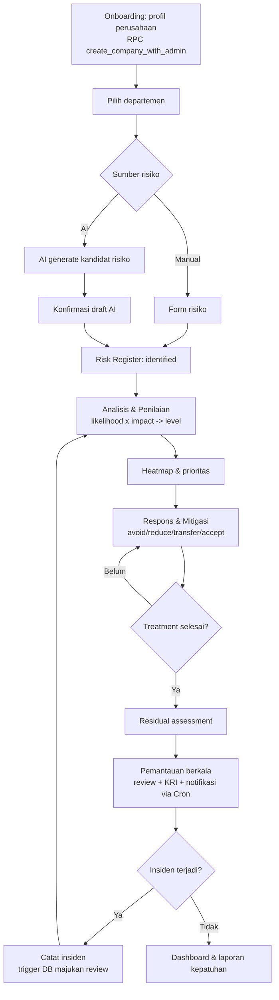
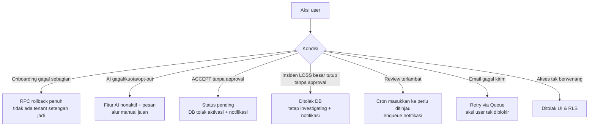
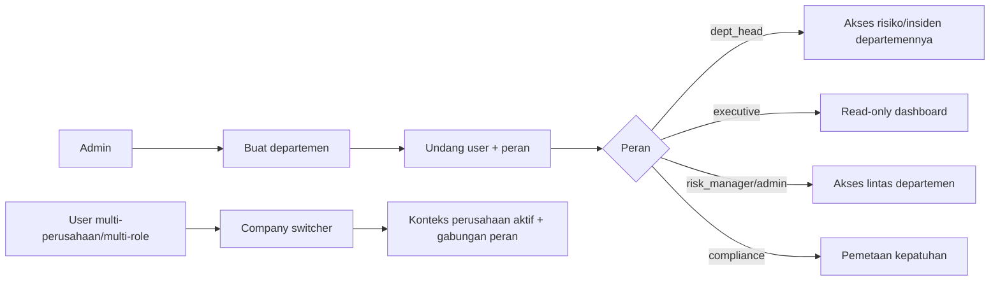
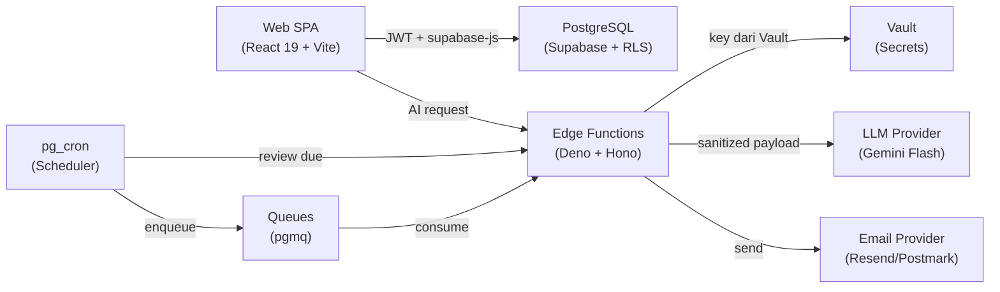
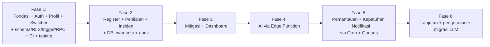

# PRD — RiskoFlow

> **Doc Type:** Product Requirement Document
> **Pitch:** Aplikasi web pengelolaan manajemen risiko perusahaan berbasis **ISO 31000:2018**, dengan AI tertanam untuk identifikasi, analisis, mitigasi, dan pemantauan risiko per departemen — multi-tenant, dapat diaudit.

| Field | Value |
|---|---|
| **Product** | RiskoFlow |
| **Version** | v1.6.1 |
| **Last Updated** | 2026-07-01 |
| **Status** | Approved (MVP; 4 OQ pra-produksi tersisa — non-blocking, lihat §17) |
| **Platform** | Web (SPA) |
| **Primary Stack** | React 19 + TS (Vite) · Clean Architecture (feature-sliced) · TanStack Router + Query + Zustand · Tailwind v4 + shadcn/ui · Supabase (Postgres + RLS + Auth + Edge Functions + Cron + Queues + Vault) |
| **Owner** | Tim RiskoFlow (Product Lead) |
| **Tech Lead** | Tim RiskoFlow |
| **Standar acuan** | ISO 31000:2018 + pedoman CRMS Indonesia & Mekari (D2, D11) |
| **Authoring rule** | Mengikuti `docs/PRD-RULE.md` + struktur `docs/PRD-TEMPLATE.md` |

> Dokumen ini adalah **single source of truth** untuk **apa** yang dibangun dan **mengapa**.
> ⚖️ Keputusan yang mengikat seluruh dokumen ada di **[§20 Decision Log](#20-decision-log)**. Bila ada detail ambigu, §20 yang berlaku.
> 🔄 **Riwayat:** v1.3 → v1.4 pengerasan stack (D16–D24). v1.4 → v1.5 materialisasi skema §7 jadi declarative SQL + RLS + trigger (D25–D26). v1.5 → v1.6 RPC provisioning atomik + **RBAC multi-role** (D27). v1.6 → v1.6.1 patch authoring: lengkapi field-spec semua entity (§7.2), tambah ID `NFR-xx` (§5), kolom Date/Version Decision Log (§20), rate limit tiap API (§6), traceability matrix (§4.15). Tidak ada perubahan scope fungsional.

---

## 1. Overview

RiskoFlow adalah aplikasi web yang membantu perusahaan menjalankan **siklus manajemen risiko sesuai ISO 31000:2018** secara terstruktur dan dapat diaudit. Alih-alih mengelola risiko di spreadsheet yang tercerai-berai, perusahaan memetakan risiko **per departemen** dalam satu *risk register* terpusat, lalu menjalankannya melalui tahap inti yang saling terhubung:

1. **Identifikasi Risiko** — mendata ancaman internal & eksternal (keuangan, operasional, hukum, reputasi, strategis).
2. **Analisis & Penilaian** — menilai *likelihood*, *impact*, dan *severity* lewat matriks risiko (heatmap 5×5).
3. **Respons & Mitigasi** — memilih strategi: hindari (*avoid*), kurangi (*reduce*), transfer (*transfer*), atau terima (*accept*).
4. **Pemantauan Berkelanjutan** — review berkala, *Key Risk Indicators* (KRI), kontrol eksekutif/manajemen.
5. **Incident / Loss-Event Log** — mencatat kejadian risiko nyata sebagai umpan balik ke penilaian & pemantauan.

**AI tertanam di seluruh siklus.** Berbekal **profil perusahaan** (bidang usaha, jumlah departemen, jumlah karyawan), AI menyarankan kandidat risiko per departemen, mengusulkan skor awal, merekomendasikan rencana mitigasi, dan menandai risiko yang perlu ditinjau. Semua saran AI **bersifat usulan** dan wajib dikonfirmasi manusia sebelum masuk register (D6).

Aplikasi bersifat **multi-tenant**: setiap perusahaan terisolasi via RLS, dan **satu user dapat tergabung di beberapa perusahaan** dengan peran berbeda, berpindah lewat *company switcher* (D9). User memilih tipe perusahaan — **jasa, dagang, atau manufaktur** — yang memengaruhi template risiko, library kepatuhan, dan contoh yang ditawarkan AI (D3).

### 1.1 Problem Statement

Banyak perusahaan menjalankan manajemen risiko secara reaktif dan tidak terstruktur: risiko dicatat terpisah per divisi, penilaian tidak konsisten, rencana mitigasi tidak ditindaklanjuti, dan pemantauan hanya terjadi saat audit. Akibatnya manajemen tidak punya gambaran utuh atas profil risiko perusahaan, dan kepatuhan terhadap standar (ISO 31000, GCG) sulit dibuktikan.

**Peluang & timing:** ISO 31000:2018 memberi kerangka proses yang jelas namun butuh tooling agar konsisten dijalankan lintas departemen. Sekaligus, **LLM** kini mampu menyusun draf risk register kontekstual berdasarkan profil industri & struktur organisasi — memangkas friksi terbesar (memulai dari halaman kosong) sambil tetap menempatkan keputusan akhir pada manusia.

### 1.2 Goals & Objectives

| # | Goal | Measurable |
|---|---|---|
| G1 | Siklus ISO 31000 utuh | Satu risiko dapat ditelusuri identifikasi → penilaian → mitigasi → pemantauan → insiden tanpa keluar aplikasi. |
| G2 | Akselerasi lewat AI | Draf risk register awal per departemen tersusun < 15 menit. |
| G3 | Visibilitas eksekutif | Dashboard risiko per perusahaan/departemen/kategori dipahami manajemen < 1 menit. |
| G4 | Kepatuhan terbukti | Setiap mitigasi dapat dipetakan ke regulasi/standar terkait & diaudit. |
| G5 | Fondasi teknis sehat | Clean Architecture, multi-tenant aman (RLS), invariant ditegakkan di DB, teruji, observable, siap skala. |

### 1.3 Non-Goals (Out of Scope rilis awal)

- **Quantitative Risk Analysis lanjutan** (Monte Carlo, VaR, simulasi finansial) — MVP fokus matriks kualitatif 5×5.
- **Integrasi otomatis ke GRC/ERP pihak ketiga** via API (SAP, Oracle GRC, dll.).
- **Modul audit internal penuh** (kertas kerja audit, sampling) — disinggung, bukan dibangun.
- **Multi-bahasa penuh** selain ID/EN.
- **Pembelian/manajemen polis asuransi** end-to-end (transfer risiko dicatat sebagai strategi, bukan transaksi).
- **Real-time collaboration editing** (co-editing simultan).
- **SSR / full-stack framework mode** — RiskoFlow tetap SPA murni di belakang auth (D16).

### 1.4 Target Users / Personas

| Persona | Description | Core Need |
|---|---|---|
| **Risk Manager / CRO** | Penanggung jawab manajemen risiko perusahaan. | Risk register terpusat, konsistensi penilaian, laporan ke direksi. |
| **Department Head / Risk Owner** | Kepala departemen pemilik risiko di unitnya. | Catat & kelola risiko + mitigasi + insiden departemen. |
| **Eksekutif / Direksi** | Pemantau lapis atas. | Dashboard ringkas, tren risiko, status mitigasi — read-mostly. |
| **Compliance Officer** | Penjaga kepatuhan & GCG. | Pemetaan risiko ↔ regulasi, bukti kepatuhan, jejak audit. |
| **Admin** | Pengelola tenant. | Setup perusahaan, departemen, user, peran (RBAC). |

> Satu user dapat memegang **beberapa peran sekaligus** dalam satu perusahaan (mis. pembuat tenant = admin + risk_manager) — D27.

### 1.5 Success Metrics

| Metric | Target | Measurement |
|---|---|---|
| Waktu menyusun draf register awal 1 departemen | < 15 menit (dengan AI) | Onboarding → register pertama |
| Risiko dinilai lengkap (likelihood+impact+treatment) | ≥ 80% | % risiko *assessed + treated* |
| Saran AI diterima tanpa edit besar | ≥ 60% | Analytics event `ai_suggestion_accepted` |
| Risiko jatuh tempo review ditinjau tepat waktu | ≥ 75% | Review selesai sebelum `next_review_date` |
| Insiden tercatat ter-link ke risiko | ≥ 70% | % insiden dengan `risk_id` |
| Retensi tim aktif 30 hari | ≥ 50% | Cohort retention |
| Error-free sessions | ≥ 99% | Sentry error reporter |

---

## 2. Functional Requirements (Overview)

### 2.1 Feature List (MoSCoW Prioritization)

| Priority | Features | Notes |
|---|---|---|
| **Must** | Auth + multi-tenant (multi-membership + company switcher); profil perusahaan; departemen, user & RBAC (multi-role); risk register; analisis & penilaian (5×5 + heatmap); respons & mitigasi (4 strategi); incident/loss-event log; dashboard; soft delete + audit (DB-enforced). | Core MVP |
| **Should** | AI via Edge Function (saran 4 tahap); pemantauan berkelanjutan (review + status); kepatuhan + library regulasi 3 industri; notifikasi in-app + email (Cron + Queues); ekspor laporan. | Post-core MVP |
| **Could** | KRI/indikator + threshold; komentar/diskusi per risiko; impor risiko via CSV; template risiko per industri; digest email harian; MFA/Passkeys. | Iterasi lanjut |
| **Won't (v1)** | Lihat [§1.3 Non-Goals](#13-non-goals-out-of-scope-rilis-awal). | — |

### 2.2 Functional Requirements Matrix

Detail per `FR-*` di [§4](#4-functional-requirements-detailed). Ringkasan:

> Kolom **AC/FR (min)** = jumlah minimum Acceptance Criteria per FR (rule wajib ≥3). Detail AC di §4.

| ID (group) | FR di §4 | Feature | AC/FR (min) | Priority | Dependencies |
|---|---|---|---|---|---|
| FR-ONB-* | FR-ONB-001, 002 | Onboarding & Profil Perusahaan | ≥3 | Must | Supabase Auth, RPC `create_company_with_admin` |
| FR-ORG-* | FR-ORG-001, 002 | Departemen, User & RBAC + Switcher | ≥3 | Must | Auth, RLS, guard trigger |
| FR-RISK-* | FR-RISK-001, 002 | Risk Register (Identifikasi) | ≥3 | Must | repo `risk`, TanStack Router |
| FR-ASSESS-* | FR-ASSESS-001 | Analisis & Penilaian | ≥3 | Must | severity generated column (D22) |
| FR-TREAT-* | FR-TREAT-001 | Respons & Mitigasi | ≥3 | Must | approval gate DB (D22), notifikasi |
| FR-MON-* | FR-MON-001 | Pemantauan Berkelanjutan | ≥3 | Should | Supabase Cron (D18) |
| FR-INC-* | FR-INC-001 | Incident / Loss-Event Log | ≥3 | Must | trigger auto-advance (D13/D22) |
| FR-COMP-* | FR-COMP-001 | Kepatuhan + Library Regulasi | ≥3 | Should | seed via RPC onboarding (D25) |
| FR-AI-* | FR-AI-001 | AI Assistant | ≥3 | Should | Edge Function + Vault (D6/D20) |
| FR-NOTIF-* | FR-NOTIF-001 | Notifikasi (in-app + email) | ≥3 | Should | Cron + Queues (D18/D19) |
| FR-DASH-* | FR-DASH-001 | Dashboard & Reporting | ≥3 | Must | agregasi RPC/view kanonik |

---

## 3. Core Features

> Format per fitur (§PRD-RULE #2): Description, Business Value, User Story, Business Rules, Validation Rules, Inputs, Outputs, Permissions, Failure Scenarios, Edge Cases, Dependencies, Analytics Events.

### 3.1 Onboarding & Profil Perusahaan

**Description:** Wizard awal yang mengidentifikasi perusahaan — bidang usaha (jasa/dagang/manufaktur), jumlah departemen, jumlah karyawan — sebagai konteks bagi AI & library kepatuhan. Untuk *Admin* pembuat tenant.

**Business Value:** Memangkas friksi "halaman kosong"; profil industri menaikkan relevansi saran AI (target metrik G2: draf < 15 menit) dan menyeed library kepatuhan (G4).

**User Story:** Sebagai *Admin*, saya ingin menyiapkan profil perusahaan sekali di awal, supaya saran risiko & regulasi relevan dengan bidang dan skala perusahaan.

**Business Rules:**
- Provisioning perusahaan + admin pertama **atomik** via RPC `create_company_with_admin` (D25).
- Pembuat tenant otomatis memperoleh **dua peran: `admin` + `risk_manager`** (D27).
- Library regulasi industri di-seed dalam transaksi yang sama (D14).

**Validation Rules:**
- `industry_type` ∈ {`JASA`,`DAGANG`,`MANUFACTURE`} (D3).
- `employee_count` > 0 (integer).
- `name` non-empty (trim); nama departemen di-dedupe case-insensitive.

**Inputs:**
| Field | Type | Required | Format | Example |
|---|---|---|---|---|
| `name` | string | Yes | 1–150 char | `PT Maju Jaya` |
| `industry_type` | enum | Yes | JASA\|DAGANG\|MANUFACTURE | `MANUFACTURE` |
| `employee_count` | integer | Yes | > 0 | `120` |
| `departments` | string[] | No | dedupe | `["Produksi","Keuangan"]` |

**Outputs:**
| Field | Type | Condition | Example |
|---|---|---|---|
| `company_id` | UUID | On success | `550e...` |
| `Department[]` | list | On success | seeded departments |
| compliance seed | rows | On success | `is_system=true` per industri |

**Permissions:** `authenticated` (siapa pun user login boleh membuat tenant baru); RPC `SECURITY DEFINER` (D25).

**Failure Scenarios:**
| Scenario | Behavior | Retry? |
|---|---|---|
| `employee_count ≤ 0` | Exception, rollback penuh | No |
| Industri di luar enum | Exception, rollback | No |
| User batal di tengah | Tidak ada transaksi commit | — |
| Insert gagal sebagian | Rollback penuh (atomik) | Yes (ulang wizard) |

**Edge Cases:** jumlah departemen 0 (izinkan, min 1 lewat FR); nama departemen duplikat (dedupe); ubah industri setelah ada data (tidak hapus data, hanya pengaruhi saran AI + tawarkan library baru).

**Dependencies:** Supabase Auth; RPC `create_company_with_admin` (SECURITY DEFINER, atomik — D25/D27); repository `company`/`department`; wizard form (react-hook-form + zod).

**Analytics Events:**
| Event | Trigger | Properties | Goal |
|---|---|---|---|
| `onboarding_started` | Buka wizard | `user_id` | Funnel |
| `company_created` | RPC sukses | `company_id, industry_type, dept_count` | Aktivasi |
| `onboarding_failed` | RPC error | `error_code, step` | Debug |

---

### 3.2 Departemen, User & RBAC + Company Switcher

**Description:** Kelola struktur organisasi & undang user dengan peran; satu user bisa lintas perusahaan via switcher, dan bisa memegang >1 peran per perusahaan.

**Business Value:** Fondasi tata kelola (framework/leadership ISO 31000); memungkinkan konsultan melayani banyak klien tanpa akun terpisah (retensi).

**User Story:** Sebagai *Admin*, saya ingin mengundang kolega dengan peran sesuai, supaya tiap orang hanya mengakses tanggung jawabnya; dan sebagai konsultan, saya ingin berpindah antar perusahaan klien tanpa login ulang.

**Business Rules:**
- Peran ∈ {`admin`,`risk_manager`,`dept_head`,`executive`,`compliance`}, dievaluasi **per perusahaan**.
- Selalu minimal satu `admin` aktif per perusahaan (cegah lockout) — guard DB.
- Departemen dengan risiko/insiden aktif tidak dapat dihapus — guard DB.

**Validation Rules:**
- Email undangan valid.
- `head_user_id` harus member perusahaan.
- Membership unik `(company_id, user_id, role)` — D27.

**Inputs:**
| Field | Type | Required | Example |
|---|---|---|---|
| `dept.name` | string | Yes | `Keuangan` |
| `invite.email` | string | Yes | `user@corp.id` |
| `invite.roles` | enum[] | Yes | `["risk_manager"]` |
| `active_company_id` | UUID | Yes (switch) | `550e...` |

**Outputs:** `Department`, `Membership` (user↔company↔role), konteks `active_company_id`.

**Permissions:** `admin` kelola dept/user/role; `risk_manager`/`admin` lintas departemen; `dept_head` scope departemennya; `executive` read-only; `compliance` pemetaan kepatuhan.

**Failure Scenarios:**
| Scenario | Behavior | Retry? |
|---|---|---|
| Turunkan admin terakhir | Ditolak DB + pesan | No |
| Hapus dept berisiko aktif | Ditolak DB (pindah/arsip dulu) | No |
| Undang email tak valid | 400 validasi | No |
| User tanpa membership | Tidak ada akses tenant | — |

**Edge Cases:** undang email sudah terdaftar; user multi-membership; peran gabungan per perusahaan.

**Dependencies:** Supabase Auth (invite via custom SMTP, D19); repository `department`/`membership`; RLS policy + guard trigger last-admin & dept-delete (D22); Zustand (active company).

**Analytics Events:**
| Event | Trigger | Properties | Goal |
|---|---|---|---|
| `member_invited` | Undang user | `company_id, role` | Adopsi tim |
| `company_switched` | Ganti perusahaan aktif | `from, to` | Multi-tenant usage |
| `rbac_denied` | Akses ditolak | `role, action` | Audit keamanan |

---

### 3.3 Risk Register — Identifikasi Risiko

**Description:** Pendataan terstruktur ancaman internal & eksternal per departemen — kategori keuangan, operasional, hukum, reputasi, strategis.

**Business Value:** Menggantikan spreadsheet tercerai — pusat tunggal (G1); prasyarat semua tahap berikutnya.

**User Story:** Sebagai *Risk Owner*, saya ingin mendata risiko unit saya dengan kategori & sumber jelas, supaya risiko terkelola sejak awal.

**Business Rules:**
- Status siklus: `identified → assessed → treated → monitored → closed`.
- Risiko AI masuk sebagai draft (`ai_suggested=true`), wajib dikonfirmasi (D6).
- Soft delete only; DELETE fisik dilarang (D8).

**Validation Rules:**
- `title` 3–150 char.
- `category` ∈ 5 enum; `source` ∈ {INTERNAL, EXTERNAL}.
- `department_id` wajib.

**Inputs:**
| Field | Type | Required | Example |
|---|---|---|---|
| `title` | string | Yes | `Gangguan pasokan bahan baku` |
| `description` | string | No | ... |
| `category` | enum | Yes | `OPERATIONAL` |
| `source` | enum | Yes | `EXTERNAL` |
| `department_id` | UUID | Yes | `550e...` |
| `owner_id` | UUID | Yes | `550e...` |

**Outputs:** entry `Risk` berstatus `identified`.

**Permissions:** `risk_manager`/`admin` lintas dept; `dept_head` hanya departemennya; `executive` read-only.

**Failure Scenarios:**
| Scenario | Behavior | Retry? |
|---|---|---|
| Tanpa departemen | 400 validasi | No |
| Title < 3 char | 400 validasi | No |
| Draft AI belum konfirmasi | Tidak masuk agregat | — |

**Edge Cases:** risiko duplikat antar departemen; lintas departemen (primary + tag); deskripsi kosong.

**Dependencies:** repository `risk`, `CategoryPicker`, AI suggestion (§3.9), zod. Filter state via typed search params (TanStack Router — D16).

**Analytics Events:**
| Event | Trigger | Properties | Goal |
|---|---|---|---|
| `risk_created` | Simpan risiko | `category, source, ai_suggested` | Adopsi |
| `risk_filtered` | Ubah filter list | `filters` | UX |
| `ai_risk_confirmed` | Konfirmasi draft AI | `risk_id` | Metrik AI-accept |

---

### 3.4 Analisis & Penilaian Risiko

**Description:** Evaluasi keparahan tiap risiko via matriks 5×5 (`likelihood` × `impact`) → `severity_score` & `risk_level`; divisualisasikan heatmap.

**Business Value:** Prioritas sebanding antar departemen (G3); dasar keputusan mitigasi.

**User Story:** Sebagai *Risk Manager*, saya ingin menilai risiko secara konsisten, supaya prioritas sebanding antar departemen.

**Business Rules:**
- `severity_score = likelihood × impact` (1–25), **generated column DB** (D22).
- Level: LOW 1–4, MEDIUM 5–9, HIGH 10–15, EXTREME 16–25 (D4).
- Dukung `inherent` (sebelum kontrol) & `residual` (setelah mitigasi).

**Validation Rules:**
- `likelihood`, `impact` ∈ 1–5 integer.
- Residual hanya tersedia setelah ≥ 1 treatment.

**Inputs:**
| Field | Type | Required | Example |
|---|---|---|---|
| `likelihood` | integer | Yes | `4` |
| `impact` | integer | Yes | `5` |
| `assessment_type` | enum | Yes | `INHERENT` |
| `financial_impact` | bigint (IDR) | No | `100000000` |
| `notes` | string | No | ... |

**Outputs:** `RiskAssessment` + `risk_level`; heatmap & ranking ter-update.

**Permissions:** `risk_manager`/`admin` lintas; `dept_head` scope dept.

**Failure Scenarios:**
| Scenario | Behavior | Retry? |
|---|---|---|
| Skala di luar 1–5 | 400 validasi | No |
| Residual tanpa treatment | Ditolak | No |

**Edge Cases:** belum dinilai; penilaian ulang (riwayat); banyak risiko di sel sama.

**Dependencies:** repository `risk_assessment`, fungsi `computeRiskLevel` kanonik (domain + IMMUTABLE function DB, D22), design token warna level.

**Analytics Events:**
| Event | Trigger | Properties | Goal |
|---|---|---|---|
| `risk_assessed` | Simpan penilaian | `risk_level, type` | Kelengkapan |
| `heatmap_cell_clicked` | Klik sel heatmap | `likelihood, impact` | UX |

---

### 3.5 Respons & Mitigasi Risiko

**Description:** Menyusun respons ISO 31000 — avoid, reduce, transfer, accept — beserta rencana tindakan, PIC, biaya, tenggat.

**Business Value:** Menutup gap "mitigasi tak ditindaklanjuti" (G1); jejak akuntabilitas.

**User Story:** Sebagai *Risk Owner*, saya ingin menetapkan strategi & rencana untuk tiap risiko, supaya mitigasi terlaksana & terlacak.

**Business Rules:**
- 4 strategi ISO 31000 (D5).
- `ACCEPT` wajib justifikasi + approval `risk_manager` (gate DB, D22).
- Setelah treatment `done`, dorong residual assessment.

**Validation Rules:**
- `strategy` ∈ {AVOID,REDUCE,TRANSFER,ACCEPT}.
- `cost` integer IDR ≥ 0.
- `ACCEPT` → `justification` non-null (CHECK).

**Inputs:**
| Field | Type | Required | Example |
|---|---|---|---|
| `strategy` | enum | Yes | `TRANSFER` |
| `action_plan` | string | Yes | ... |
| `owner_id` | UUID | Yes | PIC |
| `cost` | bigint (IDR) | No | `5000000` |
| `due_date` | date | No | `2026-08-01` |
| `justification` | string | ACCEPT only | ... |

**Outputs:** `RiskTreatment` + progres; memicu residual (§3.4).

**Permissions:** `risk_owner`/`dept_head` buat treatment; hanya `admin`/`risk_manager` set `approved`.

**Failure Scenarios:**
| Scenario | Behavior | Retry? |
|---|---|---|
| `ACCEPT` tanpa justifikasi | Ditolak (CHECK) | No |
| `ACCEPT` aktif tanpa approval | Ditolak DB, status pending | Yes (setelah approve) |
| Tenggat lewat | Notifikasi jatuh tempo | — |

**Edge Cases:** mitigasi multi-langkah; biaya nol; transfer tanpa premi.

**Dependencies:** repository `risk_treatment`, approval gate DB (trigger + approver check, D22), notifikasi (§3.10), AI suggestion (§3.9).

**Analytics Events:**
| Event | Trigger | Properties | Goal |
|---|---|---|---|
| `treatment_created` | Simpan treatment | `strategy` | Adopsi |
| `treatment_accept_requested` | ACCEPT diajukan | `risk_id` | Governance |
| `treatment_done` | Status done | `strategy` | Progres mitigasi |

---

### 3.6 Pemantauan Berkelanjutan

**Description:** Evaluasi berkala & kontrol — jadwal review, status risiko, opsional KRI dengan threshold.

**Business Value:** Kontrol tetap relevan (G1); deteksi dini via Cron (bukan hanya saat audit).

**User Story:** Sebagai *Eksekutif*, saya ingin memantau risiko yang perlu ditinjau & yang melewati ambang, supaya pengendalian tetap relevan.

**Business Rules:**
- `next_review_date` dihitung dari `review_frequency`.
- Cron harian memindai risiko lewat jatuh tempo → enqueue notifikasi (D18).
- Risiko `closed` dapat dibuka kembali dengan alasan (audit).

**Validation Rules:**
- `review_frequency` ∈ {weekly, monthly, quarterly}.
- KRI `threshold` numeric; arah ∈ {above, below}.

**Inputs:** `review_frequency`, catatan review, nilai KRI terkini.

**Outputs:** `RiskReview` log; status jatuh tempo; alert KRI.

**Permissions:** reviewer = `risk_manager`/`dept_head`/`admin`; `executive` read-only.

**Failure Scenarios:**
| Scenario | Behavior | Retry? |
|---|---|---|
| Review terlambat | Masuk daftar "perlu ditinjau" + notifikasi | — |
| KRI tanpa data | Alert tidak dievaluasi | — |

**Edge Cases:** risiko closed dibuka kembali; perubahan besar memicu re-assessment.

**Dependencies:** repository `risk_review`/`indicator`, Supabase Cron → Edge Function (D18), trigger bump `next_review_date` (D22), notifikasi (§3.10), dashboard.

**Analytics Events:**
| Event | Trigger | Properties | Goal |
|---|---|---|---|
| `review_completed` | Simpan review | `outcome` | Ketepatan review |
| `kri_threshold_breached` | KRI lewat ambang | `indicator_id` | Deteksi dini |

---

### 3.7 Incident / Loss-Event Log

**Description:** Mencatat kejadian risiko yang benar-benar terjadi (loss event/near-miss) dan menautkannya ke risiko untuk umpan balik. Insiden ter-link **otomatis** memajukan jadwal review risiko terkait (D13).

**Business Value:** Umpan balik berbasis data aktual → penilaian lebih akurat; metrik kerugian untuk manajemen.

**User Story:** Sebagai *Risk Owner*, saya ingin mencatat insiden nyata beserta dampak & akar masalahnya, supaya penilaian risiko diperbarui berdasar data aktual.

**Business Rules:**
- Insiden ter-link → set `RISK.next_review_date = current_date` (trigger, D13/D22).
- Tutup insiden `LOSS` ≥ `close_approval_threshold` (default Rp 50 jt) wajib approval `risk_manager` (gate DB).

**Validation Rules:**
- `type` ∈ {LOSS, NEAR_MISS}.
- `loss_amount` integer IDR ≥ 0 (near-miss boleh 0).
- `occurred_at` valid.

**Inputs:**
| Field | Type | Required | Example |
|---|---|---|---|
| `title` | string | Yes | `Kebocoran data pelanggan` |
| `occurred_at` | timestamptz | Yes | `2026-06-01T...` |
| `department_id` | UUID | Yes | ... |
| `type` | enum | Yes | `LOSS` |
| `loss_amount` | bigint (IDR) | Yes | `75000000` |
| `risk_id` | UUID | No | link ke risiko |

**Outputs:** entry `Incident`; otomatis re-assessment + majukan review.

**Permissions:** `risk_owner`/`dept_head` catat; hanya `admin`/`risk_manager` set `close_approved`.

**Failure Scenarios:**
| Scenario | Behavior | Retry? |
|---|---|---|
| Tutup LOSS besar tanpa approval | Ditolak DB, tetap investigating | Yes (setelah approve) |
| `loss_amount` < 0 | Ditolak (CHECK) | No |
| Insiden tanpa risiko | CTA "buat risiko dari insiden" | — |

**Edge Cases:** near-miss tanpa kerugian; lintas departemen; menutup insiden kerugian besar.

**Dependencies:** repository `incident`, repository `risk` (re-assessment), trigger DB auto-advance + close gate (D22), notifikasi (§3.10), dashboard.

**Analytics Events:**
| Event | Trigger | Properties | Goal |
|---|---|---|---|
| `incident_logged` | Simpan insiden | `type, has_risk_link` | Metrik insiden |
| `incident_close_requested` | Tutup LOSS besar | `loss_amount` | Governance |

---

### 3.8 Dashboard & Reporting

**Description:** Ringkasan eksekutif profil risiko per perusahaan/departemen/kategori + insiden + ekspor.

**Business Value:** Keputusan cepat (G3); bukti kepatuhan (G4).

**User Story:** Sebagai *Eksekutif*, saya ingin gambaran risiko menyeluruh dalam satu layar, supaya mengambil keputusan cepat.

**Business Rules:**
- Semua agregat abaikan risiko `deleted_at` & draft AI.
- Angka dari fungsi agregasi kanonik (RPC/view), bukan hitung client per-baris.

**Validation Rules:** filter periode/departemen valid; ekspor menghormati filter aktif.

**Inputs:** filter periode/departemen; data risiko, penilaian, treatment, insiden.

**Outputs:** kartu ringkasan, heatmap, distribusi kategori, status mitigasi, insiden & kerugian, daftar "perlu ditinjau"; ekspor `.xlsx`/`.pdf`.

**Permissions:** semua peran read; `executive` read-only.

**Failure Scenarios:**
| Scenario | Behavior | Retry? |
|---|---|---|
| Belum ada data | Empty state | — |
| Ekspor data besar | Loading + stream/paginate | Yes |
| Agregasi gagal | Error state + retry | Yes |

**Edge Cases:** satu departemen mendominasi; ekspor kosong → laporan dengan pesan.

**Dependencies:** fungsi agregasi kanonik (RPC/view), `recharts`, ekspor (`xlsx`/`jspdf`).

**Analytics Events:**
| Event | Trigger | Properties | Goal |
|---|---|---|---|
| `dashboard_viewed` | Buka dashboard | `company_id` | Adopsi eksekutif |
| `report_exported` | Ekspor laporan | `format, filters` | Nilai kepatuhan |

---

### 3.9 AI Assistant (Should)

**Description:** Asisten AI yang—berbekal profil perusahaan—menyarankan keluaran di empat tahap: identifikasi, penilaian, mitigasi, pemantauan. Via Edge Function proxy (Hono) (D6).

**Business Value:** Akselerator utama (G2); pembeda produk.

**User Story:** Sebagai *Risk Manager*, saya ingin AI menyusun draf risiko per departemen sesuai bidang perusahaan, supaya mulai dari draf relevan.

**Business Rules:**
- Semua call LLM lewat Edge Function; key di Vault (D6/D20).
- Output selalu lewat `responseSchema` + zod, masuk sebagai draft.
- Payload disanitasi (whitelist field non-sensitif) — NFR-08.

**Validation Rules:** output valid terhadap schema; opt-out per perusahaan menonaktifkan seluruh AI.

**Inputs:** konteks perusahaan minimal & non-sensitif (industri, nama departemen, jumlah karyawan) + (opsional) risiko yang ada.

**Outputs:** `AiSuggestion[]` (draft) + `confidence`, untuk dikonfirmasi.

**Permissions:** `risk_manager`/`admin`/`dept_head` (scope); tunduk opt-out perusahaan.

**Failure Scenarios:**
| Scenario | Behavior | Retry? |
|---|---|---|
| Kuota habis | Tombol AI nonaktif + pesan | No (reset harian) |
| Output tak sesuai schema | Error state, bukan crash | Yes |
| Opt-out aktif | Fitur AI nonaktif | — |
| Timeout > 30s | Batalkan + pesan | Yes (≤ 2×) |

**Edge Cases:** saran tak relevan; duplikat; opt-out aktif.

**Dependencies:** Edge Function `ai-risk-assistant` (Hono, Deno), key di Vault (D20), `responseSchema`/zod, repository terkait, guard biaya (D10), sanitasi payload (NFR-08).

**Analytics Events:**
| Event | Trigger | Properties | Goal |
|---|---|---|---|
| `ai_suggestion_generated` | Panggil AI | `type, count` | Usage |
| `ai_suggestion_accepted` | Terima draft | `type` | Metrik ≥60% accept |
| `ai_quota_exhausted` | Kuota habis | `company_id` | Cost monitoring |

---

### 3.10 Notifikasi (In-app + Email) (Should)

**Description:** Notifikasi in-app dan email untuk dua pemicu: review jatuh tempo dan approval tertunda (ACCEPT mitigasi & penutupan insiden besar). Email durable lewat Queues (pgmq) + Edge Function worker.

**Business Value:** Tidak ada review/approval terlewat meski user tidak membuka app (G1 kontrol).

**User Story:** Sebagai *Risk Manager*, saya ingin diberi tahu lewat email saat ada review jatuh tempo atau approval menunggu saya, supaya tidak ada yang terlewat meski tidak sedang membuka aplikasi.

**Business Rules:**
- Email lewat Queue → Edge worker → provider (key di Vault, D15/D20); guaranteed delivery + retry.
- Opt-out per kategori (in-app tetap jalan).

**Validation Rules:** penerima = peran relevan; email hanya jika terverifikasi & tidak opt-out.

**Inputs:** event sistem (review due dari Cron, approval requested dari trigger); preferensi user.

**Outputs:** notifikasi in-app + email terkirim.

**Permissions:** sistem (trigger/Cron) generate; user kelola preferensi sendiri.

**Failure Scenarios:**
| Scenario | Behavior | Retry? |
|---|---|---|
| Email gagal kirim | Retry via Queue (pgmq) | Yes |
| User opt-out | In-app only | — |
| Banjir event | Digest harian (Could) | — |

**Edge Cases:** email belum terverifikasi; banyak event sekaligus.

**Dependencies:** Supabase Cron, Queues/pgmq, Edge Function worker + provider email (Resend/Postmark) key di Vault, repository `notification`.

**Analytics Events:**
| Event | Trigger | Properties | Goal |
|---|---|---|---|
| `notification_sent` | Kirim notif | `type, channel` | Delivery |
| `notification_read` | Baca in-app | `type` | Engagement |
| `email_delivery_failed` | Gagal kirim | `attempt` | Reliability |

---

### 3.11 Kepatuhan + Library Regulasi (Should)

**Description:** Memastikan mitigasi sejalan dengan regulasi industri & GCG; membawa library regulasi siap pakai untuk 3 industri (D14), dapat dipetakan ke risiko/treatment.

**Business Value:** Kepatuhan terbukti saat audit tanpa input manual dari nol (G4).

**User Story:** Sebagai *Compliance Officer*, saya ingin menautkan risiko ke regulasi terkait dari library bawaan, supaya kepatuhan dapat dibuktikan saat audit tanpa input manual dari nol.

**Business Rules:**
- Library di-seed via `seed_compliance_for_company()` saat onboarding (D25).
- Regulasi sistem read-only sampai diduplikasi (D14/FR-COMP-001 AC di §3.11 (regulasi sistem read-only)).

**Validation Rules:** `industry_type` ∈ {JASA,DAGANG,MANUFACTURE,GENERAL}; status ∈ {compliant, partial, non_compliant}.

**Inputs:** pilihan library industri; pemetaan risiko↔regulasi; status kepatuhan.

**Outputs:** `ComplianceRequirement` (seed + custom) + relasi ke risiko; laporan kepatuhan.

**Permissions:** `compliance`/`admin` kelola; lainnya read.

**Failure Scenarios:**
| Scenario | Behavior | Retry? |
|---|---|---|
| Edit regulasi sistem | Ditolak sampai diduplikasi | No |
| Requirement tanpa risiko | Ditandai gap di laporan | — |

**Edge Cases:** regulasi lintas departemen; status partial.

**Dependencies:** repository `compliance`, relasi m:n risk↔compliance, reporting, seed via RPC onboarding (D25).

> ⚠️ Library regulasi (seed di [Appendix B](#appendix-b--seed-library-regulasi-indonesia) / D14) adalah **titik awal, bukan nasihat hukum**. Verifikasi dengan konsultan hukum/kepatuhan.

**Analytics Events:**
| Event | Trigger | Properties | Goal |
|---|---|---|---|
| `compliance_mapped` | Tautkan risiko↔regulasi | `status` | Kelengkapan |
| `compliance_report_viewed` | Buka laporan | `gap_count` | Nilai audit |

---

## 4. Functional Requirements (Detailed)

> Setiap FR: Requirement ID, Description, Priority (MoSCoW), Dependencies, Risk, + ≥3 Acceptance Criteria format Given-When-Then (testable & measurable).

### 4.1 FR-ONB-001: Provisioning Tenant Atomik

**Requirement ID:** FR-ONB-001
**Description:** Wizard 3 langkah membuat perusahaan + departemen + membership pembuat (admin+risk_manager) + seed regulasi dalam satu transaksi via RPC `create_company_with_admin`.
**Priority:** Must
**Dependencies:** Supabase Auth, RPC `create_company_with_admin` (SECURITY DEFINER, D25/D27), `seed_compliance_for_company`.
**Risk:** Provisioning tidak atomik → tenant setengah jadi / RLS deadlock (mitigasi: RPC transaksional + test rollback pgTAP).

**Acceptance Criteria:**
```
AC-001: Onboarding sukses atomik
Given user terautentikasi mengisi wizard (nama, industri MANUFACTURE, karyawan 120, 4 departemen)
When user submit langkah konfirmasi
Then 1 company + 4 departemen + 2 membership (admin+risk_manager) + baris compliance industri ter-seed dalam satu transaksi
And company_id dikembalikan untuk set active company

AC-002: Rollback penuh saat input invalid
Given user submit wizard dengan employee_count = 0
When RPC dieksekusi
Then RPC melempar exception
And tidak ada baris company/department/membership tersisa (rollback penuh)

AC-003: Dedupe nama departemen
Given user memasukkan departemen ["Keuangan","keuangan"," Keuangan "]
When RPC memproses
Then hanya 1 departemen "Keuangan" tercipta (dedupe case-insensitive + trim)
```

### 4.2 FR-ONB-002: Edit Profil Perusahaan

**Requirement ID:** FR-ONB-002
**Description:** Profil (nama, karyawan, industri) dapat diedit di Setting; ubah industri tidak menghapus data, hanya mempengaruhi saran AI & menawarkan library regulasi baru; tercatat di audit.
**Priority:** Should
**Dependencies:** repository `company`, audit trigger (D22).
**Risk:** Ubah industri membingungkan konteks AI (mitigasi: konteks di-refresh atomik + audit).

**Acceptance Criteria:**
```
AC-001: Edit tercatat audit
Given admin mengubah employee_count 120 → 150
When perubahan disimpan
Then audit_log mencatat action UPDATE (old/new) dengan actor_id

AC-002: Ubah industri tak hapus data
Given perusahaan MANUFACTURE punya risiko aktif
When admin ubah industri ke DAGANG
Then data risiko tetap ada
And konteks AI beralih ke DAGANG
And library regulasi DAGANG ditawarkan (tidak auto-hapus lama)

AC-003: Validasi industri
Given admin mengirim industry_type di luar 3 enum
When simpan
Then ditolak dengan pesan "Tipe industri wajib salah satu: JASA, DAGANG, MANUFACTURE"
```

### 4.3 FR-ORG-001: RBAC Multi-Role Ditegakkan (UI + DB)

**Requirement ID:** FR-ORG-001
**Description:** Peran per perusahaan dievaluasi gabungan; ditegakkan di UI dan RLS. `executive` read-only; `dept_head` scope departemennya.
**Priority:** Must
**Dependencies:** RLS policy, helper `has_company_role` (SECURITY DEFINER), Zustand active company.
**Risk:** Kebocoran lintas perusahaan (mitigasi: RLS test pgTAP wajib, NFR-12).

**Acceptance Criteria:**
```
AC-001: Executive read-only
Given user berperan executive di perusahaan A
When user mencoba membuat/mengubah risiko
Then aksi ditolak di UI (tombol disabled) dan di DB/policy (403/RLS)

AC-002: Dept_head terbatas departemen
Given user dept_head departemen Keuangan
When user membuka daftar risiko
Then hanya risiko/insiden departemen Keuangan yang tampil & dapat diubah

AC-003: Isolasi antar perusahaan
Given user punya membership di perusahaan A dan B
When user aktif di perusahaan A
Then tidak ada satupun baris data perusahaan B yang terbaca (diverifikasi RLS test pgTAP)
```

### 4.4 FR-ORG-002: Guard Organisasi DB-Enforced

**Requirement ID:** FR-ORG-002
**Description:** Cegah menurunkan admin terakhir; cegah hapus departemen yang masih punya risiko/insiden aktif — guard di DB (trigger).
**Priority:** Must
**Dependencies:** guard trigger last-admin & dept-delete (D22).
**Risk:** Lockout tenant (mitigasi: guard trigger + pesan jelas).

**Acceptance Criteria:**
```
AC-001: Cegah lockout admin
Given perusahaan hanya punya 1 admin aktif
When admin mencoba mencabut peran admin terakhir
Then ditolak DB dengan pesan "Minimal satu admin aktif diperlukan"

AC-002: Cegah hapus departemen berisiko
Given departemen Produksi punya risiko aktif
When admin mencoba soft-delete departemen Produksi
Then ditolak DB dengan pesan "Pindahkan/arsipkan risiko dahulu"

AC-003: Company switcher gabung peran
Given user punya membership admin+risk_manager di perusahaan A
When user aktif di A
Then peran efektif = gabungan {admin, risk_manager}
```

### 4.5 FR-RISK-001: CRUD & Filter Risk Register

**Requirement ID:** FR-RISK-001
**Description:** Buat risiko dengan kategori & sumber valid; daftar risiko dengan filter typed URL search params + keyset pagination (20/halaman); soft delete + audit.
**Priority:** Must
**Dependencies:** repository `risk`, TanStack Router (D16), zod.
**Risk:** Query tanpa scope company_id (mitigasi: RLS wajib + review).

**Acceptance Criteria:**
```
AC-001: Buat risiko valid
Given risk_owner mengisi title (≥3 char), category, source, department_id
When submit
Then Risk tersimpan berstatus identified

AC-002: Tolak tanpa departemen
Given risk_owner submit risiko tanpa department_id
When validasi berjalan
Then ditolak dengan pesan "Departemen wajib diisi"

AC-003: Filter shareable via URL
Given user memfilter (departemen=Keuangan, level=HIGH)
When URL disalin & dibuka user lain berwenang
Then daftar tersaring sama muncul (filter ter-encode di search params & tervalidasi tipe)

AC-004: Soft delete tetap terekam audit
Given user menghapus risiko
When penghapusan diproses
Then risiko hilang dari list/agregat (deleted_at terisi) tetapi tetap ada untuk audit
```

### 4.6 FR-RISK-002: Draft AI Terpisah dari Register Aktif

**Requirement ID:** FR-RISK-002
**Description:** Risiko dari AI masuk sebagai draft (`ai_suggested=true`), tidak masuk agregat/heatmap sampai dikonfirmasi manusia.
**Priority:** Must
**Dependencies:** §3.9 AI Assistant, repository `risk`.
**Risk:** Register tercemar saran halusinasi (mitigasi: konfirmasi manusia + schema).

**Acceptance Criteria:**
```
AC-001: Draft AI tak masuk agregat
Given AI menghasilkan 5 kandidat risiko (draft)
When dashboard/heatmap dihitung
Then 5 draft itu tidak ikut agregat sampai dikonfirmasi

AC-002: Konfirmasi mengaktifkan risiko
Given draft AI risiko X
When user mengkonfirmasi
Then X menjadi risiko aktif (ai_suggested tetap true untuk jejak) & masuk agregat

AC-003: Reject membuang draft
Given draft AI risiko Y
When user reject
Then Y tidak pernah masuk register aktif
```

### 4.7 FR-ASSESS-001: Severity Kanonik DB-Generated

**Requirement ID:** FR-ASSESS-001
**Description:** `severity_score = likelihood × impact` (generated column); `risk_level` via fungsi IMMUTABLE — satu sumber kanonik dipakai list, heatmap, dashboard.
**Priority:** Must
**Dependencies:** generated column + `risk_level_from_score()` (D4/D22).
**Risk:** Inkonsistensi skor client vs server (mitigasi: hitung di DB, bukan client).

**Acceptance Criteria:**
```
AC-001: Skor terkunci di DB
Given penilaian likelihood=4, impact=5
When disimpan
Then severity_score = 20 (generated), risk_level = EXTREME — konsisten di semua tampilan

AC-002: Heatmap penempatan benar
Given risiko dinilai (likelihood=2, impact=3)
When heatmap dirender
Then risiko muncul di sel (2,3); klik sel menampilkan persis risiko tersebut

AC-003: Residual butuh treatment
Given risiko belum punya treatment
When user mencoba input penilaian RESIDUAL
Then ditolak sampai ≥1 treatment ada
```

### 4.8 FR-TREAT-001: Approval Gate ACCEPT DB-Enforced

**Requirement ID:** FR-TREAT-001
**Description:** Strategi `ACCEPT` wajib justifikasi + approval `risk_manager` sebelum aktif; hanya admin/risk_manager boleh set `approved`; gate di UI dan DB.
**Priority:** Must
**Dependencies:** approval trigger + approver check (D22), notifikasi (§3.10).
**Risk:** Risiko kritis dibiarkan lewat bypass client (mitigasi: gate DB).

**Acceptance Criteria:**
```
AC-001: ACCEPT tanpa approval tak aktif
Given treatment strategy=ACCEPT dengan justifikasi
When dibuat oleh dept_head
Then status tetap planned (pending) sampai risk_manager approve
And notifikasi approval terkirim ke risk_manager

AC-002: Bypass DB ditolak
Given aktor bukan admin/risk_manager
When mencoba set approved=true langsung
Then ditolak DB (policy/trigger)

AC-003: TRANSFER simpan detail + biaya integer
Given treatment strategy=TRANSFER, provider "Asuransi X", cost 5000000
When disimpan
Then transfer_details tersimpan; cost tersimpan sebagai integer rupiah (bukan float)
```

### 4.9 FR-MON-001: Deteksi Review Jatuh Tempo via Cron

**Requirement ID:** FR-MON-001
**Description:** Cron harian memindai risiko melewati `next_review_date` → daftar "perlu ditinjau" + enqueue notifikasi ke owner/risk_manager.
**Priority:** Should
**Dependencies:** Supabase Cron → Edge Function (D18), Queues (D19).
**Risk:** Review terlewat saat user tak buka app (mitigasi: Cron server-side).

**Acceptance Criteria:**
```
AC-001: Cron memicu notifikasi
Given risiko R melewati next_review_date
When Cron harian berjalan
Then R masuk daftar "perlu ditinjau" & notifikasi (in-app + email) di-enqueue ke owner & risk_manager

AC-002: Simpan review update jadwal
Given risiko dengan review_frequency=monthly ditinjau hari ini
When review disimpan
Then next_review_date = hari ini + 1 bulan (via trigger)

AC-003: KRI lewat ambang picu alert
Given KRI dengan threshold & direction=above terlampaui
When nilai current_value diperbarui
Then alert muncul di dashboard
```

### 4.10 FR-INC-001: Insiden Auto-Advance Review

**Requirement ID:** FR-INC-001
**Description:** Insiden ter-link ke risiko otomatis memicu re-assessment & memajukan `next_review_date` risiko ke hari ini (trigger DB); insiden LOSS besar wajib approval untuk ditutup.
**Priority:** Must
**Dependencies:** trigger auto-advance + close gate (D13/D22), notifikasi (§3.10).
**Risk:** Investigasi tidak tuntas / review tak dipercepat (mitigasi: trigger + approval DB).

**Acceptance Criteria:**
```
AC-001: Link insiden majukan review
Given insiden I ditautkan ke risiko R
When penautan disimpan
Then R.next_review_date = hari ini & R muncul di daftar "perlu ditinjau" (via trigger)

AC-002: Tutup LOSS besar butuh approval
Given insiden type=LOSS, loss_amount ≥ close_approval_threshold (default 50 jt)
When user mencoba set status=closed tanpa close_approved
Then ditolak DB (tetap investigating) & notifikasi approval terkirim

AC-003: Near-miss loss nol valid
Given insiden type=NEAR_MISS
When loss_amount = 0
Then insiden tersimpan valid
```

### 4.11 FR-AI-001: Saran AI Tervalidasi Schema + Sanitasi Payload

**Requirement ID:** FR-AI-001
**Description:** Semua saran AI lewat Edge Function (key di Vault), output via `responseSchema`+zod, masuk sebagai draft; payload disanitasi (whitelist non-sensitif); guard biaya + opt-out.
**Priority:** Should
**Dependencies:** Edge Function `ai-risk-assistant`, Vault (D20), guard biaya (D10), NFR-08.
**Risk:** Data tenant bocor ke training LLM free tier (mitigasi: sanitasi + opt-out + migrasi tier berbayar).

**Acceptance Criteria:**
```
AC-001: Output invalid tak crash
Given LLM mengembalikan output tak sesuai schema
When Edge Function memvalidasi
Then tampil error state (bukan crash) & tidak ada draft tercipta

AC-002: Payload hanya field whitelist
Given konteks perusahaan mengandung detail finansial & nama pihak
When Edge Function menyusun payload ke provider
Then hanya field non-sensitif ter-whitelist (industri, nama departemen, jumlah karyawan) yang dikirim

AC-003: Kuota/opt-out nonaktifkan AI
Given kuota harian habis atau opt-out aktif
When user membuka fitur AI
Then tombol AI nonaktif + pesan jelas; alur manual tetap jalan
```

### 4.12 FR-NOTIF-001: Email Durable via Queue

**Requirement ID:** FR-NOTIF-001
**Description:** Notifikasi in-app + email untuk review due & approval; email lewat Queue → Edge worker → provider dengan guaranteed delivery + retry; opt-out per kategori.
**Priority:** Should
**Dependencies:** Cron (D18), Queues/pgmq (D19), Vault (D20).
**Risk:** Notifikasi terlewat / app hang saat email gagal (mitigasi: Queue retry, non-blocking).

**Acceptance Criteria:**
```
AC-001: Review due kirim dua kanal
Given risiko lewat jatuh tempo (bukan opt-out)
When Cron memproses
Then email terkirim ke owner & risk_manager DAN notifikasi in-app muncul

AC-002: Approval pending notifikasi
Given ACCEPT diajukan / insiden LOSS besar diminta ditutup
When event dipicu trigger
Then email approval terkirim ke risk_manager

AC-003: Gagal kirim di-retry non-blocking
Given pengiriman email gagal
When Queue memproses ulang
Then email di-retry (pgmq) & dicatat; aksi user tidak diblokir
```

### 4.13 FR-COMP-001: Seed & Pemetaan Kepatuhan

**Requirement ID:** FR-COMP-001
**Description:** Library regulasi 3 industri di-seed saat onboarding; risiko/treatment dipetakan m:n ke requirement + status; laporan menandai gap.
**Priority:** Should
**Dependencies:** `seed_compliance_for_company` (D25), relasi m:n.
**Risk:** Library usang (mitigasi: tandai referensi, read-only sistem, pembaruan ditunda §17).

**Acceptance Criteria:**
```
AC-001: Seed sesuai industri
Given onboarding perusahaan MANUFACTURE
When RPC selesai
Then library regulasi MANUFACTURE + baris GENERAL (ISO 31000, GCG) ter-seed sebagai is_system=true

AC-002: Pemetaan & status
Given risiko R ditautkan ke requirement Q
When status di-set partial
Then laporan menampilkan R↔Q dengan status partial

AC-003: Gap terdeteksi
Given requirement Q tanpa risiko/treatment terkait
When laporan kepatuhan dibuka
Then Q ditandai sebagai gap
```

### 4.14 FR-DASH-001: Agregasi Konsisten & Ekspor

**Requirement ID:** FR-DASH-001
**Description:** Dashboard menampilkan kartu ringkas, heatmap, distribusi, insiden & kerugian; ekspor `.xlsx`/`.pdf` menghormati filter aktif; angka konsisten dengan register.
**Priority:** Must
**Dependencies:** agregasi RPC/view kanonik, `recharts`, `xlsx`/`jspdf`.
**Risk:** Angka tak konsisten (mitigasi: fungsi agregasi kanonik tunggal).

**Acceptance Criteria:**
```
AC-001: Angka konsisten
Given register punya 40 risiko aktif (2 deleted, 3 draft AI)
When dashboard dihitung
Then total = 40 (abaikan deleted & draft)

AC-002: Ekspor hormati filter
Given filter aktif departemen=Keuangan
When user ekspor .xlsx
Then file hanya berisi data departemen Keuangan

AC-003: Empty state bukan file korup
Given tidak ada data pada filter
When user ekspor
Then laporan berisi pesan "tidak ada data", bukan file korup
```

---

### 4.15 Traceability Matrix (FR → AC → TC)

> TC bersifat **opsional** di PRD (biasanya di QA wiki); dicantumkan sebagai placeholder ID agar rantai FR → AC → TC dapat ditelusuri (rule #11).

| FR | AC | TC (QA wiki) | Status |
|---|---|---|---|
| FR-ONB-001 | AC-001/002/003 | TC-ONB-001..003 | ✓ ready |
| FR-ONB-002 | AC-001/002/003 | TC-ONB-004..006 | ✓ ready |
| FR-ORG-001 | AC-001/002/003 | TC-ORG-001..003 | ✓ ready |
| FR-ORG-002 | AC-001/002/003 | TC-ORG-004..006 | ✓ ready |
| FR-RISK-001 | AC-001/002/003/004 | TC-RISK-001..004 | ✓ ready |
| FR-RISK-002 | AC-001/002/003 | TC-RISK-005..007 | ✓ ready |
| FR-ASSESS-001 | AC-001/002/003 | TC-ASSESS-001..003 | ✓ ready |
| FR-TREAT-001 | AC-001/002/003 | TC-TREAT-001..003 | ✓ ready |
| FR-MON-001 | AC-001/002/003 | TC-MON-001..003 | ✓ ready |
| FR-INC-001 | AC-001/002/003 | TC-INC-001..003 | ✓ ready |
| FR-AI-001 | AC-001/002/003 | TC-AI-001..003 | ✓ ready |
| FR-NOTIF-001 | AC-001/002/003 | TC-NOTIF-001..003 | ✓ ready |
| FR-COMP-001 | AC-001/002/003 | TC-COMP-001..003 | ✓ ready |
| FR-DASH-001 | AC-001/002/003 | TC-DASH-001..003 | ✓ ready |

---

## 5. Non-Functional Requirements

> Produk: Web SPA + Backend (Supabase). Checklist wajib per PRD-RULE §5. Setiap NFR ber-ID `NFR-xx` (rule #11) agar dapat ditelusuri.

**Ringkasan ID:**

| ID | Kategori | Sub |
|---|---|---|
| NFR-01 | Multi-tenant isolation | §5.2 |
| NFR-02 | Performance | §5.1 |
| NFR-03 | Authentication | §5.2 |
| NFR-04 | Secret management | §5.2 |
| NFR-05 | AI cost control | §5.2 |
| NFR-06 | Scalability | §5.5 |
| NFR-07 | Availability / no-hang | §5.4 |
| NFR-08 | Privasi & sanitasi payload AI | §5.8 |
| NFR-09 | Accessibility | §5.3 |
| NFR-10 | Localization | §5.6 |
| NFR-11 | Monitoring & Logging | §5.7 |
| NFR-12 | Security testing (RLS/pgTAP) | §5.7 |
| NFR-13 | Type-safety (generated DB types) | §5.7 |
| NFR-14 | Offline support | §5.4 |

### 5.1 Performance (NFR-02)
| Requirement | Target | Measurement |
|---|---|---|
| Dashboard load | < 1.5 s | Waktu render agregat |
| List risiko | < 300 ms (optimistic) | Interaksi ke render |
| Heatmap (≤ 500 risiko) | < 500 ms | Waktu komputasi + render |
| React re-render | Minimal | React Compiler aktif (D16) |

### 5.2 Security
| ID | Requirement | Target | Implementation |
|---|---|---|---|
| — | HTTPS | Mandatory | Semua traffic terenkripsi |
| NFR-03 | Auth | JWT (Supabase Auth) | Bearer token; (Could) MFA/Passkeys |
| NFR-01 | Multi-tenant isolation | RLS wajib semua tabel | Scope `company_id` via `membership` |
| NFR-01 | GRANT eksplisit | Default-deny Data API | Per tabel; `anon` tanpa akses (D21) |
| NFR-04 | Secret management | Vault only | API key LLM/email di Supabase Vault, akses dari Edge Function (D20) |
| NFR-05 | AI cost control | Kuota + rate limit | 50 gen/perusahaan/hari, 10 req/mnt, timeout 30s, retry ≤2 (D10) |
| NFR-08 | Payload sanitization (AI) | Whitelist non-sensitif | Sanitasi field di Edge Function |

### 5.3 Accessibility (NFR-09)
- Kontras **WCAG 2.1 Level AA**.
- Level risiko **tidak hanya warna** — selalu label + skor.
- Komponen di atas **Radix primitives (shadcn/ui)**: focus ring, ARIA, keyboard nav bawaan (D17).
- Label untuk ikon-only.

### 5.4 Availability, Reliability & Offline
- **NFR-07 (no-hang):** operasi AI/email/jaringan punya error state jelas, app tidak hang.
- **NFR-07:** email lewat **Queues (pgmq)** guaranteed delivery + retry (D19); uptime target 99.5%.
- **NFR-07:** error-free sessions ≥ 99% (Sentry).
- **NFR-14 (offline support):** SPA menampilkan data cache TanStack Query saat jaringan putus + badge "Mode offline"; mutasi ditahan/di-queue di client dan di-flush saat online (bukan hilang). Detail perilaku UI di §12.3. Full offline-first sync **bukan** target v1 (lihat §1.3).

### 5.5 Scalability (NFR-06)
- Keyset/cursor pagination (bukan offset).
- Agregasi via **RPC/view kanonik**; indeks tepat; hindari `SELECT *`.
- Postgres connection pooling (Supabase managed).
- Target: 10k risiko/perusahaan tanpa degradasi > target §5.1.

### 5.6 Localization (NFR-10)
- UI **ID/EN** (i18n via `react-i18next`).
- Format angka/tanggal per locale (`date-fns` locale `id`).
- Mata uang **IDR**; nilai finansial = integer rupiah penuh.

### 5.7 Monitoring, Logging, Testing & Type-safety
| ID | Category | Target |
|---|---|---|
| NFR-11 | Error monitoring | Sentry (opsional PostHog) — D24; error-free sessions ≥ 99% |
| NFR-11 | Auditability | Setiap perubahan risiko/penilaian/mitigasi/insiden tercatat (who/when/what) via generic audit trigger → `audit_log` (D22/D26) |
| NFR-11 | Schema governance | Declarative + versioned migrations; tidak ada perubahan skema manual di produksi (D21/D25) |
| NFR-12 | Security testing | RLS policy + RPC atomicity diuji **pgTAP**; isolasi antar-perusahaan wajib hijau (D23) |
| NFR-12 | Test coverage | Unit/integration (Vitest+RTL), E2E (Playwright); CI lint+typecheck+test+migration dry-run (D23/D24) |
| NFR-13 | Type-safety | Tipe DB di-generate (`supabase gen types`) → `database.types.ts`; tak ada `any` pada boundary data |

### 5.8 Privasi & Kepatuhan Data (NFR-08)
Rilis awal memakai **free tier LLM** dengan **mitigasi wajib**: konteks minimal non-sensitif + disclaimer + opt-out (sanitasi field di Edge Function, bukan sekadar disclaimer). Free tier dapat dipakai melatih model pihak ketiga → **migrasi ke tier berbayar wajib sebelum menangani data tenant produksi sungguhan** (item tata kelola §17). Privacy policy menjelaskan data yang dikirim ke AI; hak hapus data tenant.

---

## 6. API Contract

> RiskoFlow tidak memakai REST server kustom. Akses data lewat **Supabase**: (a) **PostgREST** auto-endpoint via `supabase-js` (dijaga RLS), (b) **RPC** (Postgres function), (c) **Edge Functions** (Hono/Deno). Semua call diautentikasi JWT Supabase.

### 6.1 Authentication
- **Type:** JWT Bearer (Supabase Auth).
- **Headers wajib:**
  - `Authorization: Bearer <supabase_access_token>`
  - `apikey: <supabase_anon_key>`
  - `Content-Type: application/json`
- **Refresh:** ditangani `supabase-js` (auto-refresh).
- **Otorisasi:** RLS + helper `has_company_role` per request.

### 6.2 RPC: `create_company_with_admin` (Provisioning atomik)

**Endpoint:** `POST /rest/v1/rpc/create_company_with_admin`
**Method:** POST · **Auth:** `authenticated`

**Request:**
```json
{
  "p_name": "PT Maju Jaya",
  "p_industry_type": "MANUFACTURE",
  "p_employee_count": 120,
  "p_departments": ["Produksi", "Keuangan", "HSE"]
}
```

**Validation:** `p_name` non-empty; `p_industry_type` ∈ {JASA,DAGANG,MANUFACTURE}; `p_employee_count` > 0.

**Response (200 OK):**
```json
{ "data": "550e8400-e29b-41d4-a716-446655440000" }
```
(mengembalikan `company_id` baru)

**Error Responses:**
| Status | Code | Message | Example |
|---|---|---|---|
| 400 | `P0001` (raise_exception) | Validasi gagal | `{"code":"P0001","message":"Jumlah karyawan harus > 0"}` |
| 401 | `28000` | Tidak terautentikasi | `{"code":"28000","message":"Tidak terautentikasi"}` |
| 409 | `23505` | Konflik unik | `{"code":"23505","message":"duplicate key"}` |
| 500 | `XX000` | Server error | `{"code":"XX000","message":"internal error"}` |

**Rate Limit:** dibatasi platform Supabase (default project-level) + guard aplikasi: maks 5 pembuatan tenant/user/jam (cegah abuse). Header PostgREST standar berlaku.

**Catatan:** Kegagalan apa pun → rollback penuh (atomik).

### 6.3 PostgREST: List Risiko

**Endpoint:** `GET /rest/v1/risks`
**Method:** GET · **Auth:** member perusahaan (RLS)

**Request (query params):**
```
?select=id,title,category,source,status,department_id
&company_id=eq.<uuid>
&deleted_at=is.null
&order=created_at.desc
&limit=20
```
(keyset pagination via `id`/`created_at` cursor — NFR-06)

**Response (200 OK):**
```json
[
  {
    "id": "550e...001",
    "title": "Gangguan pasokan bahan baku",
    "category": "OPERATIONAL",
    "source": "EXTERNAL",
    "status": "identified",
    "department_id": "550e...dep"
  }
]
```

**Error Responses:**
| Status | Code | Message |
|---|---|---|
| 401 | `PGRST301` | JWT invalid/expired |
| 403 | `42501` | RLS menolak (bukan member) |
| 400 | `PGRST100` | Query param invalid |

**Rate Limit:** mengikuti batas project Supabase (PostgREST); `limit` maksimum 100/halaman (keyset). Tidak ada limit khusus per-user di layer app untuk read; abuse dicegah RLS + pagination.

### 6.4 Edge Function: `ai-risk-assistant`

**Endpoint:** `POST /functions/v1/ai-risk-assistant`
**Method:** POST · **Auth:** `authenticated` + guard biaya (D10)

**Request:**
```json
{
  "action": "GENERATE_RISKS",
  "company_id": "550e...",
  "department_name": "Produksi"
}
```
(payload disanitasi server-side: hanya field whitelist non-sensitif diteruskan ke provider — NFR-08)

**Response (200 OK):**
```json
{
  "suggestions": [
    { "title": "Kegagalan mesin produksi", "category": "OPERATIONAL", "source": "INTERNAL", "confidence": 0.82, "rationale": "..." }
  ]
}
```
(divalidasi `responseSchema` + zod; masuk sebagai draft)

**Error Responses:**
| Status | Code | Message |
|---|---|---|
| 401 | `AUTH_REQUIRED` | Token tidak valid |
| 403 | `AI_OPTED_OUT` | AI dinonaktifkan perusahaan |
| 422 | `SCHEMA_INVALID` | Output LLM tidak sesuai schema |
| 429 | `QUOTA_EXCEEDED` | Kuota harian/rate limit habis |
| 504 | `LLM_TIMEOUT` | Provider timeout > 30s |

**Rate Limit:** 50 generasi/perusahaan/hari, 10 req/menit (D10). Header respons: `X-AI-Quota-Remaining`.

### 6.5 Edge Function: `email-worker` (internal, dipanggil Queue)

**Endpoint:** `POST /functions/v1/email-worker`
**Method:** POST · **Auth:** service role (dipicu pgmq consumer, bukan client).

**Request (dari Queue message):**
```json
{ "notification_id": "550e...", "recipient_email": "user@corp.id", "template": "REVIEW_DUE", "ref_id": "550e...risk" }
```

**Response (200 OK):** `{ "sent": true, "email_sent_at": "2026-06-24T..." }`

**Error Responses:**
| Status | Code | Message | Retry |
|---|---|---|---|
| 502 | `PROVIDER_ERROR` | Provider email gagal | Yes (pgmq re-queue) |
| 400 | `RECIPIENT_OPTED_OUT` | User opt-out kategori | No |

---

## 7. Data Model

> Definisi kanonik di layer `domain`; dimaterialisasi sebagai declarative SQL di `supabase/schemas/` (D25). Nama kolom Postgres (snake_case). ERD `USER` = tabel `profiles` (memetakan `auth.users`).

### 7.1 Entity Relationship Diagram

```mermaid
erDiagram
    COMPANY ||--o{ DEPARTMENT : "memiliki"
    COMPANY ||--o{ MEMBERSHIP : "punya anggota"
    USER ||--o{ MEMBERSHIP : "tergabung (multi, multi-role)"
    DEPARTMENT ||--o{ RISK : "memiliki"
    USER ||--o{ RISK : "owner"
    RISK ||--o{ RISK_ASSESSMENT : "dinilai"
    RISK ||--o{ RISK_TREATMENT : "ditangani"
    RISK ||--o{ RISK_REVIEW : "ditinjau"
    RISK ||--o{ INDICATOR : "punya KRI"
    RISK ||--o{ INCIDENT : "terwujud sebagai"
    DEPARTMENT ||--o{ INCIDENT : "terjadi di"
    RISK }o--o{ COMPLIANCE_REQUIREMENT : "dipetakan"
    RISK ||--o{ AI_SUGGESTION : "menghasilkan"
    USER ||--o{ NOTIFICATION : "menerima"
    COMPANY ||--o{ AUDIT_LOG : "mencatat"

    COMPANY {
        uuid id PK
        string name
        string industry_type "JASA|DAGANG|MANUFACTURE"
        int employee_count "> 0"
        bigint close_approval_threshold "default 50000000; integer rupiah"
        boolean ai_enabled "default true"
        string theme "default light"
        timestamptz created_at
        timestamptz updated_at
    }
    DEPARTMENT {
        uuid id PK
        uuid company_id FK
        string name "unique(company_id, lower(name)) where deleted_at null"
        string description
        uuid head_user_id FK "null"
        timestamptz deleted_at "null; soft delete"
        timestamptz created_at
    }
    USER {
        uuid id PK "= auth.users.id"
        string full_name
        string email
        timestamptz created_at
    }
    MEMBERSHIP {
        uuid id PK
        uuid company_id FK
        uuid user_id FK
        string role "admin|risk_manager|dept_head|executive|compliance"
        timestamptz created_at
    }
    RISK {
        uuid id PK
        uuid company_id FK
        uuid department_id FK
        string title "3-150 char"
        string description
        string category "FINANCIAL|OPERATIONAL|LEGAL|REPUTATIONAL|STRATEGIC"
        string source "INTERNAL|EXTERNAL"
        uuid owner_id FK
        string status "identified|assessed|treated|monitored|closed"
        boolean ai_suggested "default false"
        string review_frequency "weekly|monthly|quarterly"
        date next_review_date "null"
        timestamptz created_at
        timestamptz updated_at
        timestamptz deleted_at "null; soft delete"
    }
    RISK_ASSESSMENT {
        uuid id PK
        uuid risk_id FK
        int likelihood "1-5"
        int impact "1-5"
        int severity_score "1-25; GENERATED = likelihood*impact (D22)"
        string risk_level "LOW|MEDIUM|HIGH|EXTREME; GENERATED via IMMUTABLE fn"
        string assessment_type "INHERENT|RESIDUAL"
        bigint financial_impact "integer rupiah; null"
        uuid assessor_id FK
        timestamptz assessed_at
    }
    RISK_TREATMENT {
        uuid id PK
        uuid risk_id FK
        string strategy "AVOID|REDUCE|TRANSFER|ACCEPT"
        string action_plan
        string transfer_details "null; utk TRANSFER"
        string justification "null; wajib utk ACCEPT (CHECK)"
        boolean approved "default false; gate DB utk ACCEPT"
        uuid owner_id FK
        bigint cost "integer rupiah; >= 0"
        date due_date "null"
        string status "planned|in_progress|done"
        timestamptz created_at
        timestamptz updated_at
    }
    RISK_REVIEW {
        uuid id PK
        uuid risk_id FK
        uuid reviewer_id FK
        string notes
        string outcome "unchanged|escalated|deescalated|reopened"
        timestamptz reviewed_at
    }
    INDICATOR {
        uuid id PK
        uuid risk_id FK
        string name
        decimal threshold
        decimal current_value
        string direction "above|below"
    }
    INCIDENT {
        uuid id PK
        uuid company_id FK
        uuid department_id FK
        uuid risk_id FK "null; risiko terkait"
        string title
        string type "LOSS|NEAR_MISS"
        bigint loss_amount "integer rupiah; >= 0"
        string root_cause
        string corrective_action
        boolean close_approved "default false; gate DB"
        string status "open|investigating|closed"
        timestamptz occurred_at
        timestamptz created_at
        timestamptz updated_at
        timestamptz deleted_at "null; soft delete"
    }
    COMPLIANCE_REQUIREMENT {
        uuid id PK
        uuid company_id FK "null = sistem/seed global"
        string industry_type "JASA|DAGANG|MANUFACTURE|GENERAL"
        string regulation_name
        string description
        string authority "null"
        boolean is_system "read-only sampai diduplikasi"
        timestamptz created_at
    }
    AI_SUGGESTION {
        uuid id PK
        uuid company_id FK
        uuid risk_id FK "null"
        string suggestion_type "RISK|ASSESSMENT|TREATMENT|MONITORING"
        jsonb content
        decimal confidence "0-1"
        string status "pending|accepted|rejected"
        timestamptz created_at
    }
    NOTIFICATION {
        uuid id PK
        uuid company_id FK
        uuid recipient_id FK
        string type "REVIEW_DUE|APPROVAL_PENDING"
        string channel "in_app|email"
        uuid ref_id "risk_id|treatment_id|incident_id"
        boolean read "default false"
        boolean email_sent "default false"
        timestamptz created_at
    }
    AUDIT_LOG {
        uuid id PK
        uuid company_id FK
        string table_name
        uuid record_id
        string action "INSERT|UPDATE|DELETE"
        uuid actor_id FK "auth.uid(); null = aksi sistem"
        jsonb diff "old/new"
        timestamptz created_at
    }
```



### 7.2 Entity Definitions

> Field-spec lengkap semua tabel (rule #7). `id UUID PK default gen_random_uuid()`, `created_at TIMESTAMPTZ NO default now()`, dan `updated_at` (bila ada) mengikuti pola sama dan diringkas.

**Table: companies**

| Field | Type | Nullable | Default | Constraint | Example |
|---|---|---|---|---|---|
| `id` | UUID | NO | `gen_random_uuid()` | PRIMARY KEY | `550e...000` |
| `name` | VARCHAR(150) | NO | null | non-empty | `PT Maju Jaya` |
| `industry_type` | ENUM | NO | null | JASA\|DAGANG\|MANUFACTURE | `MANUFACTURE` |
| `employee_count` | INTEGER | NO | null | CHECK > 0 | `120` |
| `close_approval_threshold` | BIGINT | NO | `50000000` | integer rupiah | `50000000` |
| `ai_enabled` | BOOLEAN | NO | `true` | — | `true` |
| `theme` | VARCHAR(10) | NO | `light` | — | `light` |
| `created_at` | TIMESTAMPTZ | NO | `now()` | — | `2026-06-24T...` |

**Table: risks**

| Field | Type | Nullable | Default | Constraint | Example |
|---|---|---|---|---|---|
| `id` | UUID | NO | `gen_random_uuid()` | PRIMARY KEY | `550e...001` |
| `company_id` | UUID | NO | null | FK companies, INDEX | `550e...000` |
| `department_id` | UUID | NO | null | FK departments, INDEX | `550e...dep` |
| `title` | VARCHAR(150) | NO | null | CHECK length 3–150 | `Gangguan pasokan` |
| `category` | ENUM | NO | null | 5 nilai | `OPERATIONAL` |
| `source` | ENUM | NO | null | INTERNAL\|EXTERNAL | `EXTERNAL` |
| `owner_id` | UUID | NO | null | FK profiles | `550e...usr` |
| `status` | ENUM | NO | `identified` | 5 nilai siklus | `identified` |
| `ai_suggested` | BOOLEAN | NO | `false` | — | `false` |
| `next_review_date` | DATE | YES | null | INDEX (company_id) | `2026-08-01` |
| `deleted_at` | TIMESTAMPTZ | YES | null | soft delete | `null` |

**Table: risk_assessments**

| Field | Type | Nullable | Default | Constraint | Example |
|---|---|---|---|---|---|
| `id` | UUID | NO | `gen_random_uuid()` | PRIMARY KEY | `550e...a01` |
| `risk_id` | UUID | NO | null | FK risks, INDEX (risk_id, assessed_at DESC) | `550e...001` |
| `likelihood` | INTEGER | NO | null | CHECK 1–5 | `4` |
| `impact` | INTEGER | NO | null | CHECK 1–5 | `5` |
| `severity_score` | INTEGER | NO | GENERATED | `= likelihood*impact` (D22) | `20` |
| `risk_level` | VARCHAR(10) | NO | GENERATED | via `risk_level_from_score()` | `EXTREME` |
| `assessment_type` | ENUM | NO | `INHERENT` | INHERENT\|RESIDUAL | `INHERENT` |
| `financial_impact` | BIGINT | YES | null | integer rupiah | `100000000` |
| `assessed_at` | TIMESTAMPTZ | NO | `now()` | — | `2026-06-24T...` |

**Table: departments**

| Field | Type | Nullable | Default | Constraint | Example |
|---|---|---|---|---|---|
| `id` | UUID | NO | `gen_random_uuid()` | PRIMARY KEY | `550e...dep` |
| `company_id` | UUID | NO | null | FK companies, INDEX | `550e...000` |
| `name` | VARCHAR(100) | NO | null | partial UNIQUE `(company_id, lower(name)) WHERE deleted_at IS NULL` | `Keuangan` |
| `description` | TEXT | YES | null | — | `Divisi keuangan` |
| `head_user_id` | UUID | YES | null | FK profiles | `550e...usr` |
| `deleted_at` | TIMESTAMPTZ | YES | null | soft delete | `null` |
| `created_at` | TIMESTAMPTZ | NO | `now()` | — | `2026-06-24T...` |

**Table: profiles** (memetakan `auth.users`)

| Field | Type | Nullable | Default | Constraint | Example |
|---|---|---|---|---|---|
| `id` | UUID | NO | — | PRIMARY KEY, FK `auth.users.id` | `550e...usr` |
| `full_name` | VARCHAR(150) | YES | null | — | `Budi Santoso` |
| `email` | VARCHAR(255) | NO | null | UNIQUE | `budi@corp.id` |
| `created_at` | TIMESTAMPTZ | NO | `now()` | — | `2026-06-24T...` |

**Table: memberships** (D27 — multi-role)

| Field | Type | Nullable | Default | Constraint | Example |
|---|---|---|---|---|---|
| `id` | UUID | NO | `gen_random_uuid()` | PRIMARY KEY | `550e...mem` |
| `company_id` | UUID | NO | null | FK companies, INDEX `(company_id, role)` | `550e...000` |
| `user_id` | UUID | NO | null | FK profiles, INDEX `(user_id)` | `550e...usr` |
| `role` | ENUM | NO | null | admin\|risk_manager\|dept_head\|executive\|compliance; UNIQUE `(company_id, user_id, role)` | `admin` |
| `created_at` | TIMESTAMPTZ | NO | `now()` | — | `2026-06-24T...` |

**Table: risk_treatments**

| Field | Type | Nullable | Default | Constraint | Example |
|---|---|---|---|---|---|
| `id` | UUID | NO | `gen_random_uuid()` | PRIMARY KEY | `550e...t01` |
| `risk_id` | UUID | NO | null | FK risks, INDEX | `550e...001` |
| `strategy` | ENUM | NO | null | AVOID\|REDUCE\|TRANSFER\|ACCEPT | `TRANSFER` |
| `action_plan` | TEXT | NO | null | — | `Beli polis asuransi` |
| `transfer_details` | TEXT | YES | null | wajib bila TRANSFER | `Asuransi X, premi 5jt` |
| `justification` | TEXT | YES | null | CHECK: non-null bila ACCEPT | `Risiko rendah, diterima` |
| `approved` | BOOLEAN | NO | `false` | gate DB utk ACCEPT (D22) | `false` |
| `owner_id` | UUID | NO | null | FK profiles (PIC) | `550e...usr` |
| `cost` | BIGINT | YES | null | integer rupiah, CHECK ≥ 0 | `5000000` |
| `due_date` | DATE | YES | null | — | `2026-08-01` |
| `status` | ENUM | NO | `planned` | planned\|in_progress\|done | `planned` |
| `created_at` | TIMESTAMPTZ | NO | `now()` | — | `2026-06-24T...` |

**Table: risk_reviews**

| Field | Type | Nullable | Default | Constraint | Example |
|---|---|---|---|---|---|
| `id` | UUID | NO | `gen_random_uuid()` | PRIMARY KEY | `550e...r01` |
| `risk_id` | UUID | NO | null | FK risks, INDEX | `550e...001` |
| `reviewer_id` | UUID | NO | null | FK profiles | `550e...usr` |
| `notes` | TEXT | YES | null | — | `Kontrol berjalan` |
| `outcome` | ENUM | NO | null | unchanged\|escalated\|deescalated\|reopened | `unchanged` |
| `reviewed_at` | TIMESTAMPTZ | NO | `now()` | — | `2026-06-24T...` |

**Table: indicators** (KRI)

| Field | Type | Nullable | Default | Constraint | Example |
|---|---|---|---|---|---|
| `id` | UUID | NO | `gen_random_uuid()` | PRIMARY KEY | `550e...i01` |
| `risk_id` | UUID | NO | null | FK risks, INDEX | `550e...001` |
| `name` | VARCHAR(150) | NO | null | — | `Rasio keterlambatan` |
| `threshold` | NUMERIC | NO | null | — | `0.15` |
| `current_value` | NUMERIC | YES | null | — | `0.12` |
| `direction` | ENUM | NO | null | above\|below | `above` |

**Table: incidents**

| Field | Type | Nullable | Default | Constraint | Example |
|---|---|---|---|---|---|
| `id` | UUID | NO | `gen_random_uuid()` | PRIMARY KEY | `550e...n01` |
| `company_id` | UUID | NO | null | FK companies, INDEX | `550e...000` |
| `department_id` | UUID | NO | null | FK departments, INDEX | `550e...dep` |
| `risk_id` | UUID | YES | null | FK risks | `550e...001` |
| `title` | VARCHAR(150) | NO | null | — | `Kebocoran data` |
| `type` | ENUM | NO | null | LOSS\|NEAR_MISS | `LOSS` |
| `loss_amount` | BIGINT | NO | `0` | integer rupiah, CHECK ≥ 0 | `75000000` |
| `root_cause` | TEXT | YES | null | — | `Config keliru` |
| `corrective_action` | TEXT | YES | null | — | `Perbaiki config` |
| `close_approved` | BOOLEAN | NO | `false` | gate DB (LOSS ≥ threshold) | `false` |
| `status` | ENUM | NO | `open` | open\|investigating\|closed | `investigating` |
| `occurred_at` | TIMESTAMPTZ | NO | null | INDEX `(company_id, occurred_at DESC)` | `2026-06-01T...` |
| `deleted_at` | TIMESTAMPTZ | YES | null | soft delete | `null` |

**Table: compliance_requirements**

| Field | Type | Nullable | Default | Constraint | Example |
|---|---|---|---|---|---|
| `id` | UUID | NO | `gen_random_uuid()` | PRIMARY KEY | `550e...c01` |
| `company_id` | UUID | YES | null | FK companies (null = template global) | `550e...000` |
| `industry_type` | ENUM | NO | null | JASA\|DAGANG\|MANUFACTURE\|GENERAL | `MANUFACTURE` |
| `regulation_name` | VARCHAR(200) | NO | null | — | `PP No. 50/2012` |
| `description` | TEXT | YES | null | — | `SMK3` |
| `authority` | VARCHAR(120) | YES | null | — | `Kemnaker` |
| `is_system` | BOOLEAN | NO | `false` | read-only sampai diduplikasi | `true` |
| `created_at` | TIMESTAMPTZ | NO | `now()` | — | `2026-06-24T...` |

**Table: risk_compliance** (junction m:n risk ↔ compliance)

| Field | Type | Nullable | Default | Constraint | Example |
|---|---|---|---|---|---|
| `risk_id` | UUID | NO | null | FK risks, PK bagian | `550e...001` |
| `requirement_id` | UUID | NO | null | FK compliance_requirements, PK bagian | `550e...c01` |
| `status` | ENUM | NO | `partial` | compliant\|partial\|non_compliant | `partial` |
| `created_at` | TIMESTAMPTZ | NO | `now()` | PRIMARY KEY `(risk_id, requirement_id)` | `2026-06-24T...` |

**Table: ai_suggestions**

| Field | Type | Nullable | Default | Constraint | Example |
|---|---|---|---|---|---|
| `id` | UUID | NO | `gen_random_uuid()` | PRIMARY KEY | `550e...s01` |
| `company_id` | UUID | NO | null | FK companies, INDEX | `550e...000` |
| `risk_id` | UUID | YES | null | FK risks | `550e...001` |
| `suggestion_type` | ENUM | NO | null | RISK\|ASSESSMENT\|TREATMENT\|MONITORING | `RISK` |
| `content` | JSONB | NO | null | tervalidasi responseSchema | `{...}` |
| `confidence` | NUMERIC | YES | null | 0–1 | `0.82` |
| `status` | ENUM | NO | `pending` | pending\|accepted\|rejected | `pending` |
| `created_at` | TIMESTAMPTZ | NO | `now()` | — | `2026-06-24T...` |

**Table: notifications**

| Field | Type | Nullable | Default | Constraint | Example |
|---|---|---|---|---|---|
| `id` | UUID | NO | `gen_random_uuid()` | PRIMARY KEY | `550e...f01` |
| `company_id` | UUID | NO | null | FK companies | `550e...000` |
| `recipient_id` | UUID | NO | null | FK profiles, INDEX `(recipient_id, read)` | `550e...usr` |
| `type` | ENUM | NO | null | REVIEW_DUE\|APPROVAL_PENDING | `REVIEW_DUE` |
| `channel` | ENUM | NO | null | in_app\|email | `email` |
| `ref_id` | UUID | YES | null | risk_id/treatment_id/incident_id | `550e...001` |
| `read` | BOOLEAN | NO | `false` | — | `false` |
| `email_sent` | BOOLEAN | NO | `false` | — | `false` |
| `created_at` | TIMESTAMPTZ | NO | `now()` | — | `2026-06-24T...` |

**Table: audit_log**

| Field | Type | Nullable | Default | Constraint | Example |
|---|---|---|---|---|---|
| `id` | UUID | NO | `gen_random_uuid()` | PRIMARY KEY | `550e...l01` |
| `company_id` | UUID | NO | null | INDEX `(company_id, table_name, record_id)` | `550e...000` |
| `table_name` | VARCHAR(63) | NO | null | — | `risks` |
| `record_id` | UUID | NO | null | — | `550e...001` |
| `action` | ENUM | NO | null | INSERT\|UPDATE\|DELETE | `UPDATE` |
| `actor_id` | UUID | YES | null | `auth.uid()`; null = aksi sistem | `550e...usr` |
| `diff` | JSONB | YES | null | old/new | `{"old":{...},"new":{...}}` |
| `created_at` | TIMESTAMPTZ | NO | `now()` | — | `2026-06-24T...` |

### 7.3 Constraints & RLS

- **Multi-tenant:** semua tabel ber-`company_id` difilter lewat `MEMBERSHIP` (`auth.uid()`); tidak ada akses lintas perusahaan (NFR-01). **GRANT eksplisit** per tabel; `anon` tanpa akses (D21).
- **RBAC multi-role (D27):** `MEMBERSHIP` unik pada `(company_id, user_id, role)`. Helper `has_company_role` mengevaluasi gabungan peran.
- **Helper RLS (SECURITY DEFINER, `search_path=public`):** `is_company_member`, `has_company_role`, `heads_department`, `shares_company_with`, `company_of_risk`, `department_of_risk` — hindari rekursi RLS pada `memberships`.
- **Departemen unik:** partial unique index `(company_id, lower(name)) where deleted_at is null`.
- **Soft delete:** query list/agregat selalu `deleted_at IS NULL`; DELETE fisik di-policy `false`.
- **Presisi uang:** `financial_impact`, `cost`, `loss_amount`, `close_approval_threshold` = `bigint` integer rupiah.
- **Severity kanonik (DB):** `severity_score` GENERATED; `risk_level` GENERATED via IMMUTABLE fn (D4/D22).
- **Approval gate (DB):** `RISK_TREATMENT.strategy=ACCEPT` tak aktif tanpa `approved=true` (hanya admin/risk_manager); `INCIDENT` LOSS ≥ threshold tak `closed` tanpa `close_approved` (D13/D22).
- **Auto-advance (trigger):** link `INCIDENT.risk_id` → `RISK.next_review_date = current_date` (D13/D22).
- **Guard organisasi (trigger):** cegah turunkan admin terakhir; cegah soft-delete departemen berisiko aktif.
- **Audit:** generic trigger `fn_audit` untuk `risks` & `incidents`; varian resolve `company_id` dari risk induk untuk `risk_assessments`/`risk_treatments` (D26).
- **Indeks:** `(company_id, department_id)`, `(company_id, status)`, `(risk_id, assessed_at DESC)`, `(company_id, next_review_date)`, `(company_id, occurred_at DESC)`, `(recipient_id, read)`, membership `(user_id)` & `(company_id, role)`, audit `(company_id, table_name, record_id)`.

---

## 8. User Flows

### 8.1 Primary Flow — Siklus Manajemen Risiko



### 8.2 Alternative / Error Flows



### 8.3 Flow Setup Organisasi & Peran



---

## 9. Architecture & Design

### 9.1 System Architecture



### 9.2 Feature-Sliced Clean Architecture

Dependency rule: `presentation → domain ← data`

- `presentation` — UI React, state lokal, routing (boleh import `domain`, design-system; **tidak** boleh import `data`).
- `domain` — entity, business rules (`computeRiskLevel`, aturan re-assessment insiden, approval threshold), interface repository.
- `data` — implementasi repository, datasource Supabase, mapper DTO ↔ entity.

> **Catatan integritas (D22):** business rules kritis hidup di `domain` (UX) **dan** di Postgres (trigger/generated column/CHECK/RPC) untuk integritas. Client tidak pernah jadi satu-satunya penjaga invariant pada sistem multi-tenant yang diaudit.

### 9.3 State Management

- **Server/persisted state** → TanStack Query (cache, invalidate, optimistic update; 5 min staleTime).
- **Routing & URL state** → TanStack Router (typed routes + typed search params untuk filter register) — D16.
- **UI state global** → Zustand (+persist tema/bahasa & perusahaan aktif); peran aktif = gabungan role user di perusahaan aktif (D27).
- **State lokal** → `useState`/`useReducer`.

### 9.4 Backend (Supabase)

| Aspek | Implementasi |
|---|---|
| Database | Postgres + RLS wajib (scope `company_id` via `membership`) + GRANT eksplisit (D21) |
| Skema & migrasi | Declarative schema (`supabase/schemas/`) → versioned migrations via CLI (D21/D25) |
| Provisioning | RPC `create_company_with_admin` (SECURITY DEFINER) atomik (D25/D27) |
| Auth | Supabase Auth (email/password + invite); custom SMTP branded (D19); (Could) MFA/Passkeys |
| Invariant & audit | Trigger/generated column DB; generic audit trigger → `audit_log` (D22/D26) |
| AI gateway | Edge Function (Hono) `ai-risk-assistant`; key di Vault + sanitasi payload (D6/D20) |
| Scheduler | Supabase Cron (pg_cron) → Edge Function (D18) |
| Email | Queues (pgmq) durable → Edge worker → provider (key di Vault) (D15/D19/D20) |
| Secrets | Supabase Vault (D20) |
| Agregasi | Fungsi ringkasan kanonik RPC/view (NFR-06) |

### 9.5 Tech Stack Decision

| Layer | Tech | Rationale | Risk |
|---|---|---|---|
| **Framework** | React 19 + Vite + TS strict | SPA murni di belakang auth; React Compiler (D16) | — |
| **Routing** | TanStack Router | typed routes + search params (D16) | Learning curve |
| **Server state** | TanStack Query | cache, optimistic | — |
| **UI state** | Zustand | ringan, persist | — |
| **UI** | Tailwind v4 + shadcn/ui (Radix) | a11y WCAG AA bawaan (D17) | — |
| **Backend/DB** | Supabase (Postgres+RLS) | RLS built-in, Edge/Cron/Queues/Vault | Vendor lock-in |
| **AI** | Gemini Flash (free tier awal) via Edge | biaya rendah + schema output (D6) | Privasi free tier → migrasi berbayar (NFR-08) |

**Lihat §20 Decision Log untuk rasional lengkap.**

---

## 10. Design System & Constraints

### 10.1 Theme & Color Tokens

- **Tema default: Light (D12)** — override default Dark PRD-RULE; umum untuk dashboard enterprise. Dark mode via Setting. Token via Tailwind v4 `@theme` directive + `DESIGN.md` (D17).

| Token | Level | Skor | Warna | Pemakaian |
|---|---|---|---|---|
| `riskLow` | LOW | 1–4 | Hijau | risiko rendah |
| `riskMedium` | MEDIUM | 5–9 | Kuning | perlu perhatian |
| `riskHigh` | HIGH | 10–15 | Oranye | prioritas |
| `riskExtreme` | EXTREME | 16–25 | Merah | kritis |
| `primary` | — | — | — | aksi utama, navigasi aktif |
| `danger` | — | — | — | hapus/error |

> Level **tidak hanya** dibedakan warna — selalu sertakan label + skor (NFR-09).

### 10.2 Spacing & Design System
- Spacing scale: `xs 4 · sm 8 · md 16 · lg 24 · xl 32 · xxl 48`.
- Komponen di atas shadcn/ui (Radix); token di `src/design-system/` & `DESIGN.md`. **Jangan hardcode** warna/spacing/font.

### 10.3 Technical Constraints
- React 19 (React Compiler aktif), TypeScript strict.
- **Path alias wajib** (`@core`, `@features`, `@design-system`, `@infrastructure`).
- **Nilai uang = integer rupiah penuh**, tidak pernah float.
- **AI & email hanya lewat Edge Function** (D6/D15); API key di Vault; payload AI disanitasi (NFR-08).
- **RLS wajib** semua tabel + GRANT eksplisit; tidak ada query tanpa scope `company_id`.
- **Skema declarative + versioned migrations** (D21/D25); tidak ada perubahan skema manual di produksi.
- **Invariant kritis DB-enforced** (D22); helper RLS & RPC pakai `SECURITY DEFINER` + `search_path` terkunci.
- **Provisioning tenant via RPC** (bukan insert client) — D25/D27.
- **DELETE fisik dilarang** pada tabel ber-soft-delete; pakai `deleted_at` via UPDATE.
- Package manager & task runner: **bun**.

---

## 11. Database Migrations

> Sumber skema declarative di `supabase/schemas/*.sql`; migrations versioned dihasilkan `supabase db diff` (D21/D25). Contoh kunci:

### 11.1 Skema `10_core_tenant.sql` — memberships (D27)

```sql
create table public.memberships (
  id         uuid primary key default gen_random_uuid(),
  company_id uuid not null references public.companies(id) on delete cascade,
  user_id    uuid not null references public.profiles(id) on delete cascade,
  role       membership_role not null,
  created_at timestamptz not null default now(),
  unique (company_id, user_id, role)   -- D27: multi-role per user per company
);
create index idx_memberships_user    on public.memberships(user_id);
create index idx_memberships_company on public.memberships(company_id, role);

create unique index idx_departments_unique_name
  on public.departments (company_id, lower(name))
  where deleted_at is null;
```

### 11.2 Skema `72_rpc_provisioning.sql` — provisioning atomik (D25/D27)

```sql
create or replace function public.create_company_with_admin(
  p_name text, p_industry_type industry_type,
  p_employee_count int, p_departments text[] default '{}'
) returns uuid
language plpgsql security definer set search_path = public as $$
declare v_uid uuid := auth.uid(); v_company_id uuid;
begin
  if v_uid is null then raise exception 'Tidak terautentikasi' using errcode='28000'; end if;
  if p_name is null or btrim(p_name)='' then raise exception 'Nama perusahaan wajib diisi'; end if;
  if p_industry_type is null then raise exception 'Tipe industri wajib salah satu: JASA, DAGANG, MANUFACTURE'; end if;
  if p_employee_count is null or p_employee_count<=0 then raise exception 'Jumlah karyawan harus > 0'; end if;

  insert into public.companies (name, industry_type, employee_count)
  values (btrim(p_name), p_industry_type, p_employee_count) returning id into v_company_id;

  insert into public.departments (company_id, name)
  select v_company_id, x.name from (
    select distinct on (lower(btrim(d))) btrim(d) as name
    from unnest(coalesce(p_departments,'{}'::text[])) as d
    where btrim(d) <> '' order by lower(btrim(d))
  ) x;

  insert into public.memberships (company_id, user_id, role)
  values (v_company_id, v_uid, 'admin'), (v_company_id, v_uid, 'risk_manager'); -- D27

  perform public.seed_compliance_for_company(v_company_id, p_industry_type);
  return v_company_id;
end; $$;
```

### 11.3 Skema `90_grants.sql` — GRANT eksplisit (D21)

```sql
grant execute on function public.create_company_with_admin(text, industry_type, int, text[]) to authenticated;
revoke all on function public.seed_compliance_for_company(uuid, industry_type) from public, authenticated;
```

> Detail seed regulasi 3 industri & verifikasi rollback: lihat [Appendix C](#appendix-c--catatan-implementasi-rpc-provisioning--rbac-multi-role-d27).

---

## 12. Error States & Handling

Setiap fitur menangani & menampilkan 6 state:

### 12.1 Loading
- Skeleton screen / spinner. Pesan "Memuat...". Timeout 30s → tombol coba lagi.

### 12.2 Empty
- Ilustrasi + panduan. Pesan "Belum ada data". CTA kontekstual (mis. "Buat risiko pertama" / "Generate dengan AI").

### 12.3 Offline
- Data cache ditampilkan (bila ada). Badge "Mode offline". Aksi mutasi ditahan sampai online (bukan hilang).

### 12.4 Timeout
- Pesan "Permintaan terlalu lama". Tombol coba lagi. Untuk AI: batalkan + saran alur manual.

### 12.5 Validation Error
- Highlight field bermasalah. Pesan spesifik (mis. "Jumlah karyawan harus > 0", "Judul risiko 3–150 karakter").

### 12.6 Unknown Error
- Pesan "Terjadi kesalahan". Kode error (mis. `ERR_RLS_DENIED`, `ERR_AI_SCHEMA`). CTA "Hubungi support" + jejak Sentry.

**Peta error khusus RiskoFlow:**
| Konteks | Error | Perilaku |
|---|---|---|
| Onboarding | RPC exception | Rollback penuh + pesan validasi field |
| AI | `SCHEMA_INVALID` / `QUOTA_EXCEEDED` / `LLM_TIMEOUT` | Error state, alur manual jalan |
| Approval | Gate DB tolak | Status pending + notifikasi |
| Email | `PROVIDER_ERROR` | Retry via Queue, non-blocking |
| Akses | RLS `42501` | "Tidak berwenang" |

---

## 13. Security Checklist

| Item | Requirement | Implementation | Owner | Status |
|---|---|---|---|---|
| **Authentication** | JWT Supabase wajib | Token validasi tiap request (supabase-js) | Backend | ✓ |
| **Authorization** | User lihat data sendiri | RLS scope `company_id` via membership + `has_company_role` | Backend | ✓ |
| **Multi-tenant isolation** | Tidak ada akses lintas perusahaan | RLS + helper SECURITY DEFINER + GRANT eksplisit; **pgTAP test** | Backend | ✓ |
| **RBAC** | Peran per perusahaan, multi-role | Ditegakkan UI + RLS (D7/D27) | Backend | ✓ |
| **Sensitive Data (AI)** | Data sensitif tak dikirim ke LLM | Sanitasi payload whitelist di Edge Function (NFR-08) | Backend | ✓ |
| **Secret Management** | Key tak pernah di client | Semua API key di Supabase Vault (D20) | DevOps | ✓ |
| **Encryption** | Data at rest terenkripsi | Supabase managed encryption | Ops | ✓ |
| **Audit Log** | Semua perubahan tercatat | Generic audit trigger → `audit_log` (who/when/what) (D22/D26) | Backend | ✓ |
| **Rate Limit (AI)** | Cegah abuse/biaya | 50 gen/hari, 10 req/mnt, timeout 30s (D10) | Backend | ✓ |
| **Invariant integrity** | Tak bisa bypass via client | Generated column + trigger + CHECK (D22) | Backend | ✓ |
| **Schema governance** | Tak ada perubahan skema manual | Declarative + versioned migrations, CI dry-run (D21/D25) | DevOps | ✓ |
| **Privacy (data tenant)** | Kepatuhan free-tier LLM | Sanitasi + disclaimer + opt-out; migrasi tier berbayar sebelum produksi (NFR-08) | Product | Pending (§17) |

---

## 14. Analytics & Events

### 14.1 Event Tracking

| Event | Trigger | Properties | Goal |
|---|---|---|---|
| `onboarding_started` | Buka wizard | `user_id` | Funnel aktivasi |
| `company_created` | RPC sukses | `company_id, industry_type, dept_count` | Aktivasi |
| `onboarding_failed` | RPC error | `error_code, step` | Debug |
| `member_invited` | Undang user | `company_id, role` | Adopsi tim |
| `company_switched` | Ganti perusahaan | `from, to` | Multi-tenant usage |
| `risk_created` | Simpan risiko | `category, source, ai_suggested` | Adopsi register |
| `risk_assessed` | Simpan penilaian | `risk_level, type` | Kelengkapan penilaian |
| `treatment_created` | Simpan treatment | `strategy` | Adopsi mitigasi |
| `treatment_accept_requested` | ACCEPT diajukan | `risk_id` | Governance |
| `incident_logged` | Simpan insiden | `type, has_risk_link` | Metrik insiden |
| `review_completed` | Simpan review | `outcome` | Ketepatan review |
| `ai_suggestion_generated` | Panggil AI | `type, count` | Usage AI |
| `ai_suggestion_accepted` | Terima draft AI | `type` | Metrik ≥60% accept |
| `ai_quota_exhausted` | Kuota habis | `company_id` | Cost monitoring |
| `notification_sent` | Kirim notif | `type, channel` | Delivery |
| `email_delivery_failed` | Gagal kirim | `attempt` | Reliability |
| `report_exported` | Ekspor laporan | `format, filters` | Nilai kepatuhan |

### 14.2 Funnel Tracking
- **Aktivasi:** `onboarding_started` → `company_created` → `risk_created` (target: draf < 15 menit, G2).
- **Siklus risiko:** `risk_created` → `risk_assessed` → `treatment_created` (target ≥ 80% assessed+treated).
- **AI value:** `ai_suggestion_generated` → `ai_suggestion_accepted` (target ≥ 60%).

---

## 15. Risks & Mitigations

### 15.1 Technical Risks
| Risk | Impact | Probability | Mitigation |
|---|---|---|---|
| Saran AI halusinasi | Register tercemar | Medium | Konfirmasi manusia + schema tervalidasi + confidence (D6) |
| Invariant bypass via client | Integritas data rusak | Medium | Invariant DB-enforced (generated + trigger) — D22 |
| Provisioning tenant tidak atomik | Tenant setengah jadi / RLS deadlock | Low | RPC atomik + test rollback pgTAP (D25/D27) |
| Penilaian tidak konsisten | Prioritas salah | Low | Skala berlabel + severity DB-generated (D4/D22) |
| Error produksi tak terdeteksi | NFR ≥99% gagal | Medium | Sentry + CI gate (D24) |

### 15.2 Business Risks
| Risk | Impact | Probability | Mitigation |
|---|---|---|---|
| Adopsi rendah | Miss metrik retensi | Medium | Onboarding cepat (AI) + template industri |
| Library regulasi usang | Kepatuhan keliru | Medium | Tandai referensi; verifikasi konsultan; read-only; pembaruan ditunda (D14) |
| Kepatuhan tak terbukti saat audit | Sanksi regulasi | Low | Audit trail (`audit_log`) + pemetaan kepatuhan (§3.11, D22/D26) |
| Biaya AI membengkak | Operasional mahal | Medium | Kuota + rate limit + timeout + caching (D10) |

### 15.3 Migration Risks
| Risk | Impact | Probability | Mitigation |
|---|---|---|---|
| Migrasi LLM free → berbayar tertunda | Data tenant bocor ke training | High (jika diabaikan) | Migrasi tier berbayar wajib sebelum data produksi nyata (NFR-08, §17) |
| Perubahan skema manual di produksi | Drift / kerusakan | Low | Declarative + versioned migrations + CI dry-run (D21/D25) |

### 15.4 Dependency Risks
| Risk | Impact | Probability | Mitigation |
|---|---|---|---|
| Data tenant bocor ke training LLM (free tier) | Pelanggaran privasi | High (free tier) | Sanitasi payload (whitelist) + disclaimer + opt-out; migrasi berbayar (NFR-08/D6) |
| Kebocoran data antar perusahaan | Pelanggaran kerahasiaan | Low | RLS ketat + helper SECURITY DEFINER + GRANT eksplisit + pgTAP (D9/D21/D23) |
| Email gagal/banjir | Notifikasi terlewat/mengganggu | Medium | Queues durable + retry + opt-out + digest (D19) |
| Review terlewat saat user tak buka app | Kontrol lemah | Medium | Cron job server-side deteksi & enqueue (D18) |
| Vendor lock-in Supabase | Sulit migrasi | Low | Akses via interface repository `domain`; skema portabel Postgres |

---

## 16. Assumptions

| ID | Assumption | Impact if Wrong | Owner |
|---|---|---|---|
| AS-001 | Satu user dapat tergabung di beberapa perusahaan (multi-membership) | Company switcher & RLS scope perlu didesain ulang | Tech Lead |
| AS-002 | Satu user memegang beberapa peran per perusahaan (multi-role, D27) | Helper RLS & provisioning berubah | Tech Lead |
| AS-003 | Penilaian MVP cukup kualitatif 5×5 (D4) | Perlu kuantitatif (Monte Carlo) lebih awal | PM |
| AS-004 | Free tier LLM cukup untuk dev & produksi awal (D6) | Migrasi tier berbayar dipercepat (biaya naik) | Tech Lead |
| AS-005 | 4 strategi ISO 31000 memadai untuk mitigasi (D5) | Model treatment perlu diperluas | PM |
| AS-006 | Invariant kritis dapat ditegakkan penuh di Postgres (D22) | Sebagian logika pindah ke aplikasi (risiko konsistensi) | Tech Lead |
| AS-007 | Nilai finansial cukup integer rupiah penuh (tak perlu sen) | Perlu presisi desimal / multi-currency | PM |

---

## 17. Open Questions

> Seluruh pertanyaan rilis awal telah terjawab. Tersisa **item tata kelola pra-produksi** (bukan blocker MVP). Format: `OQ-xxx: [Question] | Owner | Deadline | Impact`.

| # | Question | Owner | Deadline | Impact |
|---|---|---|---|---|
| OQ-001 | Migrasi LLM ke tier berbayar + multi-provider — kapan & bagaimana? | Tech Lead | 2026-09-30 (sebelum go-live produksi) | Prasyarat privasi (NFR-08/D6) |
| OQ-002 | Pembaruan library regulasi — frekuensi & siapa validator keakuratannya? | Compliance + PM | 2026-09-15 | Akurasi kepatuhan (D14) |
| OQ-003 | Mode digest email vs per-event — perlu di MVP atau fase lanjut? (Could) | PM | 2026-08-31 (awal Fase 5) | UX notifikasi (D19) |
| OQ-004 | Auth hardening — MFA/Passkeys sebelum produksi nyata? (Could) | Tech Lead | 2026-09-30 | Keamanan auth (D19) |

> **AI tidak boleh membuat asumsi terhadap Open Questions.** OQ pra-produksi tidak memblokir merge MVP, tetapi wajib diselesaikan sebelum menangani data tenant produksi nyata.
> ℹ️ Catatan platform: pembatasan template email auth free-tier Supabase (sejak 3 Jun 2026) **sudah ditangani** lewat keputusan custom SMTP di D19.

---

## 18. Development Phases



| Phase | Scope | Deliverable utama |
|---|---|---|
| **1 — Fondasi** | Setup React+TS+Vite+TanStack Router, Clean Architecture, Tailwind v4 + shadcn/ui; apply declarative schema + RLS + GRANT + helper + guard trigger + RPC `create_company_with_admin` (multi-role + seed regulasi); Supabase Auth (custom SMTP); onboarding; departemen, user & RBAC; multi-membership + company switcher. Harness: Vitest+RTL, Playwright, pgTAP (RLS + RPC atomicity), Sentry, GitHub Actions CI, type-gen. | Tenant siap (provisioning atomik teruji) + organisasi multi-perusahaan + pipeline kualitas |
| **2 — Identifikasi, Penilaian & Insiden** | Risk register (CRUD + filter typed search params + keyset pagination); penilaian 5×5 + heatmap (severity GENERATED); incident/loss-event log; DB invariants (auto-advance, approval gate); generic audit trigger + varian child-table; soft delete. | Risiko & insiden terdata, dinilai konsisten, integritas dijaga DB |
| **3 — Mitigasi & Dashboard** | Respons & mitigasi (4 strategi, approval ACCEPT DB-enforced, residual); dashboard ringkas + ekspor. | Siklus inti tanpa AI lengkap |
| **4 — AI (via Edge Function)** | Edge Function `ai-risk-assistant` (Hono), key di Vault; saran 4 tahap + `responseSchema` + zod; guard biaya (D10); sanitasi payload + disclaimer; opt-out. Gemini Flash free tier. | Akselerasi bertenaga AI |
| **5 — Pemantauan, Kepatuhan & Notifikasi** | Jadwal review + KRI; kepatuhan + library regulasi 3 industri (seed via RPC) + laporan gap; notifikasi in-app + email via Cron + Queues. | Kontrol berkelanjutan + bukti kepatuhan + alerting tahan banting |
| **6 — Lanjutan & pengerasan** | Impor CSV, komentar/diskusi, digest email, MFA/Passkeys, perluasan test & analitik; migrasi LLM ke tier berbayar/multi-provider (NFR-08, §17). | Kualitas & kesiapan produksi |

---

## 19. Engineering Deliverables

> Web SPA (React) + Backend (Supabase). Prinsip: Feature-Sliced Clean Architecture, repository pattern (interface-based), DI, custom hooks (TanStack Query + Zustand), Zod validation, global error handling, dark mode, SOLID + KISS.

### 19.1 Folder Structure (Frontend)

```
src/
├── core/                            # cross-cutting
│   ├── config/                      # AppConfig.ts (env, feature flags)
│   ├── di/                          # container.ts (repositories bound to interfaces)
│   ├── errors/                      # AppError.ts, ErrorBoundary.tsx
│   └── i18n/                        # react-i18next (id/en)
├── infrastructure/
│   └── supabase/
│       ├── client.ts                # supabase-js instance
│       └── database.types.ts        # supabase gen types (NFR-13)
├── design-system/                   # tokens, atoms (shadcn/ui wrappers)
│   ├── theme/                       # colors.ts, spacing.ts (dari DESIGN.md)
│   └── components/                  # Button, Input, Skeleton, RiskBadge
├── shared/
│   ├── state/                       # uiStore.ts (Zustand), activeCompanyStore.ts, queryClient.ts
│   ├── hooks/                       # useNetworkStatus.ts
│   └── router/                      # RootRouter.tsx (TanStack Router, typed)
└── features/
    ├── onboarding/
    │   ├── domain/                  # Company.entity, ICompanyRepository
    │   ├── data/                    # onboarding.repository.ts (RPC call), mappers, DTO
    │   ├── validation/              # onboarding.schema.ts (zod)
    │   ├── presentation/            # WizardScreen, steps, useCreateCompany hook
    │   └── __tests__/
    ├── organization/                # departemen, RBAC, company switcher
    ├── risk-register/               # domain/data/presentation + __tests__
    ├── assessment/
    ├── treatment/
    ├── monitoring/
    ├── incident/
    ├── compliance/
    ├── ai-assistant/
    ├── notification/
    └── dashboard/

supabase/
├── schemas/                         # SUMBER skema declarative
│   ├── 00_extensions_enums.sql
│   ├── 10_core_tenant.sql
│   ├── 15_rls_helpers.sql
│   ├── 20_risk_domain.sql
│   ├── 30_incidents.sql
│   ├── 40_compliance.sql
│   ├── 50_ai_notifications.sql
│   ├── 60_audit.sql
│   ├── 70_business_rules.sql
│   ├── 72_rpc_provisioning.sql      # D25/D27
│   ├── 80_rls_policies.sql
│   └── 90_grants.sql
├── migrations/                      # versioned (supabase db diff)
├── functions/                       # edge (Hono): ai-risk-assistant, email-worker, cron-targets
└── tests/                           # pgTAP: RLS policy + RPC atomicity (D23)

e2e/                                 # playwright (RBAC + multi-tenant isolation)
```

### 19.2 Mandatory Artifacts Checklist

**Frontend (React):**
- [ ] `src/core/di/container.ts` — DI (semua repository bound ke interface)
- [ ] `src/core/errors/AppError.ts` — Typed error class + error codes + user message
- [ ] `src/core/errors/ErrorBoundary.tsx` — Error boundary graceful
- [ ] `src/infrastructure/supabase/client.ts` — supabase-js instance + auth
- [ ] `src/infrastructure/supabase/database.types.ts` — `supabase gen types`
- [ ] `src/shared/state/queryClient.ts` — TanStack Query config (cache, retry, staleTime)
- [ ] `src/shared/state/activeCompanyStore.ts` — Zustand +persist (perusahaan aktif)
- [ ] `src/shared/router/RootRouter.tsx` — TanStack Router typed routes + search params
- [ ] Per feature `domain/*.entity.ts` + `I*Repository.ts` (interface)
- [ ] Per feature `data/*.repository.ts` (impl) + mappers (zod validation DTO→Entity)
- [ ] Per feature `validation/*.schema.ts` (zod)
- [ ] Per feature `presentation/hooks/use*.ts` (TanStack Query + DI)
- [ ] `vitest.config.ts` — test setup
- [ ] ≥3 test per feature (entity/mapper, hook, screen)

**Backend (Supabase):**
- [ ] `supabase/schemas/*.sql` — declarative (00…90)
- [ ] `supabase/schemas/72_rpc_provisioning.sql` — `create_company_with_admin` + `seed_compliance_for_company` (D25/D27)
- [ ] `supabase/schemas/15_rls_helpers.sql` — helper SECURITY DEFINER (`is_company_member`, `has_company_role`, dst.)
- [ ] `supabase/schemas/70_business_rules.sql` — generated column severity, approval gate, auto-advance, guard triggers (D22)
- [ ] `supabase/schemas/80_rls_policies.sql` — RLS semua tabel
- [ ] `supabase/schemas/90_grants.sql` — GRANT eksplisit (D21)
- [ ] `supabase/functions/ai-risk-assistant/` — Edge (Hono) + sanitasi + schema
- [ ] `supabase/functions/email-worker/` — Queue consumer → provider
- [ ] `supabase/functions/cron-targets/` — review-due detector (dipanggil pg_cron)
- [ ] `supabase/tests/*.sql` — pgTAP (RLS policy + RPC atomicity + rollback)
- [ ] `supabase/migrations/` — versioned dari `supabase db diff`
- [ ] `.github/workflows/ci.yml` — lint + typecheck + test + migration dry-run

### 19.3 Contoh Artifact — Repository call RPC (data layer)

```ts
// src/features/onboarding/data/onboarding.repository.ts
export async function createCompanyWithAdmin(input: CreateCompanyInput): Promise<string> {
  const { data: companyId, error } = await supabase.rpc('create_company_with_admin', {
    p_name: input.name,
    p_industry_type: input.industryType,
    p_employee_count: input.employeeCount,
    p_departments: input.departments,
  });
  if (error) throw mapSupabaseError(error); // exception DB → user-facing message
  return companyId as string;
}
```

### 19.4 Principles
Feature-sliced Clean Architecture (domain/data/presentation); dependency rule `presentation → domain ← data`; repository pattern interface-based; DI (no hardcoded imports); custom hooks (TanStack Query + Zustand); Zod di mapper/form; global error handling (ErrorBoundary + Sentry); invariant kritis DB-enforced (D22); RLS wajib; SOLID (SRP, DIP) + KISS.

---

## 20. Decision Log

> Keputusan yang **mengikat seluruh dokumen**. **[KEPUTUSAN]** = bisa di-override pemilik produk. Kolom Impact: BC=Breaking Change, MIG=Migration, API=API Changed, DB=Schema Changed, UI=UI Changed.

| # | Date | Version | Topic | **Decision** | Reason | Impact (BC/MIG/API/DB/UI) |
|---|---|---|---|---|---|---|
| D1 | 2026-05-01 | v1.0.0 | Stack (override PRD-RULE) | Frontend = React + TS (web, Vite), bukan RN; Backend = Supabase | Produk web; RLS built-in | BC:N · MIG:N · API:N · DB:N · UI:N (baseline) |
| D2 | 2026-05-01 | v1.0.0 | Metodologi | ISO 31000:2018 penuh | Standar acuan | BC:N · MIG:N · API:N · DB:N · UI:N |
| D3 | 2026-05-01 | v1.0.0 | Tipe industri | Enum JASA/DAGANG/MANUFACTURE | Konteks AI + library | BC:N · MIG:N · API:N · DB:Y (enum) · UI:Y |
| D4 | 2026-05-01 | v1.0.0 | Skoring | Matriks 5×5, severity=L×I (1–25); level LOW1–4/MED5–9/HIGH10–15/EXTREME16–25 (Final) | Kualitatif MVP | BC:N · MIG:N · API:N · DB:Y (generated) · UI:Y |
| D5 | 2026-05-01 | v1.0.0 | Strategi mitigasi | AVOID/REDUCE/TRANSFER/ACCEPT; ACCEPT butuh approval risk_manager | ISO 31000 | BC:N · MIG:N · API:N · DB:Y (CHECK/gate) · UI:Y |
| D6 | 2026-05-01 | v1.0.0 | AI gateway & provider | Semua LLM lewat Edge (Hono), key Vault, output responseSchema+zod, draft; Gemini Flash free tier; multi-provider ditunda | Keamanan + biaya | BC:N · MIG:N · API:Y (edge) · DB:Y (ai_suggestion) · UI:Y |
| D7 | 2026-05-01 | v1.0.0 | RBAC | 5 peran per perusahaan; UI + RLS | Least privilege | BC:N · MIG:N · API:N · DB:Y · UI:Y |
| D8 | 2026-05-01 | v1.0.0 | Audit & delete | Soft delete + audit trail | Auditability | BC:N · MIG:N · API:N · DB:Y (deleted_at) · UI:N |
| D9 | 2026-05-01 | v1.0.0 | Multi-tenant per user | RLS isolasi; multi-membership; company switcher | SaaS multi-klien | BC:N · MIG:N · API:N · DB:Y (membership) · UI:Y |
| D10 | 2026-05-01 | v1.0.0 | Guard biaya AI | 50 gen/hari, 10 req/mnt, timeout 30s, retry ≤2, caching | Cost control | BC:N · MIG:N · API:Y (edge guard) · DB:N · UI:Y |
| D11 | 2026-05-01 | v1.0.0 | Acuan kepatuhan | CRMS Indonesia & Mekari (pelengkap ISO) | Referensi lokal | BC:N · MIG:N · API:N · DB:N · UI:N |
| D12 | 2026-05-15 | v1.2.0 | Tema default | Light (override Dark PRD-RULE) | Dashboard enterprise | BC:N · MIG:N · API:N · DB:N · UI:Y |
| D13 | 2026-05-15 | v1.2.0 | Incident/loss-event | Masuk MVP; link → auto re-assessment + majukan review; tutup LOSS ≥ threshold butuh approval | Umpan balik aktual | BC:N · MIG:N · API:N · DB:Y (trigger/gate) · UI:Y |
| D14 | 2026-05-15 | v1.2.0 | Library regulasi | Seed 3 industri saat onboarding; read-only sampai diduplikasi; pembaruan ditunda | Bukti kepatuhan cepat | BC:N · MIG:N · API:N · DB:Y (seed) · UI:Y |
| D15 | 2026-05-15 | v1.2.0 | Notifikasi email | In-app + email MVP; via Edge + provider (Vault); opt-out | Kontrol tak terlewat | BC:N · MIG:N · API:Y (edge) · DB:Y (notification) · UI:Y |
| D16 | 2026-06-01 | v1.4.0 | Routing & React Compiler | TanStack Router (typed + search params), override react-router; React Compiler aktif | Type-safe URL state | BC:N · MIG:N · API:N · DB:N · UI:Y |
| D17 | 2026-06-01 | v1.4.0 | UI layer | Tailwind v4 + shadcn/ui (Radix) + clsx/tailwind-merge + lucide | a11y WCAG AA bawaan | BC:N · MIG:N · API:N · DB:N · UI:Y |
| D18 | 2026-06-01 | v1.4.0 | Scheduler | Supabase Cron (pg_cron) → Edge untuk review due & digest | Deteksi server-side | BC:N · MIG:N · API:Y (edge) · DB:Y (cron job) · UI:N |
| D19 | 2026-06-01 | v1.4.0 | Email reliability & SMTP | Queues (pgmq) durable + Edge worker → provider; custom SMTP branded (pembatasan free-tier 3 Jun 2026) | Guaranteed delivery | BC:N · MIG:N · API:Y · DB:Y (pgmq) · UI:N |
| D20 | 2026-06-01 | v1.4.0 | Secrets | Semua key & token di Vault | Keamanan | BC:N · MIG:N · API:N · DB:N · UI:N |
| D21 | 2026-06-01 | v1.4.0 | Schema governance | Declarative → versioned migrations + GRANT eksplisit (default-deny) | Reproducible + aman | BC:N · MIG:Y · API:N · DB:Y · UI:N |
| D22 | 2026-06-01 | v1.4.0 | Invariant DB-enforced | Severity (generated), approval gate, auto-advance, guard, audit di Postgres | Integritas multi-tenant | BC:N · MIG:Y · API:N · DB:Y · UI:N |
| D23 | 2026-06-01 | v1.4.0 | Testing stack | Vitest+RTL, Playwright (RBAC+isolasi), pgTAP (RLS + RPC atomicity) | Kualitas & keamanan | BC:N · MIG:N · API:N · DB:N · UI:N |
| D24 | 2026-06-01 | v1.4.0 | Observability | Sentry (opsional PostHog); CI lint+typecheck+test+migration dry-run | Error-free ≥99% | BC:N · MIG:N · API:N · DB:N · UI:N |
| D25 | 2026-06-15 | v1.5.0 | Materialisasi skema & provisioning | Skema §7 → declarative SQL; RPC `create_company_with_admin` (SECURITY DEFINER) atomik | RLS butuh membership sebelum insert child | BC:N · MIG:Y · API:Y (rpc) · DB:Y · UI:N |
| D26 | 2026-06-15 | v1.5.0 | Audit tabel anak risk | Varian `fn_audit` resolve `company_id` dari `risk_id` induk untuk assessments/treatments | Konsistensi audit_log | BC:N · MIG:Y · API:N · DB:Y · UI:N |
| **D27** | 2026-06-24 | v1.6.0 | **RBAC multi-role** | `MEMBERSHIP` unik `(company_id, user_id, role)` (dari `(company_id, user_id)`) → user boleh >1 peran | FR-ONB-001 butuh admin+risk_manager; helper RLS sudah `role = any(...)` | **BC:Y** (constraint) · **MIG:Y** · API:N · **DB:Y** · UI:Y |

---

## 21. Glossary

| Term | Definition |
|---|---|
| **ISO 31000:2018** | Standar internasional manajemen risiko: prinsip, kerangka, proses (D2) |
| **Risk register** | Daftar terpusat semua risiko beserta penilaian, mitigasi, status |
| **Likelihood / Impact** | Probabilitas & besarnya dampak risiko; skala 1–5 (D4) |
| **Severity score** | `likelihood × impact` (1–25), DB-generated (D22) |
| **Inherent vs Residual** | Risiko sebelum vs setelah penerapan kontrol/mitigasi |
| **Risk treatment** | Strategi penanganan: avoid/reduce/transfer/accept (D5) |
| **Loss event / Near-miss** | Kejadian risiko nyata (dengan/tanpa kerugian) di incident log (D13) |
| **SECURITY DEFINER** | Fungsi berjalan dengan privilege pembuatnya; helper RLS & RPC provisioning (D25) |
| **RPC provisioning** | `create_company_with_admin` — onboarding atomik (D25/D27) |
| **Multi-role** | Satu user >1 peran dalam satu perusahaan (D27) |
| **Generated column** | Kolom dihitung otomatis DB (severity_score, risk_level) — mustahil di-bypass client (D22) |
| **Edge Function** | Fungsi server Supabase (Deno+Hono) proxy AI & email (D6/D15) |
| **Supabase Cron** | Scheduler pg_cron untuk job berulang (D18) |
| **Supabase Queues** | Message queue durable (pgmq) untuk email tahan banting (D19) |
| **Vault** | Penyimpanan secret terenkripsi Supabase (D20) |
| **Multi-membership** | Satu user di beberapa perusahaan via company switcher (D9) |
| **Soft delete** | Penghapusan dengan menandai `deleted_at` (D8) |

### 21.1 Legend — Skema ID & Singkatan

Semua item dalam dokumen ini diberi **ID berprefiks** agar dapat ditelusuri (*traceability*, rule #11). Pahami prefiksnya sebelum membaca §4–§20.

**Prefiks ID (tipe item):**

| Prefiks | Kepanjangan | Arti | Contoh | Dirujuk sebagai |
|---|---|---|---|---|
| **FR** | Functional Requirement | *Apa* yang harus bisa dilakukan sistem (fitur). Detail di §4 | `FR-RISK-001` | `FR-<MODUL>-<NNN>` |
| **AC** | Acceptance Criteria | Kriteria terukur agar sebuah FR dianggap selesai & benar. Format **Given–When–Then**. Wajib ≥3 per FR | `AC-001` | `AC-<NNN>` |
| **TC** | Test Case | Kasus uji nyata yang membuktikan AC terpenuhi. **Opsional** di PRD (detail hidup di QA wiki; di sini hanya placeholder ID) | `TC-RISK-001..004` | `TC-<MODUL>-<NNN>` |
| **NFR** | Non-Functional Requirement | Kebutuhan kualitas: performa, keamanan, a11y, dsb. Detail di §5 | `NFR-09` | `NFR-<NN>` |
| **D** | Decision | Keputusan mengikat seluruh dokumen. Sumber kebenaran di §20 Decision Log | `D22` | `D<N>` |
| **G** | Goal | Tujuan produk yang terukur. Detail di §1.2 | `G1` | `G<N>` |
| **OQ** | Open Question | Pertanyaan tata kelola pra-produksi yang belum terjawab (non-blocker MVP). Detail di §17 | `OQ-001` | `OQ-<NNN>` |

**Rantai penelusuran (traceability chain):** `FR → AC → TC` — setiap **fitur** (FR) punya **kriteria lulus** (AC) dan **bukti uji** (TC). Matriksnya di [§4.15](#415-traceability-matrix-fr--ac--tc).

**Kode modul (dipakai di `FR-<MODUL>-*` & `TC-<MODUL>-*`):**

| Kode | Modul | FR terkait |
|---|---|---|
| **ONB** | Onboarding & Profil Perusahaan | §4.1–4.2 |
| **ORG** | Departemen, User & RBAC + Company Switcher | §4.3–4.4 |
| **RISK** | Risk Register (Identifikasi) | §4.5–4.6 |
| **ASSESS** | Analisis & Penilaian Risiko | §4.7 |
| **TREAT** | Respons & Mitigasi (*treatment*) | §4.8 |
| **MON** | Pemantauan Berkelanjutan (*monitoring*) | §4.9 |
| **INC** | Incident / Loss-Event Log | §4.10 |
| **AI** | AI Assistant | §4.11 |
| **NOTIF** | Notifikasi (in-app + email) | §4.12 |
| **COMP** | Kepatuhan + Library Regulasi (*compliance*) | §4.13 |
| **DASH** | Dashboard & Reporting | §4.14 |

**Singkatan lain (non-ID):**

| Singkatan | Kepanjangan | Konteks |
|---|---|---|
| **RLS** | Row Level Security | Isolasi data antar tenant di Postgres (D9) |
| **RBAC** | Role-Based Access Control | Otorisasi per peran, per perusahaan, multi-role (D7/D27) |
| **KRI** | Key Risk Indicator | Indikator terukur dengan threshold (FR-MON) |
| **GCG** | Good Corporate Governance | Tata kelola perusahaan; konteks kepatuhan (persona Compliance) |
| **MoSCoW** | Must / Should / Could / Won't | Prioritisasi fitur (§2.1) |
| **CRO** | Chief Risk Officer | Persona (§1.4) |
| **CRMS** | Certified Risk Management Specialist | Standar acuan Indonesia (D2/D11) |
| **DoD** | Definition of Done | Kriteria selesai (§22) |
| **DTO** | Data Transfer Object | Bentuk data mentah dari API sebelum di-map ke entity |

---

## 22. Definition of Done

**PRD disetujui HANYA jika:**

- [ ] Tidak ada placeholder `{{...}}` tersisa
- [ ] Semua FR punya ≥3 AC (format GWT, testable) — §4
- [ ] Semua NFR selesai per product type — §5
- [ ] Semua API/RPC/Edge punya Request, Response (success), Response (error) — §6
- [ ] Semua entity punya tipe data lengkap + example — §7
- [ ] Decision Log terisi + reason/impact (BC/MIG/API/DB/UI) — §20
- [ ] Version & Last Updated diperbarui
- [ ] Semua OQ terselesaikan atau ter-document dengan owner/deadline/impact — §17
- [ ] Risks diidentifikasi (4 kategori, mitigasi jelas) — §15
- [ ] Assumptions di-list dengan impact — §16
- [ ] Analytics events didefinisikan (success + failure) — §14
- [ ] Security checklist ≥9 item selesai — §13
- [ ] Error states ter-document (Loading, Empty, Offline, Timeout, Validation, Unknown) — §12
- [ ] Diagram Mermaid render tanpa error (test mermaid.live) — §7/§8/§9
- [ ] Traceability FR → AC (→ TC bila kompleks)
- [ ] Engineering Deliverables structure disetujui — §19
- [ ] **Product Lead sign-off** (comment "✓ Approved")
- [ ] **Tech Lead sign-off** (comment "✓ Feasible")

---

## 23. PR Review Checklist (untuk Reviewer)

| Checklist | Reviewer |
|---|---|
| Tidak ada `{{...}}` placeholder | Reviewer 1 |
| AC ≥3 per FR, format GWT | Reviewer 1 |
| NFR lengkap per platform | Reviewer 2 (Tech) |
| API/RPC/Edge contract konsisten | Reviewer 2 (Tech) |
| Data model bertipe lengkap + RLS | Reviewer 2 (Tech) |
| Decision Log reason + impact | Reviewer 1 |
| OQ terselesaikan atau ter-document | Reviewer 1 |
| Security checklist ditandatangani (RLS pgTAP) | Reviewer 2 (Security) |
| Diagram render (mermaid.live) | Reviewer 1 |
| **Merge approved** | Kedua lead |

---

## Appendix A — Referensi

- Standar: ISO 31000:2018 (prinsip, kerangka, proses).
- Pedoman tata kelola: CRMS Indonesia, Mekari (D11).
- Aturan & template PRD: `docs/PRD-RULE.md`, `docs/PRD-TEMPLATE.md`.
- Platform: Supabase Cron, Queues, Vault, Declarative Schemas, Custom SMTP (docs.supabase.com).
- Implementasi skema: `supabase/schemas/00_extensions_enums.sql` … `90_grants.sql`; RPC: `72_rpc_provisioning.sql` (D25/D27).

---

## Appendix B — Seed Library Regulasi (Indonesia)

> Referensi awal, **bukan nasihat hukum** — regulasi berubah & penerapannya bergantung sektor/produk/skala. Verifikasi dengan konsultan hukum/kepatuhan sebelum dijadikan acuan resmi.

**GENERAL (semua industri):** ISO 31000:2018 (kerangka & proses manajemen risiko), Prinsip GCG (transparansi, akuntabilitas, responsibilitas).

**MANUFACTURE:** UU No. 1/1970 (Keselamatan Kerja), PP No. 50/2012 (SMK3), UU Ketenagakerjaan jo. UU Cipta Kerja, PP No. 22/2021 (PPLH + limbah B3), AMDAL/UKL-UPL, SNI wajib produk tertentu, UU No. 33/2014 (Jaminan Produk Halal), izin edar BPOM, ISO 9001/14001/45001 (sukarela).

**DAGANG:** UU No. 7/2014 (Perdagangan), UU No. 8/1999 (Perlindungan Konsumen), perizinan OSS/NIB, regulasi PMSE/perdagangan elektronik, UU No. 33/2014 (Halal), izin edar BPOM (pangan/kosmetik), SNI wajib, ketentuan perpajakan (PPN/PPh), UU No. 27/2022 (Pelindungan Data Pribadi — jika menyimpan data pelanggan).

**JASA:** UU Ketenagakerjaan jo. UU Cipta Kerja, UU No. 8/1999 (Perlindungan Konsumen), UU No. 27/2022 (Pelindungan Data Pribadi), perizinan OSS/NIB, regulasi sektoral (mis. OJK untuk jasa keuangan), ISO 9001 & ISO/IEC 27001 (sukarela), ketentuan perpajakan.

---

## Appendix C — Catatan Implementasi: RPC Provisioning & RBAC Multi-Role (D27)

> **Lingkup:** Hard dependency Fase 1. Tanpa RPC `create_company_with_admin`, onboarding tidak dapat berjalan: tabel anak tidak bisa di-insert karena RLS-nya membutuhkan membership yang belum ada saat baris `companies` pertama dibuat. Test pgTAP (D23) juga bergantung pada RPC ini untuk fixture.

### C.1 Keputusan RBAC multi-role (D27)

FR-ONB-001 menetapkan pembuat tenant memperoleh peran **admin + risk_manager**, sementara `memberships` semula memakai `unique (company_id, user_id)` — hanya izinkan **satu** peran per user per perusahaan. Resolusi: RBAC dijadikan **multi-role** via `unique (company_id, user_id, role)`. Desain ini didukung penuh oleh helper RLS (pola `EXISTS ... role = any(...)`). Dicatat sebagai **D27**.

### C.2 File `supabase/schemas/72_rpc_provisioning.sql`

```sql
-- ============================================================
-- RPC Provisioning — onboarding atomik (D25, FR-ONB-001)
-- SECURITY DEFINER: bypass RLS karena saat insert companies belum
-- ada membership untuk lolos RLS tabel anak.
-- ============================================================

-- Seed library regulasi per industri (FR-COMP-001, D14). Internal.
create or replace function public.seed_compliance_for_company(
  p_company uuid, p_industry industry_type
) returns void
language plpgsql security definer set search_path = public as $$
begin
  insert into public.compliance_requirements
    (company_id, industry_type, regulation_name, description, authority, is_system)
  values
    (p_company,'GENERAL','ISO 31000:2018','Kerangka & proses manajemen risiko','ISO',true),
    (p_company,'GENERAL','Prinsip GCG','Tata kelola perusahaan yang baik','KNKG',true);

  if p_industry = 'MANUFACTURE' then
    insert into public.compliance_requirements
      (company_id, industry_type, regulation_name, description, authority, is_system)
    values
      (p_company,'MANUFACTURE','UU No. 1/1970','Keselamatan Kerja','Pemerintah RI',true),
      (p_company,'MANUFACTURE','PP No. 50/2012','SMK3','Kemnaker',true),
      (p_company,'MANUFACTURE','PP No. 22/2021','PPLH + limbah B3','KLHK',true),
      (p_company,'MANUFACTURE','AMDAL/UKL-UPL','Dokumen lingkungan wajib','KLHK',true),
      (p_company,'MANUFACTURE','UU No. 33/2014','Jaminan Produk Halal','BPJPH',true),
      (p_company,'MANUFACTURE','Izin Edar BPOM','Untuk produk tertentu','BPOM',true);
  elsif p_industry = 'DAGANG' then
    insert into public.compliance_requirements
      (company_id, industry_type, regulation_name, description, authority, is_system)
    values
      (p_company,'DAGANG','UU No. 7/2014','Perdagangan','Kemendag',true),
      (p_company,'DAGANG','UU No. 8/1999','Perlindungan Konsumen','Pemerintah RI',true),
      (p_company,'DAGANG','Perizinan OSS/NIB','Perizinan berusaha','BKPM/OSS',true),
      (p_company,'DAGANG','Regulasi PMSE','Perdagangan sistem elektronik','Kemendag',true),
      (p_company,'DAGANG','UU No. 27/2022','Pelindungan Data Pribadi','Kominfo',true),
      (p_company,'DAGANG','Ketentuan Perpajakan','PPN/PPh','DJP',true);
  elsif p_industry = 'JASA' then
    insert into public.compliance_requirements
      (company_id, industry_type, regulation_name, description, authority, is_system)
    values
      (p_company,'JASA','UU Ketenagakerjaan jo. Cipta Kerja','Hubungan kerja','Kemnaker',true),
      (p_company,'JASA','UU No. 8/1999','Perlindungan Konsumen','Pemerintah RI',true),
      (p_company,'JASA','UU No. 27/2022','Pelindungan Data Pribadi','Kominfo',true),
      (p_company,'JASA','Perizinan OSS/NIB','Perizinan berusaha','BKPM/OSS',true),
      (p_company,'JASA','Regulasi Sektoral (mis. OJK)','Untuk jasa keuangan','OJK/sektoral',true),
      (p_company,'JASA','ISO/IEC 27001','Keamanan informasi (sukarela)','ISO',true);
  end if;
end; $$;
```

(RPC `create_company_with_admin` penuh: lihat §11.2)

### C.3 Verifikasi atomik (psql — bukti rollback)

```sql
select set_config('request.jwt.claims',
  json_build_object('sub','11111111-1111-1111-1111-111111111111','role','authenticated')::text, true);
insert into public.profiles (id, email)
values ('11111111-1111-1111-1111-111111111111','demo@test.id') on conflict do nothing;

select public.create_company_with_admin('PT Uji','JASA',10,array['Ops','Finance']);
-- Harus: 1 company, 2 departemen, 2 membership (admin+risk_manager), ~8 compliance rows.
-- employee_count = 0 → exception + TIDAK ada baris company tersisa (rollback penuh).
```

### C.4 Catatan
1. **Profil otomatis.** Trigger `handle_new_user` membuat baris `profiles` saat signup; di produksi `auth.uid()` selalu punya profil sebelum RPC. Snippet `insert profiles` di atas hanya untuk uji manual.
2. **Isolasi library regulasi.** Regulasi di-seed sebagai baris `is_system = true` **milik perusahaan** (bukan global `company_id NULL`) → read-only sampai diduplikasi (FR-COMP-001 AC di §3.11 (regulasi sistem read-only)) tetapi terisolasi per tenant.
3. **Wajib ditutup pgTAP (D23).** Uji `employee_count = 0` memicu rollback penuh, dan pembuat memperoleh dua membership.

---

**End of PRD — RiskoFlow v1.6.1**